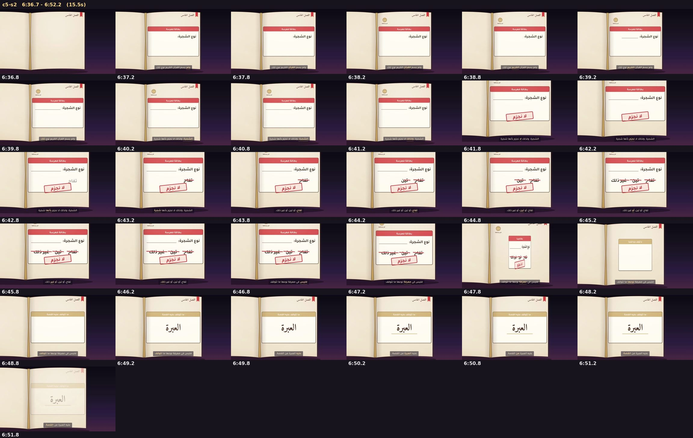

# مراجعة فنية — الحلقة 001، النسخة السادسة (الأمر 018)

**المراجِع:** المنفّذ · **التاريخ:** ٥ نوفمبر ٢٠٢٦ · **المادة:** `001-adam-beginning/previews/episode.mp4` النسخة 6 (11:51.1، ‏21333 إطارًا، 1920×1080، صامتة، البصمة `f227fb4b…`)
**الطريقة:** مشاهدة الفيلم كاملًا بلقطة كل ثانيتين مع حدود المشاهد الثمانين؛ ثم شريط لكل مشهد بلقطتين في الثانية (كلها في «الشرائط المرجعية» أدناه)؛ ثم قياس الحركة بخطة الحلقة، وربط كل مقطع ساكن بمشهده وبالكلام المنطوق لحظته.
**هذه توصية المنفّذ. قرار الاعتماد البصري للمشرف، ولا تتغير حالة الحلقة ولا يبدأ الصوت بهذه المراجعة.**

## الخلاصة

- **الفيلم متماسك ويحمل هوية «دفتر الأفق»** من الافتتاحية إلى التوقيع، ولا مخالفة لضوابط المحتوى وُجدت.
- **ثلاث ملاحظات ضرورية** (E1–E3)، كلها في مشاهد محددة وإصلاحها موضعي: إطاران فارغان طويلان يبدوان خطأً، وتداخل ختم فوق نص.
- **سبع ملاحظات تحسينية** لا تمنع الانتقال.
- **ست ملاحظات مرتبطة بالصوت** تُحسم بعد أداء الراوي والتلاوات.
- **الحركة 61%** (328 من 537 ث بعد استثناء 174 ث سكونًا مقصودًا: الآيات وتمهيدها وذكر الله). دون حد 80% الذي ترفض عنده حزمة النشر. هذا قيد على النشر لا على الاعتماد البصري؛ انظر «قيد إلزامي» آخر التقرير.

## التقييم بوصفه فيلمًا

| الجانب | التقييم |
| --- | --- |
| **الافتتاح** (0:00–0:10) | قوي: افتتاحية القناة 3.5 ث، ثم انفتاح الغلاف على البسملة (0:03.5)، ثم الأفق والأمم (0:10.8). يدخل المشاهد الدفتر من أول ثانية |
| **الإيقاع** | يتنفس جيدًا في الفصول 1 و4 و7. الفصل 3 (2:47–3:52) يتناوب فيه تمهيد آية وموضع آية خمس مرات، فيثقل إيقاعه الآن، ويتحدد نهائيًا بمدد التلاوة (A1) |
| **تنوع التكوينات** | جيد: صفحة كاملة، صفحتان، كاميرا تعبر الكعب، لقطة مكتب واسعة (`c3-s9`، 3:58)، طبقات أرض تملأ الكادر (`c7-s4`، 10:22)، ميزان (`c4-s5`)، مراوح نسل (`c7-s1`)، خريطة بلا موضع (`c6-s4`)، طريق الحلقات (`c7-s6`) |
| **وضوح الرسوم** | واضحة بحجم المعاينة، إلا تداخل E3 وازدحام الشطب في T5 |
| **تكرار حركة النصوص** | انخفض بعد الأمر 014: الكتابة بالحبر للمصطلحات المحورية فقط (السجود، العلم، الإباحة، النهي، الخلق، التعليم)، والظهور بالارتفاع لم يعد الأسلوب الغالب |
| **الانتقالات** | 9 قلب صفحة (نهايات الفصول وفواصل الأفكار الكبرى)، و26 خفوت حبر، و23 استمرار. متوازنة وغير آلية |
| **عناوين الفصول السبعة** | 1:18.3، 2:34.5، 4:14.7، 6:18.9، 8:15.7، 9:25.5 (والأول في الغلاف): المشهد نفسه بعنوان كل فصل، وهي طقس هوية مقصود. يسبق الفصل الثاني فراغ (T1) |
| **الخاتمة** (11:31–11:51) | قوية: «قصة الإنسان عبر الزمن» تُكتب، ثم «آدم عليه السلام أبي البشر»، ثم الساعة الرملية و«دفاتر الزمن» توقيعًا. يسبقها فراغ 3.8 ث (T4) |
| **ضوابط المحتوى** | لا تجسيد ولا ظل ولا رمز لنبي أو ملك أو إبليس (الأسماء كلمات). الشجرة دائرة مشطوبة بوسم «شجرة معينة» (6:28–6:32)، ونوعها بطاقة فهرسة «لا نجزم» (6:41). لا جنة ولا مشهد هبوط. «لا خريطة»: علامات روايات مختلفة على شبكة بلا تحديد (8:59–9:13)، ويُستحسن أن يؤكدها المشرف. مواضع الآيات وسوم بلا نص ولا رقم لزمن التلاوة. الأثر بحدوده (10:41–10:50) |

## الملاحظات

### ضرورية — تمنع الاعتماد البصري

| # | الوقت | المشهد | المشكلة | الأثر | المعالجة المقترحة |
| --- | --- | --- | --- | --- | --- |
| E1 | 1:34.7–1:39.6 | `c2-s2` (interpreters) | نحو 5 ث صفحتان فارغتان تمامًا والكاميرا مقتربة من الصفحة اليسرى، أثناء «أخبر الله ملائكته أنه جاعل في الأرض خليفة»، ثم تظهر بطاقة المفسرين عند «وقد ذكر المفسرون» | السكون هنا مقصود (الجملة عن كلام الله)، لكن الفراغ الكامل بعد موضع الآية يُقرأ نقصًا في الفيلم | سكون بمحتوى لا بفراغ: صفحة ساكنة عليها لوحة مرجع «البقرة: ٣٠» (`VerseRefPanel` كما في التمهيدات) بلا أي حركة حتى «المفسرون». بلا حركة مضافة |
| E2 | 10:17.6–10:21.8 | `c7-s4` (evidence) | الكادر مقترب جدًا من أسفل صفحة فارغة، فيمتلئ الإطار نحو 4 ث بلون الورق وحده، أثناء «فإلى جانب ما أخبرنا الله به» | يبدو الإطار خاليًا أو معطلًا | يبقى السكون، لكن بكادر يُظهر الدفتر (الكادر المحايد، أو رأس الصفحة واسم الفصل) حتى «شواهد»، ثم صعود الطبقات كما هو |
| E3 | 6:44.8–6:47.2 | `c5-s2` (species) | ختم «لا نجزم» يتداخل مع الكلمات المشطوبة «تفاح · تين · غير ذلك»، والكلمتان «غير ذلك» تتلاصقان تحت الشطب | تداخل يخالف المعيار الأول للقاعدة السادسة، ويضعف قراءة أهم لحظة في المشهد | نقل الختم إلى أسفل البطاقة بعيدًا عن سطر الكلمات (أو رفع السطر)، ومسافة كافية بين «غير» و«ذلك» |

### تحسينية — ترفع الجودة ولا تمنع الانتقال

| # | الوقت | المشهد | المشكلة | المعالجة المقترحة |
| --- | --- | --- | --- | --- |
| T1 | 1:16.8–1:18.3 | `c1-s8` ← `c2-s0` | بعد قلب الصفحة 1.5 ث دفتر فارغ، ثم عنوان الفصل الثاني (القياس يجمعهما سكونًا 4 ث، 1:17–1:21) | تقصير ذيل `begin` بعد القلب، ليبدأ العنوان مباشرة |
| T2 | 2:22.4–2:26.8 | `c2-s5` (two-titles) | 4.4 ث لا يظهر إلا خط علوي ثم ختم صغير قبل كتابة «الخلق» | ختم القرآن أكبر عند «القرآن الكريم»، أو كتابة العنوان الصغير «آدم عليه السلام» عند «خلق آدم» |
| T3 | 11:10.9–11:13.6 | `c7-s7` (questions) | 2.7 ث صفحة فارغة قبل بطاقة السؤال الأول | ظهور إطار البطاقة عند «أول ما نحتاج» |
| T4 | 11:31.0–11:34.8 | `c7-s8` (closing) | 3.8 ث لا يظهر إلا شريط «الحلقة القادمة» | بدء كتابة «قصة» عند «سنبدأ» بدل «القادمة» |
| T5 | 4:08.2–4:13.2 | `c3-s9` (knowledge) | «الغرور» و«ادعاء بلا علم» مشطوبتان في سطرين متقاربين، وخطا الشطب يزحمان الكلمتين | مسافة رأسية أكبر بين السطرين، وشطب أرفع |
| T6 | 2:13.0–2:16.0 | `c2-s4` (known) | الدائرة ساكنة 3 ث قبل أول نقطة («وقد نعرف بعض الحكم») | النقطة الأولى عند «نعرف» |
| T7 | 7:31.4–7:41.4 | `c5-s6` (return-line) | مشهد الرجوع خط واحد على صفحة مصبوغة؛ أفقر المشاهد رسمًا | إن بقي بعد الصوت: وسم «دعاء» صغير عند «دعاءهما» بلا أي رمز بجوار ذكر الله |

### مرتبطة بالصوت — تُحسم عند أداء الراوي والتلاوات

| # | الوقت | المشهد | الملاحظة |
| --- | --- | --- | --- |
| A1 | 2:47–3:52، وفي الفصول 4–6 | 22 موضع آية و9 تمهيدات | مدد مواضع الآيات (4 ث الآن) تتحدد بالتلاوة؛ يُراجع إيقاع الفصل 3 خاصة بعد إدراجها |
| A2 | كل الحلقة | — | التوقيت تقديري؛ عند المحاذاة تتحرك الأحداث مع الصوت تلقائيًا. تُعاد مراجعة البدايات الفارغة (E1، T2، T3، T4) بعد الصوت، لأن مددها قد تطول أو تقصر |
| A3 | 2:06–2:10، 9:31.8–9:39، 3:53–3:58، 0:30–0:32 | `c2-s4`، `c7-s1`، `c3-s9`، `c1-s4` | سكون مقصود لجمل فيها كلام الله أو خبره (جواب الله للملائكة، خبر سورة النساء، إظهار الله لملائكته علم آدم). مقبول، ومدته تتبع إلقاء الراوي |
| A4 | 11:47–11:50 | `c7-s8` | توقيع «دفاتر الزمن» يجب أن يُمسَك حتى نهاية آخر كلمة («العالمين») ثم ثانية |
| A5 | — | كل الحلقة | يُعاد قياس الحركة بعد الصوت بخطة الحلقة؛ المدد ستتغير |
| A6 | — | `c1-s1` البسملة، ومواضع ذكر الله | تُراجع نافذة السكون حول لفظ الجلالة بالتوقيت الحقيقي (الاختبار يفحصها آليًا) |

## الأدلة البصرية

## قيد إلزامي يُعرض على المشرف

حزمة النشر ترفض أي فيديو تحت 80% حركة (`CLAUDE.md`، القاعدة الثانية). الحلقة الآن 61% بعد الاستثناءات، وإصلاح الملاحظات الضرورية لن يرفعها كثيرًا، لأنه سكون بمحتوى لا حركة.
لم أُضف حركة زخرفية ولم أغيّر القياس. ما بقي تحت الحد أغلبه جمل خبر وتمهيد فيها ذكر الله دون لفظ الجلالة نفسه (المقياس يستثني اللفظ وحده لا الجملة)، وبدايات المشاهد.
يحتاج المشرف أن يقرر قبل النشر بين أمرين: مراسٍ أغنى في الجمل غير التعبدية بعد الصوت، أو قرار بشأن نطاق الاستثناء في الجمل التعبدية. لا أقترح تغيير القاعدة من عندي.

## التوصية

**يحتاج إصلاحات محددة قبل الاعتماد البصري: E1 وE2 وE3.** ثلاث مشاهد، وإصلاحها موضعي لا يمس السكريبت ولا التشكيل ولا بقية المشاهد.
بعدها تكون الحلقة **جاهزة للاعتماد البصري والانتقال إلى الصوت**، وتُحسم ملاحظات A بعد الصوت. التحسينات T1–T7 تُنفَّذ إن أذن المشرف، ولا تمنع الانتقال.
لم يُعدَّل شيء في الحلقة في هذا الأمر، ولم تُستبدل النسخة السادسة.
