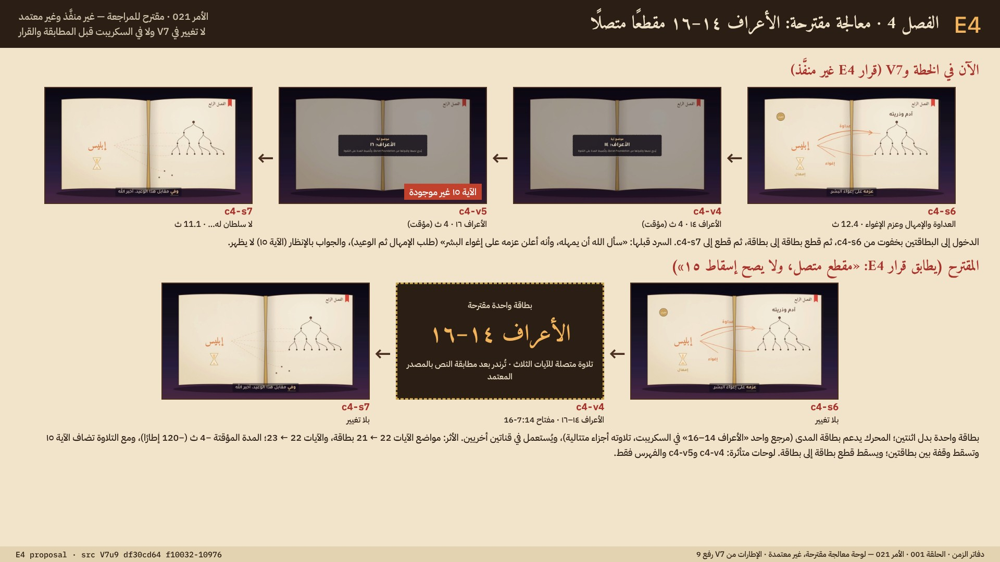

# إغلاق التعارضات التحريرية وتجهيز الستوري بورد v1.1 للاعتماد — الأمر 021

**المنفّذ · ٦ نوفمبر ٢٠٢٦ · الحالة: مقترحات للمراجعة — لا شيء منها منفَّذ أو معتمد.** الستوري بورد v1.1 (المراجعة 020) و v1 محفوظان بلا تغيير، وV7 رفع 9 بلا تغيير.

## 1. معالجة E4 المقترحة

- **الآن:** بطاقتان منفصلتان `c4-v4` (الأعراف 14) و`c4-v5` (الأعراف 16)، والآية 15 غير موجودة. قرار E4 (٤ نوفمبر) «مقطع متصل، ولا يصح إسقاط 15» اعتُمد «بعد التحقق عند الجلب» ولم يُطبَّق.
- **المقترح:** موضع واحد «الأعراف 14–16» في السكريبت والتشكيل والاستشهادات، وبطاقة واحدة تُتلى متصلة. **مطابق للقرار السابق نصًا.** المحرك يدعم المدى (`7:14-16`).
- **الأثر:** البطاقات 22 → 21، والآيات 22 → 23؛ المدة المؤقتة −4 ث؛ يسقط قطع بطاقة إلى بطاقة. اللوحات المتأثرة: `c4-v4` و`c4-v5` والفهرس فقط.
- **شرط التنفيذ:** مطابقة الآيات الثلاث وملف التلاوة بالمصدر المعتمد، ثم قرار المشرف وصاحب المشروع.

التفصيل في `verse-plan.md`، قسم «الأمر 021».

## 2. جدول قرارات التلاوة والإحالة (توصيات)

| الموضع | التوصية | السبب المختصر |
| --- | --- | --- |
| الأعراف 12 | تلاوة كاملة | التمهيد يَعِد بالخبر ولا يحكيه؛ ذروة التكبر |
| طه 117 | تلاوة كاملة | الدليل الوحيد على التحذير الصريح؛ قصيرة |
| الأعراف 20 | إحالة (مرجع على الصفحة) | السرد ينقل معناها كاملًا والمشهد يرسمه؛ الأطول؛ الأعراف 22 تحمل الحدث |
| الأعراف 24–25 | تلاوة متصلة في بطاقة واحدة | أساس نقطة التحول إلى التاريخ؛ آيتان متتاليتان |

مع E4: البطاقات 22 → 19، والآيات المتلوة 22 → 22، والمدة المؤقتة −12 ث. البدائل والأسباب الكاملة في `verse-plan.md`. **التوصية ليست اعتمادًا.**

## 3. توثيق المصادر

**موثّق 0 من 22 — لم يتغير.** الاتساق الداخلي متحقق. المطابقة بمصدر معتمد لم تُجرَ: الجلسة لا تصل إلى AlQuran Cloud ولا Quran Foundation (الطرفية بلا اتصال، وأداة الجلب ترفض `api.alquran.cloud` و`legacy.quran.com` و`quran.ksu.edu.sa` لأنها خارج قائمة السماح). عشر مسائل تفسيرية تحتاج مراجعة مؤهلة، مفصلة في `source-audit.md` (قسم «سجل التوثيق — الأمر 021»).

## 4. التعديلات البصرية المطلوبة في الستوري بورد

| اللوحة | التعديل | متى |
| --- | --- | --- |
| `c4-v4`، `c4-v5` | بطاقة واحدة «الأعراف 14–16» بدل اثنتين | بعد اعتماد E4 والمطابقة |
| `c5-v3` | إحالة على صفحة `c5-s4` بدل بطاقة، إن اعتُمدت التوصية | بعد القرار |
| `c6-v2`، `c6-v3` | بطاقة واحدة «الأعراف 24–25» إن اعتُمدت | بعد القرار |
| الفهرس (3 صفحات) | أرقام البطاقات ومددها | مع ما سبق |
| الفصل السابع (`c7-s3`–`c7-s8`) | لا شيء: الأوصاف بعد تصحيح v1.1 تطابق الإطارات (فُحصت اللوحات الست) | — |

تُصدر عند التنفيذ مراجعة جديدة باللوحات المتأثرة وحدها، لا إعادة لكل اللوحات.

## 5. النقل إلى Google Drive

**لم يتم.** الأداة الرسمية (`scripts/studio-preview-cloud.py` في فرع PR #47) تعمل بـ rclone وإعداد `studio_drive` على جهاز صاحب المشروع؛ هذه الجلسة غير مرتبطة به، وموصل Drive فيها لا يرى المجلد. لم يُستعمل طريق بديل.

جُرّب `tech-reviews/020/drive-upload.sh` هنا بأداة بديلة صامتة تحاكي واجهة الأداة: 88 ملفًا (PDF وJSON v1.1، و85 لوحة، والمرجع الصامت) بالمسارات والخانات الصحيحة، بلا أخطاء. **هذا اختبار للسكريبت، لا نقل.** التنفيذ على الجهاز من نسخة فرع PR #47: `bash <main>/channels/dafatir-alzaman/episodes/001-adam-beginning/tech-reviews/020/drive-upload.sh <main>`، ثم إعادة `drive-upload.log` لمطابقة البصمات وتسجيل الروابط.

## 6. الموانع المتبقية قبل اعتماد الستوري بورد

1. مراجعة المراجع الفني للوحات v1.1 كلها، وقرار صاحب المشروع.
2. قرار E4 التنفيذي وجدول «ت؟»، ثم تعديل العلامات في السكريبت والتشكيل، ولوحات المواضع المتأثرة.
3. مطابقة نص الآيات (22، و23 مع الأعراف 15) بالمصدر المعتمد، وقرارات التوثيق، والمراجعة المؤهلة للمسائل العشر.
4. النقل إلى Drive من جهاز صاحب المشروع وإعادة السجل.

لا نبرة ولا صوت ولا تحريك جديد ولا Master. V7 بلا تغيير.
