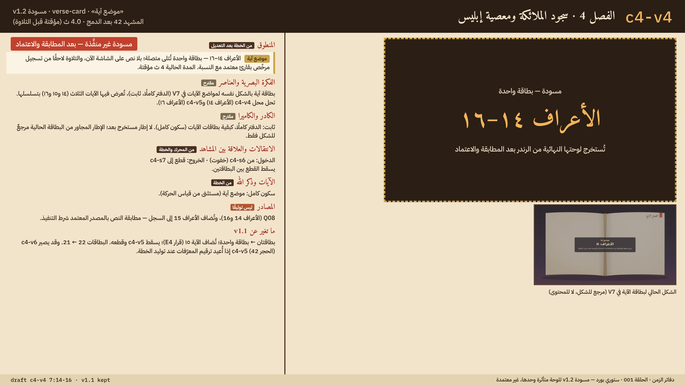
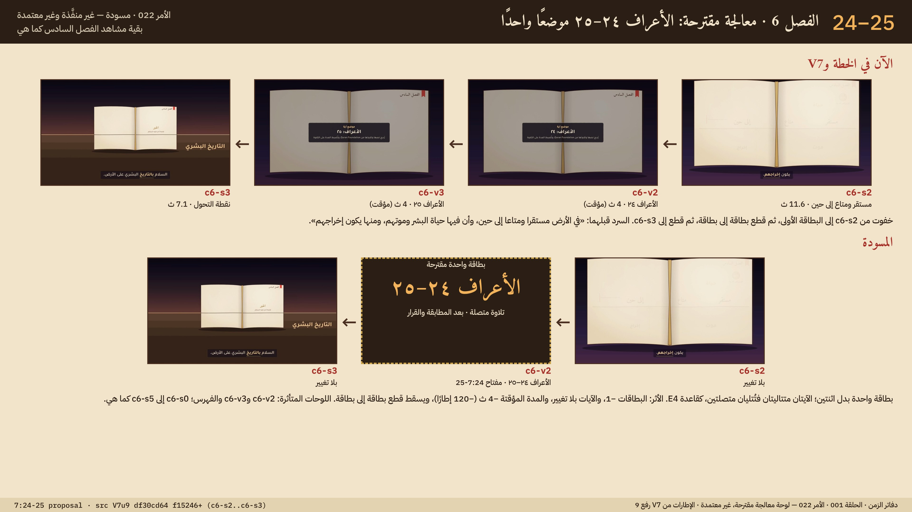
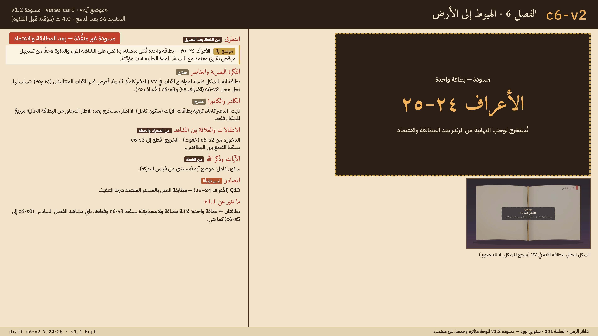
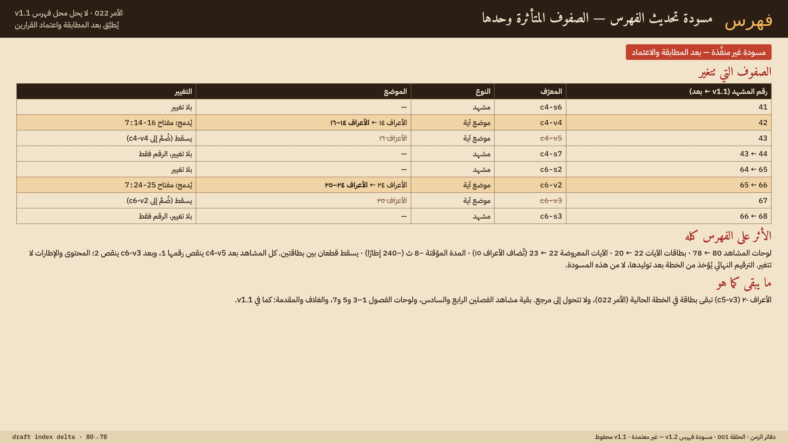
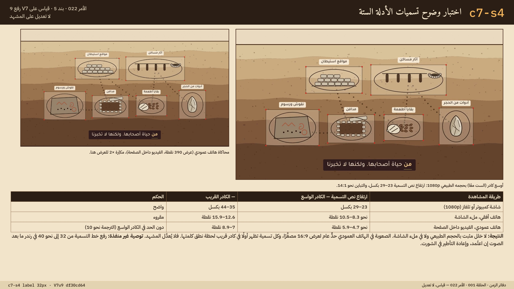

# إنهاء ملاحظات ستوري بورد الحلقة 001 — الأمر 022

**المنفّذ · ٧ نوفمبر ٢٠٢٦ · الحالة: مسودات للمراجعة، غير منفَّذة وغير معتمدة.** لوحات v1.1 الـ85 (المراجعة 020) وv1 محفوظة بلا تغيير، وV7 رفع 9 (`df30cd64…`) بلا تغيير. لا نبرة ولا صوت ولا فيديو جديد ولا Master.

## 1. الأعراف 14–16 (الفصل الرابع) — مسودة موضعية

- `c4-v4` يصير «الأعراف 14–16» (مفتاح `7:14-16`)، ويسقط `c4-v5`. تُضاف الآية 15 كما قرر E4. الدخول من `c4-s6` بخفوت، والخروج قطع إلى `c4-s7`.
- لوحة قبل/بعد في المراجعة 021 (`e4-proposal`).
- **شرط التطبيق:** مطابقة الآيات الثلاث وملف التلاوة بالمصدر المعتمد، ثم القرار. اللوحة النهائية تُستخرج من الرندر بعد ذلك، لا من هذه المسودة.

## 2. الأعراف 24–25 (الفصل السادس) — مسودة موضعية

- `c6-v2` يصير «الأعراف 24–25» (مفتاح `7:24-25`)، ويسقط `c6-v3`. الآيتان متتاليتان فتُتليان متصلتين، كقاعدة E4. لا آية مضافة ولا محذوفة.
- الأثر: البطاقات −1، والمدة المؤقتة −4 ث (−120 إطارًا)، ويسقط قطع بطاقة إلى بطاقة.
- **باقي مشاهد الفصل السادس كما هي** (`c6-s0` إلى `c6-s5` و`c6-v1`).

## 3. الأعراف 20 تبقى بطاقة

`c5-v3` يبقى في الخطة الحالية بطاقةً، ولا يتحول إلى إحالة. هذا ينقض توصية الأمر 021 بالإحالة، ولا تتغير لوحته.

## 4. الفهرس — مسودة الفرق وحده

- لوحات المشاهد 80 ← 78، وبطاقات الآيات 22 ← 20، والآيات المعروضة 22 ← 23، والمدة المؤقتة −8 ث.
- أرقام المشاهد بعد `c4-v5` تنقص 1، وبعد `c6-v3` تنقص 2. المحتوى والإطارات لا تتغير.
- فهرس v1.1 (3 صفحات) لا يُستبدل الآن؛ يُعاد توليده من الخطة بعد الاعتماد، وv1.1 يبقى محفوظًا.

## 5. وضوح تسميات `c7-s4`

| طريقة المشاهدة | الكادر الواسع (الست معًا) | الكادر القريب | الحكم |
| --- | --- | --- | --- |
| كمبيوتر أو تلفاز 1080p | 23–29 بكسل | 35–44 بكسل | واضح |
| هاتف أفقي، ملء الشاشة | نحو 8.3–10.5 نقطة | 12.6–15.9 نقطة | مقروء |
| هاتف عمودي، الفيديو داخل الصفحة | نحو 4.7–5.9 نقطة | 7–8.9 نقطة | دون الحد في الكادر الواسع |

- خط التسمية 32 بكسل، والكاميرا ×0.88–1.38، والتباين نحو 14:1.
- **النتيجة: لا خلل مثبت** بالحجم الطبيعي ولا في ملء الشاشة. صعوبة الهاتف العمودي حد عام لعرض 16:9 مصغرًا، وكل تسمية تظهر أولًا قريبةً لحظة نطق كلمتها. **لا تعديل على المشهد.**
- **توصية غير منفذة:** رفع خط التسمية إلى نحو 40 في رندر ما بعد الصوت إن اعتُمد، وإعادة التأطير في الشورت.

## 6. وضوح المعلومات الصغيرة في اللوحات

- كل لوحة في «المراجعات الفنية» تُفتح بحجمها الكامل (1920×1080) في تبويب جديد عند الضغط عليها؛ وكذلك صور هذا التقرير.
- أصغر خط في لوحات v1.1 هو 13 بكسل في الملاحظات. هو مقروء بالحجم الكامل وصغير في المصغرة.
- **المسودات هنا مرسومة بدقة مضاعفة (3840×2160)، وأصغر خط فيها 15 بكسل.** كل لوحة تُحدَّث لاحقًا تُرسم كذلك. لوحات v1.1 السليمة لا تُعاد.

## 7. اللوحات التي تتغير والتي تبقى

| تتغير بعد المطابقة والقرار | تبقى كما هي |
| --- | --- |
| `c4-v4` (تُدمج)، `c4-v5` (تسقط) | كل لوحات الفصول 1–3 و5 و7، ومنها `c5-v3` (الأعراف 20) و`c7-s3` إلى `c7-s8` |
| `c6-v2` (تُدمج)، `c6-v3` (تسقط) | بقية الفصلين الرابع والسادس |
| صفحات الفهرس الثلاث (الأرقام فقط) | الغلاف والمقدمة |

## 8. المصادر وDrive

- **التوثيق: 0 من 22، بلا تغيير.** العوائق قائمة: الطرفية بلا اتصال خارجي، وأداة الجلب لا تصل إلى `api.alquran.cloud` ولا `legacy.quran.com` ولا `quran.ksu.edu.sa`. لم يُستعمل نص من الذاكرة، ولم يُغيَّر نص قرآني. الآية 15 تُضاف إلى السجل عند تطبيق E4.
- **Drive: لم يُنقل.** موصل Drive في الجلسة لا يرى مجلد الحلقة ولا أي Drive مشترك، والجلسة لا تصل إلى `rclone` ولا إلى جهاز صاحب المشروع. أُضيفت لوحات 022 إلى `tech-reviews/020/drive-upload.sh`، فيرفعها مع v1.1 من الجهاز ويكتب البصمات والروابط في سجله. PR #47 لم يُدمج.

## بصمات اللوحات (SHA-256، أول 16 حرفًا)

| الملف | البصمة |
| --- | --- |
| `draft-c4-v4-14-16.jpg` | `cec402431f73004b` |
| `draft-c6-v2-24-25.jpg` | `9d315aa3642d7269` |
| `c6-2425-proposal.jpg` | `b0e76bfbaa53cdd6` |
| `draft-index-delta.jpg` | `43cf7a8a46be76a6` |
| `c7-s4-readability.jpg` | `6e2e7732db9addeb` |
