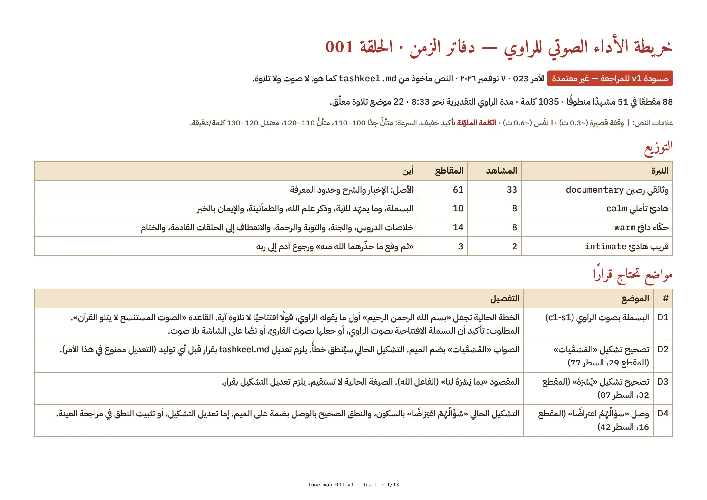
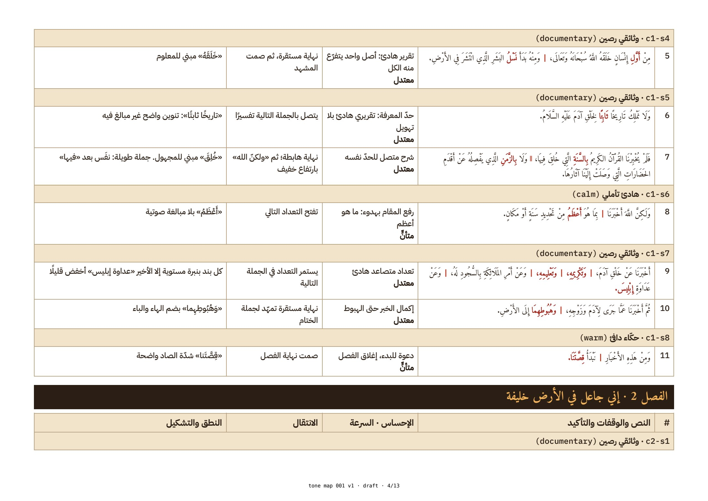

# خريطة الأداء الصوتي للراوي — الحلقة 001 · الأمر 023

**المنفّذ · ٧ نوفمبر ٢٠٢٦ · الحالة: مسودة v1 للمراجعة، غير معتمدة.** لا عينات صوت ولا تلاوة ولا رندر. السكريبت والتشكيل بلا تعديل؛ النص في الخريطة مأخوذ آليًا من `tashkeel.md` ومطابق له حرفًا (اختبار). V7 رفع 9 وكل إصدارات الستوري بورد ومسوداته محفوظة.

- **الملفات:** [خريطة الأداء — PDF](docs/tone-map-001-v1.pdf) · [البيانات — JSON](docs/tone-map-001-v1.json). النسخة المرجعية `tone-map.json` في مجلد الحلقة.
- **الستوري بورد v1.1:** الاتجاه البصري وهوية «دفتر الأفق» مقبولان مبدئيًا بعد مراجعة المشرف للصفحات الـ85. **الاعتماد النهائي لم يصدر.** مسودات 022 غير منفَّذة.
- **الآيات والمسائل التفسيرية:** المطابقة مؤجلة بقرار الأمر 023، دون إلغاء أي متطلب. التوثيق 0 من 22.

## 1. التغطية

| البند | العدد |
| --- | --- |
| المقاطع المنطوقة (جمل الراوي) | 88 |
| المشاهد المنطوقة | 51 من 80 مشهدًا (29 بلا كلام: 22 بطاقة آية و7 عناوين فصول) |
| الكلمات | 1035 |
| مدة الراوي التقديرية بالسرعات المقترحة | نحو 8:33 دقيقة، بلا التلاوات والصمت |
| مواضع التلاوة (معلّقة، خارج الخريطة) | 22 |

## 2. توزيع النبرات

النبرة تُضبط في المحرك لكل مشهد (`scene.tone`)، وتفاصيل كل جملة في «الإحساس» والوقفات والتأكيد.

| النبرة | المشاهد | المقاطع | أين |
| --- | --- | --- | --- |
| وثائقي رصين (`documentary`) | 33 | 61 | الأصل: الإخبار والشرح وحدود المعرفة |
| هادئ تأملي (`calm`) | 8 | 10 | البسملة، وما يمهّد للآية، وذكر علم الله، والطمأنينة، والإيمان بالخبر |
| حكّاء دافئ (`warm`) | 8 | 14 | خلاصات الدروس، والجنة، والتوبة والرحمة، والانعطاف إلى الحلقات القادمة، والختام |
| قريب هادئ (`intimate`) | 2 | 3 | «ثم وقع ما حذّرهما الله منه» ورجوع آدم إلى ربه |

لم تُستعمل «درامي» ولا «حماسي» (قرار D9).

| السرعة | المقاطع | الإيقاع |
| --- | --- | --- |
| متأنٍّ جدًا | 3 | 100–110 كلمة/دقيقة |
| متأنٍّ | 35 | 110–120 كلمة/دقيقة |
| معتدل | 50 | 120–130 كلمة/دقيقة |

السرعات نسبية إلى طبقة الراوي في القناة، وتُضبط في العينات.

**علامات الوقف في النص:** `|` وقفة قصيرة نحو 0.3 ث بلا نفَس · `‖` نفَس نحو 0.6 ث · **الغامق** كلمة تحتاج تأكيدًا خفيفًا. نهاية كل جملة وقفة طبيعية.

## 3. مواضع تحتاج قرارًا إخراجيًا

| # | الموضع | التفصيل |
| --- | --- | --- |
| D1 | البسملة بصوت الراوي (c1-s1) | الخطة الحالية تجعل «بسم الله الرحمن الرحيم» أول ما يقوله الراوي، قولًا افتتاحيًا لا تلاوة آية. القاعدة «الصوت المستنسخ لا يتلو القرآن». المطلوب: تأكيد أن البسملة الافتتاحية بصوت الراوي، أو جعلها بصوت القارئ، أو نصًا على الشاشة بلا صوت. |
| D2 | تصحيح تشكيل «المَسَمَّيات» (المقطع 29، السطر 77) | الصواب «المُسَمَّيات» بضم الميم. التشكيل الحالي سيُنطق خطأً. يلزم تعديل `tashkeel.md` بقرار قبل أي توليد (التعديل ممنوع في هذا الأمر). |
| D3 | تصحيح تشكيل «يُسِّرَهُ» (المقطع 32، السطر 87) | المقصود «بما يَسَّرَهُ لنا» (الفاعل الله). الصيغة الحالية لا تستقيم. يلزم تعديل التشكيل بقرار. |
| D4 | وصل «سؤالُهُمُ اعتراضًا» (المقطع 16، السطر 42) | التشكيل الحالي «سُؤَالُهُمْ اعْتِرَاضًا» بالسكون، والنطق الصحيح بالوصل بضمة على الميم. إما تعديل التشكيل، أو تثبيت النطق في مراجعة العينة. |
| D5 | نبرة الختام في مشهد واحد (c7-s8) | المشهد «حكّاء دافئ»، وآخره «والحمد لله رب العالمين» يحتاج خشوعًا أبطأ. والنبرة في المحرك لكل مشهد لا لكل جملة. الخيار: (أ) نبرة دافئة للمشهد مع إبطاء الجملة الأخيرة بالوقفة، أو (ب) فصل الحمد مقطعًا صوتيًا مستقلًا بنبرة «هادئ تأملي». |
| D6 | الأسئلة الختامية (c7-s7) | مقترح «وثائقي رصين» بنبرة استفهام صاعدة (التوجيه الصوتي). البديل «قريب هادئ» إن أُريد خطاب أقرب إلى المشاهد. |
| D7 | تكرار «عليه السلام» (12 مرة) | المقترح: تُقال موصولة بالاسم بلا وقفة قبلها، وبنبرة أخفض قليلًا، لئلا تتكرر وقفة آلية. |
| D8 | مدد الصمت حول الآيات | المقترح: نهاية معلّقة للجملة الممهدة، ثم صمت 0.6–0.8 ث قبل التلاوة و0.6 ث بعدها، وصمت 1.0–1.5 ث بين الفصول. التلاوة لا تُولَّد الآن، ومواضعها معلّقة. |
| D9 | لا نبرة «درامية» ولا «حماسية» | لم تُستعمل النبرتان في أي مشهد التزامًا بالرصانة الوثائقية. لحظات الثقل (إبليس أبى، ثم وقع ما حذّرهما الله منه) تؤدَّى بالبطء وخفض الطبقة لا بالانفعال. يلزم التأكيد. |

## 4. مواضع التلاوة — معلّقة، لا توليد

تُخطط منفصلة: صحة الآية، والقارئ، والحقوق. الصوت المستنسخ لا يتلو. القارئ المقرر في القناة محمود خليل الحصري، مع النسبة.

| الآية | بطاقتها | بعد المقطع | ملاحظة |
| --- | --- | --- | --- |
| البقرة 30 | `c2-v1` | 12 | — |
| ص 71 | `c3-v1` | 23 | — |
| ص 72 | `c3-v2` | 24 | — |
| البقرة 31 | `c3-v3` | 26 | — |
| البقرة 32 | `c3-v4` | 29 | — |
| البقرة 33 | `c3-v5` | 30 | — |
| البقرة 34 | `c4-v1` | 36 | — |
| الكهف 50 | `c4-v2` | 40 | — |
| الأعراف 12 | `c4-v3` | 41 | — |
| الأعراف 14 | `c4-v4` | 47 | مسودة E4: الأعراف 14–16 بطاقة واحدة (المراجعة 022) |
| الأعراف 16 | `c4-v5` | 47 | مسودة E4: تُضم إلى الأعراف 14–16 |
| الحجر 42 | `c4-v6` | 48 | — |
| البقرة 35 | `c5-v1` | 51 | — |
| طه 117 | `c5-v2` | 55 | — |
| الأعراف 20 | `c5-v3` | 57 | — |
| الأعراف 22 | `c5-v4` | 58 | — |
| الأعراف 23 | `c5-v5` | 60 | — |
| البقرة 37 | `c5-v6` | 61 | — |
| البقرة 38 | `c6-v1` | 64 | — |
| الأعراف 24 | `c6-v2` | 65 | مسودة: الأعراف 24–25 بطاقة واحدة (المراجعة 022) |
| الأعراف 25 | `c6-v3` | 65 | مسودة: تُضم إلى الأعراف 24–25 |
| النساء 1 | `c7-v1` | 72 | — |

## 5. الخريطة الكاملة

### الفصل 1 · بداية القصة

#### `c1-s1` · هادئ تأملي

> **1** · بِسْمِ اللَّهِ الرَّحْمَنِ الرَّحِيمِ.

- **الإحساس:** افتتاح خاشع بلا تفخيم ولا مدّ زائد · **السرعة:** متأنٍّ جدًا (100–110)
- **التأكيد:** لا تأكيد خاص · **الوقفات:** وقفة النهاية وحدها
- **الانتقال:** صمت نحو ثانية، ثم دخول هادئ إلى «عرفت الأرض»
- **النطق:** تُقال وصلًا واحدًا. لام الجلالة مرقّقة بعد كسرة «بسمِ». قول افتتاحي من الراوي، لا تلاوة

#### `c1-s2` · هادئ تأملي

> **2** · عَرَفَتِ الأَرْضُ أُمَمًا **كَثِيرَةً،** | وَتَعَاقَبَتْ فِيهَا أَجْيَالٌ لَا يَعْلَمُ عَدَدَهَا إِلَّا **اللَّهُ.**

- **الإحساس:** اتساع وتأمل في طول الزمن · **السرعة:** متأنٍّ (110–120)
- **التأكيد:** كَثِيرَةً،، اللَّهُ. · **الوقفات:** بعد «كثيرة»
- **الانتقال:** «ولكنّ» التالية انعطاف: ترتفع النبرة قليلًا
- **النطق:** «أُمَمًا» بضم الهمزة وفتح الميمين. «إلا الله» بلا استعجال، ولا تُختطف

#### `c1-s3` · وثائقي رصين

> **3** · وَلَكِنَّ رِحْلَتَنَا هَذِهِ | لَا تَبْدَأُ مِنْ **مَدِينَةٍ** قَدِيمَةٍ، | وَلَا مِنْ **مَمْلَكَةٍ** نَسِيَ النَّاسُ اسْمَهَا.

- **الإحساس:** نفي متدرّج يمهّد لما بعده · **السرعة:** معتدل (120–130)
- **التأكيد:** مَدِينَةٍ، مَمْلَكَةٍ · **الوقفات:** بعد «هذه»، بعد «قديمة»
- **الانتقال:** تعليق خفيف في آخرها، ثم الكشف
- **النطق:** «نَسِيَ النّاسُ اسْمَها»: همزة «اسمها» وصل لا تُنطق

> **4** · إِنَّنَا نَبْدَأُ مِنْ **أَبِي** البَشَرِ، | **آدَمَ** عَلَيْهِ السَّلَامُ.

- **الإحساس:** كشف هادئ دافئ للاسم · **السرعة:** متأنٍّ (110–120)
- **التأكيد:** أَبِي، آدَمَ · **الوقفات:** بعد «البشر»
- **الانتقال:** وقفة قصيرة، ثم «من أول إنسان» على النفس نفسه تقريبًا
- **النطق:** وقفة قصيرة قبل «آدم» (التوجيه الصوتي). «عليهِ السّلام» موصولة بالاسم، لا وقفة قبلها

#### `c1-s4` · وثائقي رصين

> **5** · مِنْ **أَوَّلِ** إِنْسَانٍ خَلَقَهُ اللَّهُ سُبْحَانَهُ وَتَعَالَى، | وَمِنْهُ بَدَأَ **نَسْلُ** البَشَرِ الَّذِي انْتَشَرَ فِي الأَرْضِ.

- **الإحساس:** تقرير هادئ: أصل واحد يتفرّع منه الكل · **السرعة:** معتدل (120–130)
- **التأكيد:** أَوَّلِ، نَسْلُ · **الوقفات:** بعد «وتعالى»
- **الانتقال:** نهاية مستقرة، ثم صمت المشهد
- **النطق:** «خَلَقَهُ» مبني للمعلوم

#### `c1-s5` · وثائقي رصين

> **6** · وَلَا نَمْلِكُ تَارِيخًا **ثَابِتًا** لِخَلْقِ آدَمَ عَلَيْهِ السَّلَامُ.

- **الإحساس:** حدّ المعرفة: تقريري هادئ بلا تهويل · **السرعة:** معتدل (120–130)
- **التأكيد:** ثَابِتًا · **الوقفات:** وقفة النهاية وحدها
- **الانتقال:** يتصل بالجملة التالية تفسيرًا
- **النطق:** «تاريخًا ثابتًا»: تنوين واضح غير مبالغ فيه

> **7** · فَلَمْ يُخْبِرْنَا القُرْآنُ الكَرِيمُ **بِالسَّنَةِ** الَّتِي خُلِقَ فِيهَا، ‖ وَلَا **بِالزَّمَنِ** الَّذِي يَفْصِلُهُ عَنْ أَقْدَمِ الحَضَارَاتِ الَّتِي وَصَلَتْ إِلَيْنَا آثَارُهَا.

- **الإحساس:** شرح متصل للحدّ نفسه · **السرعة:** معتدل (120–130)
- **التأكيد:** بِالسَّنَةِ، بِالزَّمَنِ · **الوقفات:** نفَس بعد «فيها»
- **الانتقال:** نهاية هابطة؛ ثم «ولكنّ الله» بارتفاع خفيف
- **النطق:** «خُلِقَ» مبني للمجهول. جملة طويلة: نفَس بعد «فيها»

#### `c1-s6` · هادئ تأملي

> **8** · وَلَكِنَّ اللَّهَ أَخْبَرَنَا | بِمَا هُوَ **أَعْظَمُ** مِنْ تَحْدِيدِ سَنَةٍ أَوْ مَكَانٍ.

- **الإحساس:** رفع المقام بهدوء: ما هو أعظم · **السرعة:** متأنٍّ (110–120)
- **التأكيد:** أَعْظَمُ · **الوقفات:** بعد «أخبرنا»
- **الانتقال:** تفتح التعداد التالي
- **النطق:** «أَعْظَمُ» بلا مبالغة صوتية

#### `c1-s7` · وثائقي رصين

> **9** · أَخْبَرَنَا عَنْ خَلْقِ آدَمَ، | **وَتَكْرِيمِهِ،** | **وَتَعْلِيمِهِ،** | وَعَنْ أَمْرِ المَلَائِكَةِ بِالسُّجُودِ لَهُ، | وَعَنْ عَدَاوَةِ **إِبْلِيسَ.**

- **الإحساس:** تعداد متصاعد هادئ · **السرعة:** معتدل (120–130)
- **التأكيد:** وَتَكْرِيمِهِ،، وَتَعْلِيمِهِ،، إِبْلِيسَ. · **الوقفات:** بعد «آدم»، بعد «وتكريمه»، بعد «وتعليمه»، بعد «له»
- **الانتقال:** يستمر التعداد في الجملة التالية
- **النطق:** كل بند بنبرة مستوية إلا الأخير «عداوة إبليس» أخفض قليلًا

> **10** · ثُمَّ أَخْبَرَنَا عَمَّا جَرَى لِآدَمَ وَزَوْجِهِ، | **وَهُبُوطِهِمَا** إِلَى الأَرْضِ.

- **الإحساس:** إكمال الخبر حتى الهبوط · **السرعة:** معتدل (120–130)
- **التأكيد:** وَهُبُوطِهِمَا · **الوقفات:** بعد «وزوجه»
- **الانتقال:** نهاية مستقرة تمهّد لجملة الختام
- **النطق:** «وَهُبُوطِهِما» بضم الهاء والباء

#### `c1-s8` · حكّاء دافئ

> **11** · وَمِنْ هَذِهِ الأَخْبَارِ | نَبْدَأُ **قِصَّتَنَا.**

- **الإحساس:** دعوة للبدء، إغلاق الفصل · **السرعة:** متأنٍّ (110–120)
- **التأكيد:** قِصَّتَنَا. · **الوقفات:** بعد «الأخبار»
- **الانتقال:** صمت نهاية الفصل
- **النطق:** «قِصَّتَنا» شدّة الصاد واضحة

### الفصل 2 · إني جاعل في الأرض خليفة

#### `c2-s1` · وثائقي رصين

> **12** · قَبْلَ أَنْ نَتَحَدَّثَ عَنْ حَيَاةِ آدَمَ عَلَيْهِ السَّلَامُ، ‖ **نَقِفُ** عِنْدَ مَا أَخْبَرَنَا اللَّهُ بِهِ فِي سُورَةِ **البَقَرَةِ.**

- **الإحساس:** توقّف متأمّل قبل الخبر القرآني · **السرعة:** متأنٍّ (110–120)
- **التأكيد:** نَقِفُ، البَقَرَةِ. · **الوقفات:** نفَس بعد «السلام»
- **الانتقال:** نهاية معلّقة غير هابطة، ثم صمت قبل الآية
- **النطق:** «عِنْدَ ما» كلمتان. «سورةِ البقرة» بلا وقفة بينهما

#### `c2-s2` · وثائقي رصين

> **13** · أَخْبَرَ اللَّهُ مَلَائِكَتَهُ أَنَّهُ جَاعِلٌ فِي الأَرْضِ | **خَلِيفَةً.**

- **الإحساس:** إعادة الخبر بوضوح بعد الآية · **السرعة:** متأنٍّ (110–120)
- **التأكيد:** خَلِيفَةً. · **الوقفات:** بعد «الأرض»
- **الانتقال:** يتصل بالشرح التالي
- **النطق:** «جاعِلٌ» بالتنوين

> **14** · وَقَدْ ذَكَرَ المُفَسِّرُونَ فِي مَعْنَى الخِلَافَةِ **أَقْوَالًا،** | **مِنْهَا** | أَنَّ البَشَرَ يَخْلُفُ بَعْضُهُمْ بَعْضًا فِي عِمَارَةِ الأَرْضِ وَالحَيَاةِ عَلَيْهَا.

- **الإحساس:** شارح محايد: قول من الأقوال · **السرعة:** معتدل (120–130)
- **التأكيد:** أَقْوَالًا،، مِنْهَا · **الوقفات:** بعد «أقوالا»، بعد «منها»
- **الانتقال:** نهاية هابطة، ثم سؤال الملائكة
- **النطق:** «يَخْلُفُ» مفتوحة الياء. وقفة خفيفة عند «منها» (التوجيه الصوتي)

#### `c2-s3` · وثائقي رصين

> **15** · وَسَأَلَتِ المَلَائِكَةُ رَبَّهَا عَنْ جَعْلِ مَنْ يَكُونُ مِنْهُ الفَسَادُ وَسَفْكُ الدِّمَاءِ، ‖ مَعَ أَنَّهُمْ **يُسَبِّحُونَ** بِحَمْدِهِ **وَيُقَدِّسُونَ** لَهُ.

- **الإحساس:** نقل أمين لسؤال الملائكة بلا تهويل لعبارة «سفك الدماء» · **السرعة:** معتدل (120–130)
- **التأكيد:** يُسَبِّحُونَ، وَيُقَدِّسُونَ · **الوقفات:** نفَس بعد «الدماء»
- **الانتقال:** تتبعها جملة تصحيح الفهم بنبرة أوضح
- **النطق:** «سَفْكُ» بسكون الفاء

> **16** · وَلَمْ يَكُنْ سُؤَالُهُمْ **اعْتِرَاضًا** عَلَى حُكْمِ اللَّهِ، | وَإِنَّمَا كَانَ سُؤَالًا لِطَلَبِ **الفَهْمِ** وَمَعْرِفَةِ الحِكْمَةِ.

- **الإحساس:** تصحيح فهم: حاسم ولطيف · **السرعة:** معتدل (120–130)
- **التأكيد:** اعْتِرَاضًا، الفَهْمِ · **الوقفات:** بعد «الله»
- **الانتقال:** صمت قصير، ثم جواب الله بوقار
- **النطق:** تُقرأ وصلًا «سؤالُهُمُ اعتراضًا» (ضمة وصل على الميم)؛ التشكيل الحالي بالسكون. «حُكْمِ» بضم الحاء غير «الحِكْمة»

#### `c2-s4` · هادئ تأملي

> **17** · فَأَجَابَهُمُ اللَّهُ بِأَنَّهُ | **يَعْلَمُ** مَا لَا **يَعْلَمُونَ.**

- **الإحساس:** جواب الحق: وقار وثبات · **السرعة:** متأنٍّ (110–120)
- **التأكيد:** يَعْلَمُ، يَعْلَمُونَ. · **الوقفات:** بعد «بأنه»
- **الانتقال:** صمت أطول قليلًا
- **النطق:** «يَعْلَمُ ما لا يَعْلَمُون» بلا استعجال؛ ذكر لله لا يُقطع

> **18** · إِنَّ مَعْرِفَتَنَا **مَحْدُودَةٌ،** | وَعِلْمَ اللَّهِ **مُحِيطٌ** بِكُلِّ شَيْءٍ.

- **الإحساس:** مقابلة بين محدود ومحيط · **السرعة:** متأنٍّ (110–120)
- **التأكيد:** مَحْدُودَةٌ،، مُحِيطٌ · **الوقفات:** بعد «محدودة»
- **الانتقال:** تتصل بالجملة التالية
- **النطق:** «مُحِيطٌ» بضم الميم

> **19** · وَقَدْ نَعْرِفُ **بَعْضَ** الحِكَمِ مِنْ أَمْرٍ مِنْ أُمُورِ اللَّهِ، | وَلَكِنَّنَا لَا **نَدَّعِي** الإِحَاطَةَ بِجَمِيعِ حِكَمِهِ.

- **الإحساس:** تواضع معرفي · **السرعة:** معتدل (120–130)
- **التأكيد:** بَعْضَ، نَدَّعِي · **الوقفات:** بعد «الله»
- **الانتقال:** نهاية مستقرة
- **النطق:** «الحِكَمِ» و«حِكَمِهِ» جمع حكمة بكسر الحاء وفتح الكاف، لا «الحُكْم»

#### `c2-s5` · وثائقي رصين

> **20** · وَبَعْدَ هَذَا الإِخْبَارِ، | يُحَدِّثُنَا القُرْآنُ الكَرِيمُ عَنْ خَلْقِ آدَمَ عَلَيْهِ السَّلَامُ، | ثُمَّ عَنْ أَمْرٍ مِنْ **أَعْظَمِ** مَا خَصَّهُ اللَّهُ بِهِ: | **التَّعْلِيمِ.**

- **الإحساس:** جسر إلى الفصل التالي، مع إبراز «التعليم» · **السرعة:** معتدل (120–130)
- **التأكيد:** أَعْظَمِ، التَّعْلِيمِ. · **الوقفات:** بعد «الإخبار»، بعد «السلام»، بعد «به»
- **الانتقال:** الكلمة الأخيرة تستقر، ثم صمت الفصل
- **النطق:** وقفة قصيرة عند النقطتين قبل «التَّعْلِيمِ»

### الفصل 3 · خلق آدم وتعليمه

#### `c3-s1` · وثائقي رصين

> **21** · خَلَقَ اللَّهُ آدَمَ عَلَيْهِ السَّلَامُ | مِنْ **طِينٍ.**

- **الإحساس:** خبر أصل الخلق: رصين · **السرعة:** متأنٍّ (110–120)
- **التأكيد:** طِينٍ. · **الوقفات:** بعد «السلام»
- **الانتقال:** يتصل بالجملة التالية
- **النطق:** «طِين» بكسر الطاء

> **22** · وَقَدْ جَاءَ ذِكْرُ خَلْقِهِ فِي مَوَاضِعَ **مُتَعَدِّدَةٍ** مِنَ القُرْآنِ الكَرِيمِ.

- **الإحساس:** إشارة إلى تعدّد المواضع · **السرعة:** معتدل (120–130)
- **التأكيد:** مُتَعَدِّدَةٍ · **الوقفات:** وقفة النهاية وحدها
- **الانتقال:** تمهّد لـ«قال الله تعالى»
- **النطق:** «مُتَعَدِّدَةٍ» شدّة الدال

#### `c3-s2` · هادئ تأملي

> **23** · قَالَ اللَّهُ تَعَالَى:

- **الإحساس:** تمهيد خاشع للآية · **السرعة:** متأنٍّ (110–120)
- **التأكيد:** لا تأكيد خاص · **الوقفات:** وقفة النهاية وحدها
- **الانتقال:** نهاية معلّقة، ثم صمت ثم التلاوة (ص 71)
- **النطق:** لام الجلالة مفخّمة بعد فتحة «قالَ»

#### `c3-s3` · هادئ تأملي

> **24** · ثُمَّ قَالَ سُبْحَانَهُ:

- **الإحساس:** تمهيد خاشع للآية التالية · **السرعة:** متأنٍّ (110–120)
- **التأكيد:** لا تأكيد خاص · **الوقفات:** وقفة النهاية وحدها
- **الانتقال:** نهاية معلّقة، ثم صمت ثم التلاوة (ص 72)
- **النطق:** «سُبْحانَهُ» بلا إطالة

#### `c3-s4` · وثائقي رصين

> **25** · وَفِي هَذِهِ الآيَاتِ خَبَرُ خَلْقِ آدَمَ عَلَيْهِ السَّلَامُ، | **وَتَسْوِيَتِهِ،** | وَنَفْخِ **الرُّوحِ** فِيهِ.

- **الإحساس:** تلخيص ثلاثي لما تُلي · **السرعة:** معتدل (120–130)
- **التأكيد:** وَتَسْوِيَتِهِ،، الرُّوحِ · **الوقفات:** بعد «السلام»، بعد «وتسويته»
- **الانتقال:** نهاية مستقرة
- **النطق:** «تَسْوِيَتِهِ»، و«الرُّوح» بضم الراء

#### `c3-s5` · وثائقي رصين

> **26** · ثُمَّ أَخْبَرَنَا اللَّهُ بِأَنَّهُ عَلَّمَ آدَمَ | **الأَسْمَاءَ** **كُلَّهَا.**

- **الإحساس:** إعلان النعمة · **السرعة:** متأنٍّ (110–120)
- **التأكيد:** الأَسْمَاءَ، كُلَّهَا. · **الوقفات:** بعد «آدم»
- **الانتقال:** نهاية معلّقة قليلًا، ثم الآية (البقرة 31)
- **النطق:** «عَلَّمَ» بالتشديد (لا «عَلِمَ»)

#### `c3-s6` · وثائقي رصين

> **27** · وَقَدِ **اخْتَلَفَ** المُفَسِّرُونَ فِي تَفْصِيلِ المَقْصُودِ بِالأَسْمَاءِ، | وَذَكَرُوا فِي ذَلِكَ أَقْوَالًا **مُتَعَدِّدَةً.**

- **الإحساس:** شارح محايد · **السرعة:** معتدل (120–130)
- **التأكيد:** اخْتَلَفَ، مُتَعَدِّدَةً. · **الوقفات:** بعد «بالأسماء»
- **الانتقال:** «ولكنّ» التالية خلاصة واثقة
- **النطق:** «المَقْصُودِ»

> **28** · وَلَكِنَّ المَعْنَى **الوَاضِحَ** فِي الآيَاتِ | أَنَّ اللَّهَ **خَصَّ** آدَمَ **بِعِلْمٍ** عَلَّمَهُ إِيَّاهُ.

- **الإحساس:** خلاصة واثقة · **السرعة:** معتدل (120–130)
- **التأكيد:** الوَاضِحَ، خَصَّ، بِعِلْمٍ · **الوقفات:** بعد «الآيات»
- **الانتقال:** نهاية مستقرة
- **النطق:** «خَصَّ» شدّة الصاد، و«عَلَّمَهُ إيّاه»

#### `c3-s7` · وثائقي رصين

> **29** · وَعِنْدَمَا عَرَضَ اللَّهُ المَسَمَّيَاتِ عَلَى المَلَائِكَةِ، | لَمْ **يَدَّعُوا** عِلْمَ مَا لَمْ يُعَلِّمْهُمُ اللَّهُ.

- **الإحساس:** وصف أدب الملائكة · **السرعة:** معتدل (120–130)
- **التأكيد:** يَدَّعُوا · **الوقفات:** بعد «الملائكة»
- **الانتقال:** نهاية معلّقة، ثم الآية (البقرة 32)
- **النطق:** **التشكيل الحالي «المَسَمَّيات» خطأ: الصواب «المُسَمَّيات» بضم الميم** (قرار). «يُعَلِّمْهُمُ اللهُ» وصل

#### `c3-s8` · وثائقي رصين

> **30** · ثُمَّ أَمَرَ اللَّهُ آدَمَ أَنْ **يُنْبِئَهُمْ** بِأَسْمَائِهَا.

- **الإحساس:** أمر وإظهار · **السرعة:** متأنٍّ (110–120)
- **التأكيد:** يُنْبِئَهُمْ · **الوقفات:** وقفة النهاية وحدها
- **الانتقال:** نهاية معلّقة، ثم الآية (البقرة 33)
- **النطق:** «يُنْبِئَهُمْ» همزة محققة

#### `c3-s9` · حكّاء دافئ

> **31** · وَهَكَذَا **أَظْهَرَ** اللَّهُ لِمَلَائِكَتِهِ مَا عَلَّمَهُ لِآدَمَ عَلَيْهِ السَّلَامُ.

- **الإحساس:** خلاصة الموقف · **السرعة:** معتدل (120–130)
- **التأكيد:** أَظْهَرَ · **الوقفات:** وقفة النهاية وحدها
- **الانتقال:** يتصل بالدرس التالي
- **النطق:** «لِمَلائِكَتِهِ»

> **32** · وَنَتَعَلَّمُ مِنْ هَذَا المَوْقِفِ أَنَّ العِلْمَ **نِعْمَةٌ** مِنَ اللَّهِ، ‖ وَأَنَّ مَا نَعْرِفُهُ إِنَّمَا نَعْرِفُهُ بِمَا **يُسِّرَهُ** لَنَا مِنْ أَسْبَابِ المَعْرِفَةِ.

- **الإحساس:** درس: العلم نعمة · **السرعة:** متأنٍّ (110–120)
- **التأكيد:** نِعْمَةٌ، يُسِّرَهُ · **الوقفات:** نفَس بعد «الله»
- **الانتقال:** يتصل بالجملة الأخيرة
- **النطق:** **التشكيل الحالي «يُسِّرَهُ» لا يستقيم: المقصود «يَسَّرَهُ»** (قرار). جملة طويلة: نفَس بعد «من الله»

> **33** · فَلَا مَكَانَ **لِلْغُرُورِ** بِالعِلْمِ، | وَلَا لِادِّعَاءِ مَعْرِفَةِ مَا لَمْ يَقُمْ عَلَيْهِ **دَلِيلٌ.**

- **الإحساس:** درس هادئ حازم بلا وعظ · **السرعة:** معتدل (120–130)
- **التأكيد:** لِلْغُرُورِ، دَلِيلٌ. · **الوقفات:** بعد «بالعلم»
- **الانتقال:** صمت نهاية الفصل
- **النطق:** «لِادِّعاءِ» شدّة الدال

### الفصل 4 · سجود الملائكة ومعصية إبليس

#### `c4-s1` · وثائقي رصين

> **34** · بَعْدَ أَنْ خَلَقَ اللَّهُ آدَمَ عَلَيْهِ السَّلَامُ، | أَمَرَ المَلَائِكَةَ أَنْ **يَسْجُدُوا** لَهُ.

- **الإحساس:** مدخل المشهد الكبير: وقار · **السرعة:** متأنٍّ (110–120)
- **التأكيد:** يَسْجُدُوا · **الوقفات:** بعد «السلام»
- **الانتقال:** يتصل بالتوضيح التالي
- **النطق:** «يَسْجُدُوا»

> **35** · وَكَانَ هَذَا السُّجُودُ بِأَمْرِ اللَّهِ، | **تَكْرِيمًا** لِآدَمَ عَلَيْهِ السَّلَامُ، | وَلَيْسَ **عِبَادَةً** لَهُ.

- **الإحساس:** توضيح عقدي واضح · **السرعة:** معتدل (120–130)
- **التأكيد:** تَكْرِيمًا، عِبَادَةً · **الوقفات:** بعد «الله»، بعد «السلام»
- **الانتقال:** تتلوها جملة قصيرة قاطعة
- **النطق:** «وَلَيْسَ عِبادَةً» نبرة نفي واضحة بلا حدّة

> **36** · فَالعِبَادَةُ حَقٌّ لِلَّهِ **وَحْدَهُ.**

- **الإحساس:** قاطع هادئ · **السرعة:** متأنٍّ (110–120)
- **التأكيد:** وَحْدَهُ. · **الوقفات:** وقفة النهاية وحدها
- **الانتقال:** صمت، ثم الآية (البقرة 34)
- **النطق:** «حَقٌّ لِلّهِ وَحْدَهُ»؛ ذكر لله بلا استعجال

#### `c4-s2` · وثائقي رصين

> **37** · **اسْتَجَابَتِ** المَلَائِكَةُ لِأَمْرِ رَبِّهَا.

- **الإحساس:** امتثال هادئ · **السرعة:** معتدل (120–130)
- **التأكيد:** اسْتَجَابَتِ · **الوقفات:** وقفة النهاية وحدها
- **الانتقال:** وقفة تنفس قبل المقابلة
- **النطق:** «اسْتَجابَتِ» همزة وصل في أول الكلام تُنطق

> **38** · وَلَكِنَّ إِبْلِيسَ | **أَبَى** **وَاسْتَكْبَرَ.**

- **الإحساس:** مقابلة حازمة بنبرة أخفض، بلا تمثيل · **السرعة:** متأنٍّ (110–120)
- **التأكيد:** أَبَى، وَاسْتَكْبَرَ. · **الوقفات:** بعد «إبليس»
- **الانتقال:** صمت قصير
- **النطق:** «أَبَى» ألف مقصورة. لا تفخيم مسرحي لاسم إبليس

#### `c4-s3` · وثائقي رصين

> **39** · وَمِنَ المُهِمِّ هُنَا أَنْ نَعْرِفَ | أَنَّ إِبْلِيسَ لَمْ **يَكُنْ** مِنَ المَلَائِكَةِ.

- **الإحساس:** تنبيه معرفي · **السرعة:** معتدل (120–130)
- **التأكيد:** يَكُنْ · **الوقفات:** بعد «نعرف»
- **الانتقال:** يتصل بالتصحيح التالي
- **النطق:** «لَمْ يَكُنْ مِنَ المَلائِكَة»

> **40** · بَلْ كَانَ مِنَ **الجِنِّ،** | كَمَا أَخْبَرَنَا اللَّهُ فِي سُورَةِ الكَهْفِ.

- **الإحساس:** تصحيح واضح · **السرعة:** معتدل (120–130)
- **التأكيد:** الجِنِّ، · **الوقفات:** بعد «الجن»
- **الانتقال:** نهاية معلّقة، ثم الآية (الكهف 50)
- **النطق:** «الجِنّ» بكسر الجيم، لا «الجَنّة»

#### `c4-s4` · وثائقي رصين

> **41** · وَقَدْ جَاءَ فِي سُورَةِ الأَعْرَافِ | خَبَرُ سُؤَالِ اللَّهِ لِإِبْلِيسَ عَنْ **سَبَبِ** امْتِنَاعِهِ عَنِ السُّجُودِ.

- **الإحساس:** تمهيد لسؤال الله لإبليس · **السرعة:** معتدل (120–130)
- **التأكيد:** سَبَبِ · **الوقفات:** بعد «الأعراف»
- **الانتقال:** نهاية معلّقة، ثم الآية (الأعراف 12)
- **النطق:** «امْتِناعِهِ»

#### `c4-s5` · وثائقي رصين

> **42** · فَقَدَّمَ إِبْلِيسُ مَا **ظَنَّهُ** حُجَّةً، ‖ حِينَ رَأَى أَنَّ خَلْقَهُ مِنْ **نَارٍ** يَجْعَلُهُ أَفْضَلَ مِنْ آدَمَ الَّذِي خُلِقَ مِنْ **طِينٍ.**

- **الإحساس:** عرض حجة الخصم بحياد · **السرعة:** معتدل (120–130)
- **التأكيد:** ظَنَّهُ، نَارٍ، طِينٍ. · **الوقفات:** نفَس بعد «حجة»
- **الانتقال:** يتصل بالحكم التالي
- **النطق:** «خُلِقَ» مبني للمجهول

> **43** · وَلَكِنَّهُ **أَخْطَأَ** | حِينَ جَعَلَ هَذَا الظَّنَّ **مُقَدَّمًا** عَلَى أَمْرِ اللَّهِ.

- **الإحساس:** حكم واضح · **السرعة:** معتدل (120–130)
- **التأكيد:** أَخْطَأَ، مُقَدَّمًا · **الوقفات:** بعد «أخطأ»
- **الانتقال:** تتبعها جملتان قصيرتان
- **النطق:** «مُقَدَّمًا» بفتح الدال المشددة

> **44** · لَمْ يَكُنِ الأَمْرُ **مُجَرَّدَ** مُقَارَنَةٍ بَيْنَ مَادَّتَيْنِ.

- **الإحساس:** نفي التبسيط · **السرعة:** متأنٍّ (110–120)
- **التأكيد:** مُجَرَّدَ · **الوقفات:** وقفة النهاية وحدها
- **الانتقال:** يتصل بالجملة التالية
- **النطق:** «مادَّتَيْنِ» شدّة الدال

> **45** · بَلْ كَانَ أَمْرًا **إِلَهِيًّا** وَجَبَتْ طَاعَتُهُ، | **فَاسْتَكْبَرَ** إِبْلِيسُ عَنْهُ.

- **الإحساس:** أصل المسألة: طاعة الأمر · **السرعة:** معتدل (120–130)
- **التأكيد:** إِلَهِيًّا، فَاسْتَكْبَرَ · **الوقفات:** بعد «طاعته»
- **الانتقال:** صمت قصير، نهاية المشهد
- **النطق:** «إلهِيًّا»

#### `c4-s6` · وثائقي رصين

> **46** · وَهَكَذَا أَصْبَحَ إِبْلِيسُ | **عَدُوًّا** لِآدَمَ وَذُرِّيَّتِهِ.

- **الإحساس:** نتيجة ثقيلة، نبرة أخفض · **السرعة:** متأنٍّ (110–120)
- **التأكيد:** عَدُوًّا · **الوقفات:** بعد «إبليس»
- **الانتقال:** يتصل بخبر الإمهال
- **النطق:** «عَدُوًّا» و«ذُرِّيَّتِهِ»

> **47** · وَقَدْ ذَكَرَ القُرْآنُ الكَرِيمُ أَنَّ إِبْلِيسَ سَأَلَ اللَّهَ أَنْ **يُمْهِلَهُ،** | وَأَنَّهُ أَعْلَنَ عَزْمَهُ عَلَى **إِغْوَاءِ** البَشَرِ.

- **الإحساس:** إخبار عن الإمهال والعزم · **السرعة:** معتدل (120–130)
- **التأكيد:** يُمْهِلَهُ،، إِغْوَاءِ · **الوقفات:** بعد «يمهله»
- **الانتقال:** نهاية معلّقة، ثم الآيات (الأعراف 14–16)
- **النطق:** «يُمْهِلَهُ» بضم الياء. «إغْواءِ» همزة محققة

#### `c4-s7` · هادئ تأملي

> **48** · وَفِي مُقَابِلِ هَذَا الوَعِيدِ، أَخْبَرَ اللَّهُ فِي سُورَةِ الحِجْرِ ‖ أَنَّ عِبَادَهُ لَيْسَ لِإِبْلِيسَ عَلَيْهِمْ **سُلْطَانٌ،** | **إِلَّا** مَنِ اتَّبَعَهُ مِنَ الغَاوِينَ.

- **الإحساس:** طمأنينة في مقابل الوعيد · **السرعة:** متأنٍّ (110–120)
- **التأكيد:** سُلْطَانٌ،، إِلَّا · **الوقفات:** نفَس بعد «الحجر»، بعد «سلطان»
- **الانتقال:** نهاية معلّقة، ثم الآية (الحجر 42)
- **النطق:** «مَنِ اتَّبَعَهُ» كسر النون للوصل. «الغاوِين»

#### `c4-s8` · وثائقي رصين

> **49** · وَمِنْ هُنَا نَفْهَمُ أَنَّ عَدَاوَةَ الشَّيْطَانِ لِلإِنْسَانِ **قَدِيمَةٌ،** | وَأَنَّ القُرْآنَ يُحَذِّرُنَا مِنْهَا تَحْذِيرًا **صَرِيحًا.**

- **الإحساس:** تحذير صريح بلا تخويف · **السرعة:** معتدل (120–130)
- **التأكيد:** قَدِيمَةٌ،، صَرِيحًا. · **الوقفات:** بعد «قديمة»
- **الانتقال:** صمت نهاية الفصل
- **النطق:** «تَحْذِيرًا صَرِيحًا»

### الفصل 5 · آدم وزوجه في الجنة

#### `c5-s1` · حكّاء دافئ

> **50** · خَلَقَ اللَّهُ لِآدَمَ زَوْجَهُ، | وَأَسْكَنَهُمَا **الجَنَّةَ.**

- **الإحساس:** انفراج ودفء · **السرعة:** متأنٍّ (110–120)
- **التأكيد:** الجَنَّةَ. · **الوقفات:** بعد «زوجه»
- **الانتقال:** يتصل بالإباحة والنهي
- **النطق:** «الجَنَّة» بفتح الجيم

> **51** · **وَأَبَاحَ** لَهُمَا أَنْ يَأْكُلَا مِنْهَا، | **وَنَهَاهُمَا** عَنِ الاقْتِرَابِ مِنْ شَجَرَةٍ **مُعَيَّنَةٍ.**

- **الإحساس:** إباحة واسعة ثم نهي محدد · **السرعة:** معتدل (120–130)
- **التأكيد:** وَأَبَاحَ، وَنَهَاهُمَا، مُعَيَّنَةٍ. · **الوقفات:** بعد «منها»
- **الانتقال:** نهاية معلّقة، ثم الآية (البقرة 35)
- **النطق:** «الاقْتِراب» همزة وصل لا تُنطق بعد «عن»

#### `c5-s2` · وثائقي رصين

> **52** · وَلَمْ **يُسَمِّ** القُرْآنُ الكَرِيمُ نَوْعَ تِلْكَ الشَّجَرَةِ.

- **الإحساس:** تقرير حدّ النص · **السرعة:** معتدل (120–130)
- **التأكيد:** يُسَمِّ · **الوقفات:** وقفة النهاية وحدها
- **الانتقال:** يتصل بالتعداد التالي
- **النطق:** «لَمْ يُسَمِّ» بكسر الميم المشددة

> **53** · وَلِذَلِكَ لَا **نَجْزِمُ** بِأَنَّهَا شَجَرَةُ تُفَّاحٍ، | أَوْ تِينٍ، | أَوْ غَيْرِ ذَلِكَ.

- **الإحساس:** نفي الجزم بتعداد خفيف · **السرعة:** معتدل (120–130)
- **التأكيد:** نَجْزِمُ · **الوقفات:** بعد «تفاح»، بعد «تين»
- **الانتقال:** يتصل بالخلاصة
- **النطق:** «تُفّاحٍ» بضم التاء، و«تِينٍ»

> **54** · فَلَيْسَ فِي مَعْرِفَةِ نَوْعِهَا مَا تَتَوَقَّفُ عَلَيْهِ **العِبْرَةُ** مِنَ القِصَّةِ.

- **الإحساس:** ترتيب الأولوية: العبرة · **السرعة:** معتدل (120–130)
- **التأكيد:** العِبْرَةُ · **الوقفات:** وقفة النهاية وحدها
- **الانتقال:** نهاية مستقرة
- **النطق:** «العِبْرَة» بكسر العين

#### `c5-s3` · وثائقي رصين

> **55** · وَقَدْ **حَذَّرَ** اللَّهُ آدَمَ عَلَيْهِ السَّلَامُ | مِنْ **عَدَاوَةِ** الشَّيْطَانِ.

- **الإحساس:** تحذير إلهي بوقار · **السرعة:** متأنٍّ (110–120)
- **التأكيد:** حَذَّرَ، عَدَاوَةِ · **الوقفات:** بعد «السلام»
- **الانتقال:** نهاية معلّقة، ثم الآية (طه 117)
- **النطق:** «حَذَّرَ» شدّة الذال

#### `c5-s4` · وثائقي رصين

> **56** · وَلَكِنَّ إِبْلِيسَ **وَسْوَسَ** إِلَى آدَمَ وَزَوْجِهِ، | وَسَعَى إِلَى إِيقَاعِهِمَا فِيمَا نَهَاهُمَا اللَّهُ عَنْهُ.

- **الإحساس:** وصف الوسوسة بخفوت لا تهويل · **السرعة:** معتدل (120–130)
- **التأكيد:** وَسْوَسَ · **الوقفات:** بعد «وزوجه»
- **الانتقال:** يتصل بتفصيل الإغراء
- **النطق:** «وَسْوَسَ» و«إيقاعِهِما»

> **57** · وَفِي سُورَةِ الأَعْرَافِ، | يُخْبِرُنَا اللَّهُ أَنَّ الشَّيْطَانَ أَغْرَاهُمَا ‖ بِمَا **زَعَمَ** أَنَّهُ يُؤَدِّي إِلَى مَنْزِلَةِ المَلَائِكَةِ أَوْ إِلَى **الخُلْدِ.**

- **الإحساس:** نقل زعم الشيطان بحياد · **السرعة:** معتدل (120–130)
- **التأكيد:** زَعَمَ، الخُلْدِ. · **الوقفات:** بعد «الأعراف»، نفَس بعد «أغراهما»
- **الانتقال:** نهاية معلّقة، ثم الآية (الأعراف 20)
- **النطق:** «يُؤَدِّي»، و«الخُلْد» بضم الخاء

#### `c5-s5` · قريب هادئ

> **58** · ثُمَّ **وَقَعَ** | مَا حَذَّرَهُمَا اللَّهُ مِنْهُ.

- **الإحساس:** لحظة ثقيلة: أخفض وأبطأ · **السرعة:** متأنٍّ جدًا (100–110)
- **التأكيد:** وَقَعَ · **الوقفات:** بعد «وقع»
- **الانتقال:** صمت أطول، ثم الآية (الأعراف 22)
- **النطق:** بلا انفعال؛ الثقل من البطء لا من الصوت

#### `c5-s6` · قريب هادئ

> **59** · وَلَكِنَّ آدَمَ عَلَيْهِ السَّلَامُ لَمْ **يُصِرَّ** عَلَى مَعْصِيَتِهِ، | بَلْ **رَجَعَ** إِلَى رَبِّهِ.

- **الإحساس:** انعطاف نحو الرجاء · **السرعة:** متأنٍّ (110–120)
- **التأكيد:** يُصِرَّ، رَجَعَ · **الوقفات:** بعد «معصيته»
- **الانتقال:** يتصل بتمهيد الدعاء
- **النطق:** «لَمْ يُصِرَّ» بضم الياء وتشديد الراء

> **60** · وَقَدْ حَكَى اللَّهُ عَنْ آدَمَ وَزَوْجِهِ | **دُعَاءَهُمَا:**

- **الإحساس:** تمهيد خاشع لدعاء · **السرعة:** متأنٍّ (110–120)
- **التأكيد:** دُعَاءَهُمَا: · **الوقفات:** بعد «وزوجه»
- **الانتقال:** نهاية معلّقة، ثم الآية (الأعراف 23)
- **النطق:** «دُعاءَهُما» همزة محققة

#### `c5-s7` · حكّاء دافئ

> **61** · وَفِي سُورَةِ البَقَرَةِ، | أَخْبَرَنَا اللَّهُ أَنَّ آدَمَ تَلَقَّى مِنْ رَبِّهِ **كَلِمَاتٍ،** | **فَتَابَ** عَلَيْهِ.

- **الإحساس:** بشارة القبول · **السرعة:** متأنٍّ (110–120)
- **التأكيد:** كَلِمَاتٍ،، فَتَابَ · **الوقفات:** بعد «البقرة»، بعد «كلمات»
- **الانتقال:** نهاية مستقرة، ثم الآية (البقرة 37)
- **النطق:** «تَلَقَّى» ألف مقصورة

#### `c5-s8` · حكّاء دافئ

> **62** · وَهُنَا يَظْهَرُ الفَرْقُ بَيْنَ المَوْقِفَيْنِ: | فَإِبْلِيسُ **اسْتَكْبَرَ** وَأَصَرَّ، | وَآدَمُ عَلَيْهِ السَّلَامُ **تَابَ** وَأَنَابَ.

- **الإحساس:** مقارنة واضحة بين موقفين · **السرعة:** معتدل (120–130)
- **التأكيد:** اسْتَكْبَرَ، تَابَ · **الوقفات:** بعد «الموقفين»، بعد «وأصر»
- **الانتقال:** تتبعها خلاصة الرحمة أبطأ
- **النطق:** «أَصَرَّ» و«أَنابَ»

> **63** · وَفِي ذَلِكَ بَيَانٌ لِسَعَةِ **رَحْمَةِ** اللَّهِ، | وَأَنَّ بَابَ التَّوْبَةِ لَيْسَ **مُغْلَقًا** أَمَامَ مَنْ أَذْنَبَ | ثُمَّ رَجَعَ إِلَى رَبِّهِ **صَادِقًا.**

- **الإحساس:** سعة الرحمة: أبطأ قليلًا ودافئ · **السرعة:** متأنٍّ (110–120)
- **التأكيد:** رَحْمَةِ، مُغْلَقًا، صَادِقًا. · **الوقفات:** بعد «الله»، بعد «أذنب»
- **الانتقال:** صمت نهاية الفصل
- **النطق:** «مُغْلَقًا» بضم الميم وفتح اللام

### الفصل 6 · الهبوط إلى الأرض

#### `c6-s1` · وثائقي رصين

> **64** · أَخْبَرَنَا اللَّهُ أَنَّ آدَمَ وَزَوْجَهُ | **هَبَطَا** إِلَى الأَرْضِ.

- **الإحساس:** إخبار هادئ بانتقال كبير · **السرعة:** متأنٍّ (110–120)
- **التأكيد:** هَبَطَا · **الوقفات:** بعد «وزوجه»
- **الانتقال:** نهاية معلّقة، ثم الآية (البقرة 38)
- **النطق:** «هَبَطا» ألف التثنية واضحة

#### `c6-s2` · وثائقي رصين

> **65** · وَفِي سُورَةِ الأَعْرَافِ، | جَاءَ بَيَانُ أَنَّ فِي الأَرْضِ **مُسْتَقَرًّا** **وَمَتَاعًا** إِلَى حِينٍ، ‖ وَأَنَّ فِيهَا حَيَاةَ البَشَرِ وَمَوْتَهُمْ، | وَمِنْهَا يَكُونُ **إِخْرَاجُهُمْ.**

- **الإحساس:** بيان معنى الأرض: مستقر ومتاع · **السرعة:** معتدل (120–130)
- **التأكيد:** مُسْتَقَرًّا، وَمَتَاعًا، إِخْرَاجُهُمْ. · **الوقفات:** بعد «الأعراف»، نفَس بعد «حين»، بعد «وموتهم»
- **الانتقال:** نهاية معلّقة، ثم الآيتان (الأعراف 24–25)
- **النطق:** «مُسْتَقَرًّا» بفتح القاف

#### `c6-s3` · وثائقي رصين

> **66** · وَمِنْ هُنَا | تَتَّصِلُ قِصَّةُ آدَمَ عَلَيْهِ السَّلَامُ **بِالتَّارِيخِ** البَشَرِيِّ عَلَى الأَرْضِ.

- **الإحساس:** نقطة التحول: ارتفاع خفيف · **السرعة:** متأنٍّ (110–120)
- **التأكيد:** بِالتَّارِيخِ · **الوقفات:** بعد «هنا»
- **الانتقال:** صمت قصير، ثم حدّ المعرفة
- **النطق:** «بِالتّارِيخِ البَشَرِيِّ»

#### `c6-s4` · وثائقي رصين

> **67** · وَأَمَّا مَوْضِعُ هُبُوطِهِ، | فَقَدِ اشْتَهَرَتْ فِيهِ رِوَايَاتٌ **مُخْتَلِفَةٌ،** | وَلَا نَعْلَمُ نَصًّا **صَحِيحًا** **صَرِيحًا** يُحَدِّدُهُ.

- **الإحساس:** حدّ المعرفة: تقريري · **السرعة:** معتدل (120–130)
- **التأكيد:** مُخْتَلِفَةٌ،، صَحِيحًا، صَرِيحًا · **الوقفات:** بعد «هبوطه»، بعد «مختلفة»
- **الانتقال:** يتصل بما بعده
- **النطق:** «اشْتَهَرَتْ» و«يُحَدِّدُهُ»

> **68** · كَمَا لَا نَمْلِكُ تَارِيخًا **مُحَدَّدًا** لِذَلِكَ الهُبُوطِ.

- **الإحساس:** استمرار الحدّ نفسه · **السرعة:** معتدل (120–130)
- **التأكيد:** مُحَدَّدًا · **الوقفات:** وقفة النهاية وحدها
- **الانتقال:** يتصل بالمنهج
- **النطق:** «مُحَدَّدًا» بفتح الدال المشددة

> **69** · وَلِذَلِكَ لَا نَنْسُبُ إِلَيْهِ مَكَانًا وَلَا تَارِيخًا عَلَى سَبِيلِ **الجَزْمِ،** | وَنَقُولُ فِيمَا لَا نَعْلَمُهُ: | اللَّهُ أَعْلَمُ.

- **الإحساس:** منهج واضح، وختام خاشع «الله أعلم» · **السرعة:** متأنٍّ (110–120)
- **التأكيد:** الجَزْمِ، · **الوقفات:** بعد «الجزم»، بعد «نعلمه»
- **الانتقال:** صمت قصير، ثم الإيمان بالخبر
- **النطق:** «اللهُ أَعْلَمُ» ببطء، ذكر لله بلا استعجال

#### `c6-s5` · هادئ تأملي

> **70** · وَمَا أَخْبَرَنَا اللَّهُ بِهِ عَنْ آدَمَ **نُؤْمِنُ** بِهِ وَنُثْبِتُهُ، | دُونَ أَنْ نَزِيدَ عَلَيْهِ مَا لَمْ يَثْبُتْ بِهِ **دَلِيلٌ.**

- **الإحساس:** تقرير إيماني ثابت · **السرعة:** متأنٍّ (110–120)
- **التأكيد:** نُؤْمِنُ، دَلِيلٌ. · **الوقفات:** بعد «ونثبته»
- **الانتقال:** صمت نهاية الفصل
- **النطق:** «نُثْبِتُهُ» بضم النون وكسر الباء

### الفصل 7 · من آدم إلى تاريخ البشرية

#### `c7-s1` · وثائقي رصين

> **71** · بَدَأَ **نَسْلُ** البَشَرِ مِنْ آدَمَ عَلَيْهِ السَّلَامُ وَزَوْجِهِ.

- **الإحساس:** بداية الامتداد · **السرعة:** معتدل (120–130)
- **التأكيد:** نَسْلُ · **الوقفات:** وقفة النهاية وحدها
- **الانتقال:** يتصل بخبر سورة النساء
- **النطق:** «نَسْلُ»

> **72** · وَأَخْبَرَنَا اللَّهُ فِي سُورَةِ النِّسَاءِ | أَنَّهُ خَلَقَ النَّاسَ مِنْ نَفْسٍ **وَاحِدَةٍ،** | وَخَلَقَ مِنْهَا زَوْجَهَا، | **وَبَثَّ** مِنْهُمَا رِجَالًا كَثِيرًا وَنِسَاءً.

- **الإحساس:** خبر الأصل الواحد · **السرعة:** متأنٍّ (110–120)
- **التأكيد:** وَاحِدَةٍ،، وَبَثَّ · **الوقفات:** بعد «النساء»، بعد «واحدة»، بعد «زوجها»
- **الانتقال:** نهاية معلّقة، ثم الآية (النساء 1)
- **النطق:** «بَثَّ» شدّة الثاء

#### `c7-s2` · وثائقي رصين

> **73** · وَمَعَ تَعَاقُبِ الأَجْيَالِ، | **امْتَدَّ** التَّارِيخُ البَشَرِيُّ، | **وَتَنَوَّعَتْ** أَحْوَالُ النَّاسِ وَمَعَايِشُهُمْ.

- **الإحساس:** اتساع الزمن · **السرعة:** معتدل (120–130)
- **التأكيد:** امْتَدَّ، وَتَنَوَّعَتْ · **الوقفات:** بعد «الأجيال»، بعد «البشري»
- **الانتقال:** «ولكننا» التالية حدّ للمعرفة
- **النطق:** «مَعايِشُهُم» بالياء

> **74** · وَلَكِنَّنَا لَا نَمْلِكُ سِجِلًّا **مُتَّصِلًا** يُخْبِرُنَا بِتَفَاصِيلِ كُلِّ جِيلٍ، ‖ مِنْ آدَمَ عَلَيْهِ السَّلَامُ إِلَى أَقْدَمِ المُجْتَمَعَاتِ الَّتِي وَصَلَتْ إِلَيْنَا آثَارُهَا.

- **الإحساس:** حدّ السجل المكتوب · **السرعة:** معتدل (120–130)
- **التأكيد:** مُتَّصِلًا · **الوقفات:** نفَس بعد «جيل»
- **الانتقال:** يتصل بالنفي التالي
- **النطق:** «سِجِلًّا مُتَّصِلًا»

> **75** · فَلَا نَعْرِفُ **أَسْمَاءَ** جَمِيعِ الأُمَمِ الأُولَى، | وَلَا **أَمَاكِنَ** إِقَامَتِهَا، | وَلَا **كُلَّ** مَا جَرَى لَهَا مِنْ أَحْدَاثٍ.

- **الإحساس:** تعداد نفي هادئ · **السرعة:** معتدل (120–130)
- **التأكيد:** أَسْمَاءَ، أَمَاكِنَ، كُلَّ · **الوقفات:** بعد «الأولى»، بعد «إقامتها»
- **الانتقال:** صمت قصير قبل التحول
- **النطق:** «الأُمَمِ الأُولَى»

#### `c7-s3` · حكّاء دافئ

> **76** · وَهُنَا | تَبْدَأُ مَرْحَلَةٌ **أُخْرَى** مِنْ رِحْلَتِنَا.

- **الإحساس:** انعطاف: باب جديد، نبرة أعلى قليلًا · **السرعة:** متأنٍّ (110–120)
- **التأكيد:** أُخْرَى · **الوقفات:** بعد «وهنا»
- **الانتقال:** صمت قصير، ثم الشواهد
- **النطق:** «مَرْحَلَةٌ»

#### `c7-s4` · وثائقي رصين

> **77** · فَإِلَى جَانِبِ مَا أَخْبَرَنَا اللَّهُ بِهِ، | هُنَاكَ شَوَاهِدُ **مَادِّيَّةٌ** دَرَسَهَا البَاحِثُونَ ‖ لِلتَّعَرُّفِ إِلَى حَيَاةِ المُجْتَمَعَاتِ البَشَرِيَّةِ القَدِيمَةِ.

- **الإحساس:** تعريف الشواهد المادية · **السرعة:** معتدل (120–130)
- **التأكيد:** مَادِّيَّةٌ · **الوقفات:** بعد «به»، نفَس بعد «الباحثون»
- **الانتقال:** يتصل بالتعداد
- **النطق:** «مادِّيَّةٌ» شدّتان

> **78** · مِنْهَا أَدَوَاتٌ صُنِعَتْ مِنَ الحَجَرِ، | وَآثَارُ مَسَاكِنَ، | وَبَقَايَا أَطْعِمَةٍ، | وَمَوَاقِعُ اسْتِيطَانٍ، | وَمَدَافِنُ، | وَنُقُوشٌ وَرُسُومٌ تَرَكَتْهَا مُجْتَمَعَاتٌ فِي أَزْمِنَةٍ مُخْتَلِفَةٍ.

- **الإحساس:** تعداد منتظم الإيقاع · **السرعة:** معتدل (120–130)
- **التأكيد:** لا تأكيد خاص · **الوقفات:** بعد «الحجر»، بعد «مساكن»، بعد «أطعمة»، بعد «استيطان»، بعد «ومدافن»
- **الانتقال:** يتصل بفائدة الآثار
- **النطق:** كل بند يقع مع ظهور تسميته على الشاشة (c7-s4). «اسْتِيطانٍ» و«مَدافِنُ» بلا تنوين

> **79** · وَتُسَاعِدُنَا هَذِهِ الآثَارُ عَلَى دِرَاسَةِ **جَوَانِبَ** مِنْ حَيَاةِ أَصْحَابِهَا.

- **الإحساس:** إيجاب محدود · **السرعة:** معتدل (120–130)
- **التأكيد:** جَوَانِبَ · **الوقفات:** وقفة النهاية وحدها
- **الانتقال:** «ولكنها» حدّ
- **النطق:** «جَوانِبَ» بالفتح

> **80** · وَلَكِنَّهَا لَا تُخْبِرُنَا **بِكُلِّ** شَيْءٍ، | وَلَا تُمَكِّنُنَا مِنْ **رَبْطِ** كُلِّ اكْتِشَافٍ بِشَخْصِيَّةٍ وَرَدَ ذِكْرُهَا فِي القُرْآنِ الكَرِيمِ.

- **الإحساس:** حدّ الآثار · **السرعة:** معتدل (120–130)
- **التأكيد:** بِكُلِّ، رَبْطِ · **الوقفات:** بعد «شيء»
- **الانتقال:** نهاية مستقرة
- **النطق:** «اكْتِشافٍ»

#### `c7-s5` · وثائقي رصين

> **81** · وَلِذَلِكَ سَنَذْكُرُ مِنْهَا مَا **ثَبَتَ،** | وَنُبَيِّنُ مَا اخْتُلِفَ فِيهِ، | وَلَنْ نَجْعَلَ الظُّنُونَ **حَقَائِقَ.**

- **الإحساس:** التزام منهجي حازم · **السرعة:** متأنٍّ (110–120)
- **التأكيد:** ثَبَتَ،، حَقَائِقَ. · **الوقفات:** بعد «ثبت»، بعد «فيه»
- **الانتقال:** صمت قصير، ثم النظر إلى الحلقات القادمة
- **النطق:** «ثَبَتَ» و«اخْتُلِفَ» مبني للمجهول

#### `c7-s6` · حكّاء دافئ

> **82** · وَمَعَ تَقَدُّمِ حَلَقَاتِنَا، | سَنَتَعَرَّفُ إِلَى أَحْوَالِ البَشَرِ قَبْلَ **الكِتَابَةِ،** | ثُمَّ إِلَى نَشْأَةِ القُرَى وَالمُدُنِ، | **وَالحَضَارَاتِ** الَّتِي تَعَاقَبَتْ عَلَى الأَرْضِ.

- **الإحساس:** تشويق هادئ لما يأتي · **السرعة:** معتدل (120–130)
- **التأكيد:** الكِتَابَةِ،، وَالحَضَارَاتِ · **الوقفات:** بعد «حلقاتنا»، بعد «الكتابة»، بعد «والمدن»
- **الانتقال:** يتصل بالأسئلة
- **النطق:** «حَلَقاتِنا» بفتح اللام (جمع حَلْقة)

#### `c7-s7` · وثائقي رصين

> **83** · وَأَوَّلُ مَا نَحْتَاجُ إِلَى فَهْمِهِ: | **كَيْفَ** يَعْرِفُ البَاحِثُونَ شَيْئًا عَنْ حَيَاةِ قَوْمٍ لَمْ يَتْرُكُوا لَنَا سِجِلًّا **مَكْتُوبًا؟**

- **الإحساس:** سؤال حقيقي صاعد · **السرعة:** معتدل (120–130)
- **التأكيد:** كَيْفَ، مَكْتُوبًا؟ · **الوقفات:** بعد «فهمه»
- **الانتقال:** وقفة بعد علامة الاستفهام
- **النطق:** نبرة استفهام صاعدة في آخرها (التوجيه الصوتي)

> **84** · وَكَيْفَ يُقَدِّرُونَ **أَعْمَارَ** الأَدَوَاتِ وَالمَسَاكِنِ وَالآثَارِ؟

- **الإحساس:** سؤال ثانٍ أقصر · **السرعة:** معتدل (120–130)
- **التأكيد:** أَعْمَارَ · **الوقفات:** وقفة النهاية وحدها
- **الانتقال:** وقفة بعد علامة الاستفهام
- **النطق:** «يُقَدِّرُونَ»

> **85** · وَمَا الَّذِي **يُمْكِنُ** لِهَذِهِ الأَدِلَّةِ أَنْ تُخْبِرَنَا بِهِ، | وَمَا الَّذِي يَبْقَى **خَارِجَ** حُدُودِهَا؟

- **الإحساس:** سؤال الحدود · **السرعة:** متأنٍّ (110–120)
- **التأكيد:** يُمْكِنُ، خَارِجَ · **الوقفات:** بعد «به»
- **الانتقال:** وقفة أطول بعد السؤال الأخير
- **النطق:** «حُدُودِها»

#### `c7-s8` · حكّاء دافئ

> **86** · هَذَا مَا سَنَبْدَأُ بِهِ فِي الحَلْقَةِ القَادِمَةِ مِنْ | **«قِصَّةِ** الإِنْسَانِ عَبْرَ الزَّمَنِ».

- **الإحساس:** وعد بالحلقة القادمة · **السرعة:** معتدل (120–130)
- **التأكيد:** «قِصَّةِ · **الوقفات:** بعد «من»
- **الانتقال:** يتصل بالختام
- **النطق:** وقفة خفيفة قبل العنوان «قصة الإنسان عبر الزمن» وبعده. «الحَلْقَةِ» بسكون اللام

> **87** · أَمَّا اليَوْمَ، | فَقَدْ بَدَأْنَا مِنْ آدَمَ عَلَيْهِ السَّلَامُ، | **أَبِي** البَشَرِ، | وَمِنْ هُنَا نَفْتَحُ **أُولَى** صَفَحَاتِ **«دَفَاتِرِ** الزَّمَنِ».

- **الإحساس:** ختام دافئ: نعود إلى البداية · **السرعة:** متأنٍّ (110–120)
- **التأكيد:** أَبِي، أُولَى، «دَفَاتِرِ · **الوقفات:** بعد «اليوم»، بعد «السلام»، بعد «البشر»
- **الانتقال:** صمت، ثم الحمد
- **النطق:** اسم القناة «دَفاتِرِ الزَّمَن» واضح بلا مبالغة

> **88** · وَالْحَمْدُ لِلَّهِ رَبِّ العَالَمِينَ.

- **الإحساس:** ختام خاشع، أبطأ، بلا انفعال · **السرعة:** متأنٍّ جدًا (100–110)
- **التأكيد:** لا تأكيد خاص · **الوقفات:** وقفة النهاية وحدها
- **الانتقال:** صمت حتى النهاية
- **النطق:** ذكر لله بلا استعجال؛ لام الجلالة مرقّقة بعد كسرة «الحمدُ لِلّه»

## 6. ما بعد الموافقة

بعد مراجعة الخريطة وقرارات D1–D9 وموافقة صاحب المشروع: عينات قصيرة لصوت الراوي فقط وفق عقد الإنتاج، لكل نبرة ولمواضع النطق الحساسة (D2–D4 بعد تصحيح التشكيل). لا صوت كامل ولا تلاوة قبل ذلك.

## بصمات الملفات (SHA-256، أول 16 حرفًا)

| الملف | البصمة |
| --- | --- |
| `docs/tone-map-001-v1.pdf` (13 صفحة) | `d1ac99b546d523df` |
| `docs/tone-map-001-v1.json` (مطابق لـ`tone-map.json` في مجلد الحلقة) | `f916e5f5bcd31279` |

**Drive:** لم يُنقل. الجلسة لا تصل إلى أداة الرفع الموثقة ولا إلى جهاز صاحب المشروع، وموصل Drive لا يرى مجلد الحلقة. أُضيفت ملفات 023 إلى `tech-reviews/020/drive-upload.sh`، فتُرفع من الجهاز مع البصمات والروابط.
