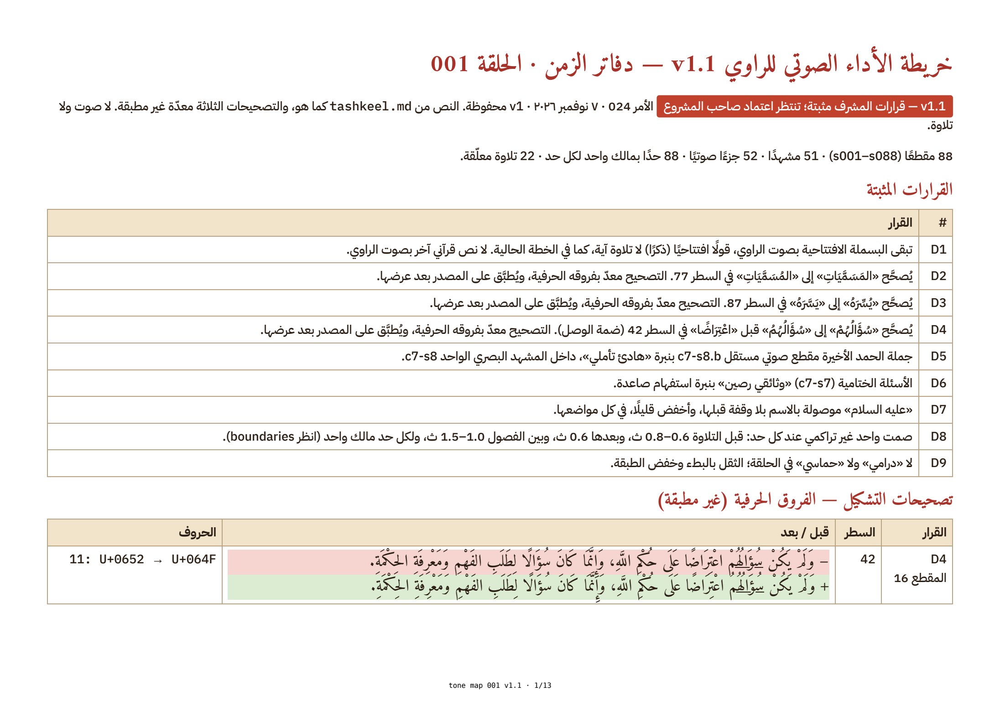
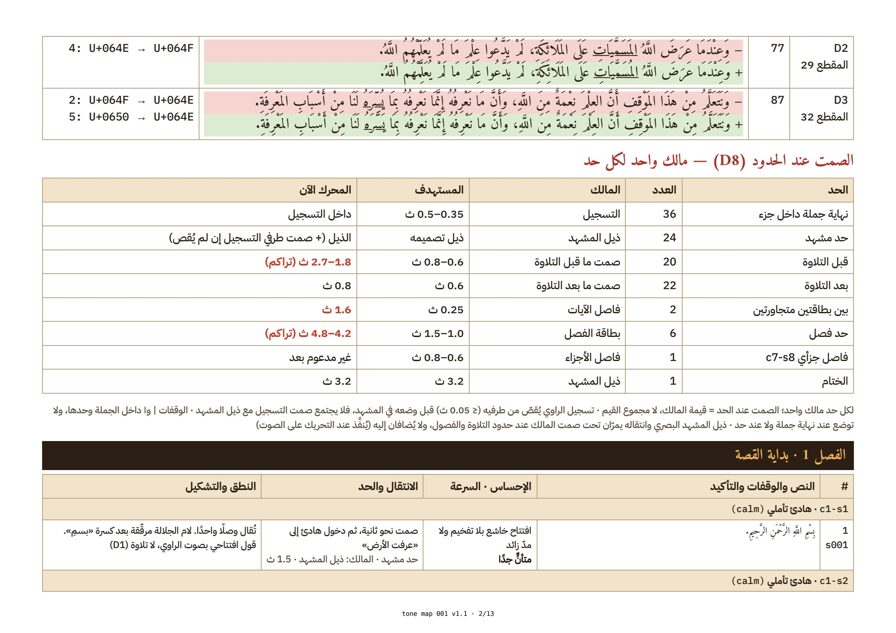

# خريطة الأداء الصوتي v1.1 — تثبيت القرارات D1–D9 · الأمر 024

**المنفّذ · ٧ نوفمبر ٢٠٢٦ · الحالة: v1.1 بقرارات المشرف، تنتظر اعتماد صاحب المشروع.** v1 محفوظة كما هي (`tone-map.v1.json`، والمراجعة 023). لا صوت ولا تلاوة ولا رندر. السكريبت والتشكيل وعلامات الآيات بلا تعديل، وتصحيحات التشكيل الثلاثة **معدّة ومعروضة هنا ولم تُطبَّق** على `tashkeel.md`. اعتماد النبرة ليس اعتمادًا للستوري بورد.

- **الملفات:** [خريطة الأداء v1.1 — PDF](docs/tone-map-001-v1.1.pdf) · [البيانات — JSON](docs/tone-map-001-v1.1.json). المرجع `tone-map.json` في مجلد الحلقة (v1.1)، و`tone-map.v1.json` (v1).





## 1. القرارات المثبتة

| # | القرار |
| --- | --- |
| D1 | تبقى البسملة الافتتاحية بصوت الراوي، قولًا افتتاحيًا (ذكرًا) لا تلاوة آية، كما في الخطة الحالية. لا نص قرآني آخر بصوت الراوي. |
| D2 | يُصحَّح «المَسَمَّيَاتِ» إلى «المُسَمَّيَاتِ» في السطر 77. التصحيح معدّ بفروقه الحرفية، ويُطبَّق على المصدر بعد عرضها. |
| D3 | يُصحَّح «يُسِّرَهُ» إلى «يَسَّرَهُ» في السطر 87. التصحيح معدّ بفروقه الحرفية، ويُطبَّق على المصدر بعد عرضها. |
| D4 | يُصحَّح «سُؤَالُهُمْ» إلى «سُؤَالُهُمُ» قبل «اعْتِرَاضًا» في السطر 42 (ضمة الوصل). التصحيح معدّ بفروقه الحرفية، ويُطبَّق على المصدر بعد عرضها. |
| D5 | جملة الحمد الأخيرة مقطع صوتي مستقل `c7-s8.b` بنبرة «هادئ تأملي»، داخل المشهد البصري الواحد `c7-s8`. |
| D6 | الأسئلة الختامية (`c7-s7`) «وثائقي رصين» بنبرة استفهام صاعدة. |
| D7 | «عليه السلام» موصولة بالاسم بلا وقفة قبلها، وأخفض قليلًا، في كل مواضعها. |
| D8 | صمت واحد غير تراكمي عند كل حد: قبل التلاوة 0.6–0.8 ث، وبعدها 0.6 ث، وبين الفصول 1.0–1.5 ث، ولكل حد مالك واحد (انظر `boundaries`). |
| D9 | لا «درامي» ولا «حماسي» في الحلقة؛ الثقل بالبطء وخفض الطبقة. |

D1 مثبت على الخطة الحالية (البسملة بصوت الراوي قولًا افتتاحيًا). إن كان توجيه المشرف غير ذلك فهو حقل واحد يُغيَّر.

## 2. تصحيحات التشكيل — الفروق الحرفية (غير مطبقة)

الصياغة لا تتغير: كل سطر بعد التصحيح مطابق لما قبله بعد حذف التشكيل، والسكريبت بلا تشكيل لا يتأثر. تُطبَّق على `tashkeel.md` بعد اعتماد هذه الفروق، ثم تُحدَّث بصمة التشكيل في الخريطة في الدفع نفسه.

### D4 · المقطع 16 · السطر 42

```diff
- وَلَمْ يَكُنْ سُؤَالُهُمْ اعْتِرَاضًا عَلَى حُكْمِ اللَّهِ، وَإِنَّمَا كَانَ سُؤَالًا لِطَلَبِ الفَهْمِ وَمَعْرِفَةِ الحِكْمَةِ.
+ وَلَمْ يَكُنْ سُؤَالُهُمُ اعْتِرَاضًا عَلَى حُكْمِ اللَّهِ، وَإِنَّمَا كَانَ سُؤَالًا لِطَلَبِ الفَهْمِ وَمَعْرِفَةِ الحِكْمَةِ.
```

- الكلمة: «سُؤَالُهُمْ» ← «سُؤَالُهُمُ» (الحرف 11: U+0652 ← U+064F).

### D2 · المقطع 29 · السطر 77

```diff
- وَعِنْدَمَا عَرَضَ اللَّهُ المَسَمَّيَاتِ عَلَى المَلَائِكَةِ، لَمْ يَدَّعُوا عِلْمَ مَا لَمْ يُعَلِّمْهُمُ اللَّهُ.
+ وَعِنْدَمَا عَرَضَ اللَّهُ المُسَمَّيَاتِ عَلَى المَلَائِكَةِ، لَمْ يَدَّعُوا عِلْمَ مَا لَمْ يُعَلِّمْهُمُ اللَّهُ.
```

- الكلمة: «المَسَمَّيَاتِ» ← «المُسَمَّيَاتِ» (الحرف 4: U+064E ← U+064F).

### D3 · المقطع 32 · السطر 87

```diff
- وَنَتَعَلَّمُ مِنْ هَذَا المَوْقِفِ أَنَّ العِلْمَ نِعْمَةٌ مِنَ اللَّهِ، وَأَنَّ مَا نَعْرِفُهُ إِنَّمَا نَعْرِفُهُ بِمَا يُسِّرَهُ لَنَا مِنْ أَسْبَابِ المَعْرِفَةِ.
+ وَنَتَعَلَّمُ مِنْ هَذَا المَوْقِفِ أَنَّ العِلْمَ نِعْمَةٌ مِنَ اللَّهِ، وَأَنَّ مَا نَعْرِفُهُ إِنَّمَا نَعْرِفُهُ بِمَا يَسَّرَهُ لَنَا مِنْ أَسْبَابِ المَعْرِفَةِ.
```

- الكلمة: «يُسِّرَهُ» ← «يَسَّرَهُ» (الحرف 2: U+064F ← U+064E، الحرف 5: U+0650 ← U+064E).

## 3. الجزء الصوتي المستقل للحمد (D5)

`c7-s8` مشهد بصري واحد بجزأين صوتيين: `c7-s8.a` (المقطعان 86 و87، «حكّاء دافئ»)، و`c7-s8.b` (المقطع 88، «هادئ تأملي»)، بينهما فاصل 0.6–0.8 ث يملكه المحرك. الأجزاء الصوتية 52 لـ51 مشهدًا. **المحرك يولّد اليوم تسجيلًا واحدًا لكل مشهد؛ دعم الجزأين شرط قبل توليد هذا المشهد** (لم يُبنَ في هذا الأمر).

## 4. الصمت عند الحدود — غير تراكمي (D8)

لكل مقطع حد واحد بعده، ولكل حد مالك واحد، والصمت عنده قيمة المالك لا مجموع القيم:

- لكل حد مالك واحد؛ الصمت عند الحد = قيمة المالك، لا مجموع القيم
- تسجيل الراوي يُقصّ من طرفيه (≤ 0.05 ث) قبل وضعه في المشهد، فلا يجتمع صمت التسجيل مع ذيل المشهد
- الوقفات | و‖ داخل الجملة وحدها، ولا توضع عند نهاية جملة ولا عند حد
- ذيل المشهد البصري وانتقاله يمرّان تحت صمت المالك عند حدود التلاوة والفصول، ولا يُضافان إليه (يُنفَّذ عند التحريك على الصوت)

| الحد | العدد | المالك | المستهدف | المحرك الآن |
| --- | --- | --- | --- | --- |
| نهاية جملة داخل جزء | 36 | التسجيل | 0.35–0.5 ث | داخل التسجيل |
| حد مشهد | 24 | ذيل المشهد | ذيل تصميمه (0.9–1.9 ث) | الذيل + صمت طرفي التسجيل إن لم يُقص |
| قبل التلاوة | 20 (لـ22 آية) | صمت ما قبل التلاوة | 0.6–0.8 ث | 1.8–2.7 ث: ذيل المشهد + 0.8 |
| بعد التلاوة | 22 | صمت ما بعد التلاوة | 0.6 ث | 0.8 ث |
| بين بطاقتين متجاورتين | 2 (الأعراف 14/16، 24/25) | فاصل الآيات | 0.25 ث | 1.6 ث (يزول بدمج مسودتي 022) |
| حد فصل | 6 | بطاقة الفصل | 1.0–1.5 ث | 4.2–4.8 ث: ذيل المشهد + بطاقة 3.2 ث |
| فاصل جزأي c7-s8 | 1 | فاصل الأجزاء | 0.6–0.8 ث | غير مدعوم بعد |
| الختام | 1 | ذيل المشهد | 3.2 ث | 3.2 ث |

**نتيجة التحقق:** الخريطة نفسها لا تحتسب صمتًا مرتين: 88 حدًا، لكل منها مالك واحد، ولا وقفة `|` أو `‖` عند نهاية جملة. **لكن المحرك الحالي يراكم الصمت عند 26 حدًا** (20 قبل التلاوة و6 بين الفصول): ذيل المشهد البصري يُضاف إلى صمت البطاقة. الإصلاح في مرحلة التحريك على الصوت: يمرّ الذيل وانتقاله تحت صمت المالك. وتسجيلات الراوي تُقص من طرفيها. لم يُعدَّل المحرك ولا المشاهد في هذا الأمر.

**يحتاج قرارًا:** بطاقة الفصل 3.2 ث بلا كلام أطول من صمت 1.0–1.5 ث المقرر. إما أن تبقى وقفة بصرية مقصودة بين الفصول، وإما أن تُقصَّر عند التحريك على الصوت.

## 5. حفظ المقاطع الـ88 وربطها بمشاهدها

- **محفوظ بلا تغيير عن v1 (اختبار):** رقم المقطع، والمشهد، والنص، وسطر التشكيل، والنص المعلَّم، والتأكيد، والوقفات، والسرعة. وكل مواضع التلاوة الـ22.
- **أُضيف لكل مقطع:**
  - `id` ثابت من s001 إلى s088.
  - `key`: بصمة النص بلا تشكيل. لا تتغير بتصحيحات التشكيل، فتبقى المزامنة على المقطع نفسه بعد تطبيقها.
  - `indexInScene`، و`audioPart`.
- **التسلسل:** المقاطع مرتبة كما في الخطة. كل مشهد منطوق له مقاطعه متتالية، ونص المشهد في `plan.json` يساوي مقاطعه موصولة (اختبار). لا مقطع ضائع ولا مكرر.

## 6. سجل الفروق v1 → v1.1

| المقطع | الحقل | التغيير |
| --- | --- | --- |
| 1 | `pronunciation` | «تُقال وصلًا واحدًا. لام الجلالة مرقّقة بعد كسرة «بسمِ». قول افتتاحي بصوت الراوي، لا تلاوة (D1)» |
| 6 | `pronunciation` | ««تاريخًا ثابتًا»: تنوين واضح غير مبالغ فيه. «عليه السلام» موصولة بالاسم بلا وقفة قبلها، أخفض قليلًا (D7)» |
| 12 | `pronunciation` | ««عِنْدَ ما» كلمتان. «سورةِ البقرة» بلا وقفة بينهما. «عليه السلام» موصولة بالاسم بلا وقفة قبلها، أخفض قليلًا (D7)» |
| 16 | `pronunciation` | «تُقرأ وصلًا «سؤالُهُمُ اعتراضًا» (ضمة وصل على الميم)؛ تصحيح التشكيل مقرر (D4) ومعدّ ولم يُطبَّق بعد. «حُكْمِ» بضم الحاء غير «الحِكْمة»» |
| 16 | `tashkeelCorrection` | أُضيف: «سُؤَالُهُمْ» ← «سُؤَالُهُمُ» (D4، غير مطبق) |
| 20 | `pronunciation` | «وقفة قصيرة عند النقطتين قبل «التَّعْلِيمِ». «عليه السلام» موصولة بالاسم بلا وقفة قبلها، أخفض قليلًا (D7)» |
| 21 | `pronunciation` | ««طِين» بكسر الطاء. «عليه السلام» موصولة بالاسم بلا وقفة قبلها، أخفض قليلًا (D7)» |
| 25 | `pronunciation` | ««تَسْوِيَتِهِ»، و«الرُّوح» بضم الراء. «عليه السلام» موصولة بالاسم بلا وقفة قبلها، أخفض قليلًا (D7)» |
| 29 | `pronunciation` | «تصحيح التشكيل المَسَمَّيَاتِ ← المُسَمَّيَاتِ مقرر (D2)، معدّ ولم يُطبَّق بعد. «يُعَلِّمْهُمُ اللهُ» وصل» |
| 29 | `tashkeelCorrection` | أُضيف: «المَسَمَّيَاتِ» ← «المُسَمَّيَاتِ» (D2، غير مطبق) |
| 31 | `pronunciation` | ««لِمَلائِكَتِهِ». «عليه السلام» موصولة بالاسم بلا وقفة قبلها، أخفض قليلًا (D7)» |
| 32 | `pronunciation` | «تصحيح التشكيل يُسِّرَهُ ← يَسَّرَهُ مقرر (D3)، معدّ ولم يُطبَّق بعد. جملة طويلة: نفَس بعد «من الله»» |
| 32 | `tashkeelCorrection` | أُضيف: «يُسِّرَهُ» ← «يَسَّرَهُ» (D3، غير مطبق) |
| 34 | `pronunciation` | ««يَسْجُدُوا». «عليه السلام» موصولة بالاسم بلا وقفة قبلها، أخفض قليلًا (D7)» |
| 35 | `pronunciation` | ««وَلَيْسَ عِبادَةً» نبرة نفي واضحة بلا حدّة. «عليه السلام» موصولة بالاسم بلا وقفة قبلها، أخفض قليلًا (D7)» |
| 55 | `pronunciation` | ««حَذَّرَ» شدّة الذال. «عليه السلام» موصولة بالاسم بلا وقفة قبلها، أخفض قليلًا (D7)» |
| 59 | `pronunciation` | ««لَمْ يُصِرَّ» بضم الياء وتشديد الراء. «عليه السلام» موصولة بالاسم بلا وقفة قبلها، أخفض قليلًا (D7)» |
| 62 | `pronunciation` | ««أَصَرَّ» و«أَنابَ». «عليه السلام» موصولة بالاسم بلا وقفة قبلها، أخفض قليلًا (D7)» |
| 66 | `pronunciation` | ««بِالتّارِيخِ البَشَرِيِّ». «عليه السلام» موصولة بالاسم بلا وقفة قبلها، أخفض قليلًا (D7)» |
| 71 | `pronunciation` | ««نَسْلُ». «عليه السلام» موصولة بالاسم بلا وقفة قبلها، أخفض قليلًا (D7)» |
| 74 | `pronunciation` | ««سِجِلًّا مُتَّصِلًا». «عليه السلام» موصولة بالاسم بلا وقفة قبلها، أخفض قليلًا (D7)» |
| 83 | `feel` | «سؤال حقيقي صاعد (D6)» |
| 87 | `pronunciation` | «اسم القناة «دَفاتِرِ الزَّمَن» واضح بلا مبالغة. «عليه السلام» موصولة بالاسم بلا وقفة قبلها، أخفض قليلًا (D7)» |
| 87 | `transition` | «يُنهي الجزء الدافئ؛ ثم فاصل الجزأين، ثم الحمد مقطعًا مستقلًا (D5)» |
| 88 | `feel` | «ختام خاشع، أبطأ، بلا انفعال — مقطع صوتي مستقل (D5)» |
| 88 | `tone` | `warm` ← `calm` (D5) |
| 88 | `transition` | «صمت الختام حتى النهاية (ذيل المشهد)» |

إضافات بنيوية: أُضيف لكل مقطع: id ثابت (s001–s088)، وkey (بصمة النص بلا تشكيل، لا تتغير بتصحيح التشكيل)، وindexInScene، وaudioPart؛ أُضيف audioParts (52 جزءًا: 51 مشهدًا، وc7-s8 جزءان)، وboundaries (88 حدًا)، وsilenceRules، وtashkeelCorrections (3، غير مطبقة)؛ قرارات D1–D9 مملوءة.

## 7. الخريطة الكاملة v1.1

### الفصل 1 · بداية القصة

#### `c1-s1` · هادئ تأملي

> **1** `s001` · بِسْمِ اللَّهِ الرَّحْمَنِ الرَّحِيمِ.

- **الإحساس:** افتتاح خاشع بلا تفخيم ولا مدّ زائد · **السرعة:** متأنٍّ جدًا (100–110)
- **التأكيد:** لا تأكيد خاص · **الوقفات:** لا وقفة داخلية
- **الانتقال:** صمت نحو ثانية، ثم دخول هادئ إلى «عرفت الأرض» — **الحد:** حد مشهد · المالك: ذيل المشهد · 1.5 ث
- **النطق:** تُقال وصلًا واحدًا. لام الجلالة مرقّقة بعد كسرة «بسمِ». قول افتتاحي بصوت الراوي، لا تلاوة (D1)

#### `c1-s2` · هادئ تأملي

> **2** `s002` · عَرَفَتِ الأَرْضُ أُمَمًا **كَثِيرَةً،** | وَتَعَاقَبَتْ فِيهَا أَجْيَالٌ لَا يَعْلَمُ عَدَدَهَا إِلَّا **اللَّهُ.**

- **الإحساس:** اتساع وتأمل في طول الزمن · **السرعة:** متأنٍّ (110–120)
- **التأكيد:** كَثِيرَةً،، اللَّهُ. · **الوقفات:** بعد «كثيرة»
- **الانتقال:** «ولكنّ» التالية انعطاف: ترتفع النبرة قليلًا — **الحد:** حد مشهد · المالك: ذيل المشهد · 1.2 ث
- **النطق:** «أُمَمًا» بضم الهمزة وفتح الميمين. «إلا الله» بلا استعجال، ولا تُختطف

#### `c1-s3` · وثائقي رصين

> **3** `s003` · وَلَكِنَّ رِحْلَتَنَا هَذِهِ | لَا تَبْدَأُ مِنْ **مَدِينَةٍ** قَدِيمَةٍ، | وَلَا مِنْ **مَمْلَكَةٍ** نَسِيَ النَّاسُ اسْمَهَا.

- **الإحساس:** نفي متدرّج يمهّد لما بعده · **السرعة:** معتدل (120–130)
- **التأكيد:** مَدِينَةٍ، مَمْلَكَةٍ · **الوقفات:** بعد «هذه»، بعد «قديمة»
- **الانتقال:** تعليق خفيف في آخرها، ثم الكشف — **الحد:** نهاية جملة · المالك: التسجيل · 0.35–0.5 ث
- **النطق:** «نَسِيَ النّاسُ اسْمَها»: همزة «اسمها» وصل لا تُنطق

> **4** `s004` · إِنَّنَا نَبْدَأُ مِنْ **أَبِي** البَشَرِ، | **آدَمَ** عَلَيْهِ السَّلَامُ.

- **الإحساس:** كشف هادئ دافئ للاسم · **السرعة:** متأنٍّ (110–120)
- **التأكيد:** أَبِي، آدَمَ · **الوقفات:** بعد «البشر»
- **الانتقال:** وقفة قصيرة، ثم «من أول إنسان» على النفس نفسه تقريبًا — **الحد:** حد مشهد · المالك: ذيل المشهد · 0.9 ث
- **النطق:** وقفة قصيرة قبل «آدم» (التوجيه الصوتي). «عليهِ السّلام» موصولة بالاسم، لا وقفة قبلها

#### `c1-s4` · وثائقي رصين

> **5** `s005` · مِنْ **أَوَّلِ** إِنْسَانٍ خَلَقَهُ اللَّهُ سُبْحَانَهُ وَتَعَالَى، | وَمِنْهُ بَدَأَ **نَسْلُ** البَشَرِ الَّذِي انْتَشَرَ فِي الأَرْضِ.

- **الإحساس:** تقرير هادئ: أصل واحد يتفرّع منه الكل · **السرعة:** معتدل (120–130)
- **التأكيد:** أَوَّلِ، نَسْلُ · **الوقفات:** بعد «وتعالى»
- **الانتقال:** نهاية مستقرة، ثم صمت المشهد — **الحد:** حد مشهد · المالك: ذيل المشهد · 1.3 ث
- **النطق:** «خَلَقَهُ» مبني للمعلوم

#### `c1-s5` · وثائقي رصين

> **6** `s006` · وَلَا نَمْلِكُ تَارِيخًا **ثَابِتًا** لِخَلْقِ آدَمَ عَلَيْهِ السَّلَامُ.

- **الإحساس:** حدّ المعرفة: تقريري هادئ بلا تهويل · **السرعة:** معتدل (120–130)
- **التأكيد:** ثَابِتًا · **الوقفات:** لا وقفة داخلية
- **الانتقال:** يتصل بالجملة التالية تفسيرًا — **الحد:** نهاية جملة · المالك: التسجيل · 0.35–0.5 ث
- **النطق:** «تاريخًا ثابتًا»: تنوين واضح غير مبالغ فيه. «عليه السلام» موصولة بالاسم بلا وقفة قبلها، أخفض قليلًا (D7)

> **7** `s007` · فَلَمْ يُخْبِرْنَا القُرْآنُ الكَرِيمُ **بِالسَّنَةِ** الَّتِي خُلِقَ فِيهَا، ‖ وَلَا **بِالزَّمَنِ** الَّذِي يَفْصِلُهُ عَنْ أَقْدَمِ الحَضَارَاتِ الَّتِي وَصَلَتْ إِلَيْنَا آثَارُهَا.

- **الإحساس:** شرح متصل للحدّ نفسه · **السرعة:** معتدل (120–130)
- **التأكيد:** بِالسَّنَةِ، بِالزَّمَنِ · **الوقفات:** نفَس بعد «فيها»
- **الانتقال:** نهاية هابطة؛ ثم «ولكنّ الله» بارتفاع خفيف — **الحد:** حد مشهد · المالك: ذيل المشهد · 1.2 ث
- **النطق:** «خُلِقَ» مبني للمجهول. جملة طويلة: نفَس بعد «فيها»

#### `c1-s6` · هادئ تأملي

> **8** `s008` · وَلَكِنَّ اللَّهَ أَخْبَرَنَا | بِمَا هُوَ **أَعْظَمُ** مِنْ تَحْدِيدِ سَنَةٍ أَوْ مَكَانٍ.

- **الإحساس:** رفع المقام بهدوء: ما هو أعظم · **السرعة:** متأنٍّ (110–120)
- **التأكيد:** أَعْظَمُ · **الوقفات:** بعد «أخبرنا»
- **الانتقال:** تفتح التعداد التالي — **الحد:** حد مشهد · المالك: ذيل المشهد · 1.2 ث
- **النطق:** «أَعْظَمُ» بلا مبالغة صوتية

#### `c1-s7` · وثائقي رصين

> **9** `s009` · أَخْبَرَنَا عَنْ خَلْقِ آدَمَ، | **وَتَكْرِيمِهِ،** | **وَتَعْلِيمِهِ،** | وَعَنْ أَمْرِ المَلَائِكَةِ بِالسُّجُودِ لَهُ، | وَعَنْ عَدَاوَةِ **إِبْلِيسَ.**

- **الإحساس:** تعداد متصاعد هادئ · **السرعة:** معتدل (120–130)
- **التأكيد:** وَتَكْرِيمِهِ،، وَتَعْلِيمِهِ،، إِبْلِيسَ. · **الوقفات:** بعد «آدم»، بعد «وتكريمه»، بعد «وتعليمه»، بعد «له»
- **الانتقال:** يستمر التعداد في الجملة التالية — **الحد:** نهاية جملة · المالك: التسجيل · 0.35–0.5 ث
- **النطق:** كل بند بنبرة مستوية إلا الأخير «عداوة إبليس» أخفض قليلًا

> **10** `s010` · ثُمَّ أَخْبَرَنَا عَمَّا جَرَى لِآدَمَ وَزَوْجِهِ، | **وَهُبُوطِهِمَا** إِلَى الأَرْضِ.

- **الإحساس:** إكمال الخبر حتى الهبوط · **السرعة:** معتدل (120–130)
- **التأكيد:** وَهُبُوطِهِمَا · **الوقفات:** بعد «وزوجه»
- **الانتقال:** نهاية مستقرة تمهّد لجملة الختام — **الحد:** حد مشهد · المالك: ذيل المشهد · 1.0 ث
- **النطق:** «وَهُبُوطِهِما» بضم الهاء والباء

#### `c1-s8` · حكّاء دافئ

> **11** `s011` · وَمِنْ هَذِهِ الأَخْبَارِ | نَبْدَأُ **قِصَّتَنَا.**

- **الإحساس:** دعوة للبدء، إغلاق الفصل · **السرعة:** متأنٍّ (110–120)
- **التأكيد:** قِصَّتَنَا. · **الوقفات:** بعد «الأخبار»
- **الانتقال:** صمت نهاية الفصل — **الحد:** حد فصل · المالك: بطاقة الفصل · 1.0–1.5 ث · **المحرك الآن 4.2 ث (تراكم)**
- **النطق:** «قِصَّتَنا» شدّة الصاد واضحة

### الفصل 2 · إني جاعل في الأرض خليفة

#### `c2-s1` · وثائقي رصين

> **12** `s012` · قَبْلَ أَنْ نَتَحَدَّثَ عَنْ حَيَاةِ آدَمَ عَلَيْهِ السَّلَامُ، ‖ **نَقِفُ** عِنْدَ مَا أَخْبَرَنَا اللَّهُ بِهِ فِي سُورَةِ **البَقَرَةِ.**

- **الإحساس:** توقّف متأمّل قبل الخبر القرآني · **السرعة:** متأنٍّ (110–120)
- **التأكيد:** نَقِفُ، البَقَرَةِ. · **الوقفات:** نفَس بعد «السلام»
- **الانتقال:** نهاية معلّقة غير هابطة، ثم صمت قبل الآية — **الحد:** قبل تلاوة · المالك: صمت ما قبل التلاوة · 0.6–0.8 ث · **المحرك الآن 1.8 ث (تراكم)**
- **النطق:** «عِنْدَ ما» كلمتان. «سورةِ البقرة» بلا وقفة بينهما. «عليه السلام» موصولة بالاسم بلا وقفة قبلها، أخفض قليلًا (D7)

#### `c2-s2` · وثائقي رصين

> **13** `s013` · أَخْبَرَ اللَّهُ مَلَائِكَتَهُ أَنَّهُ جَاعِلٌ فِي الأَرْضِ | **خَلِيفَةً.**

- **الإحساس:** إعادة الخبر بوضوح بعد الآية · **السرعة:** متأنٍّ (110–120)
- **التأكيد:** خَلِيفَةً. · **الوقفات:** بعد «الأرض»
- **الانتقال:** يتصل بالشرح التالي — **الحد:** نهاية جملة · المالك: التسجيل · 0.35–0.5 ث
- **النطق:** «جاعِلٌ» بالتنوين

> **14** `s014` · وَقَدْ ذَكَرَ المُفَسِّرُونَ فِي مَعْنَى الخِلَافَةِ **أَقْوَالًا،** | **مِنْهَا** | أَنَّ البَشَرَ يَخْلُفُ بَعْضُهُمْ بَعْضًا فِي عِمَارَةِ الأَرْضِ وَالحَيَاةِ عَلَيْهَا.

- **الإحساس:** شارح محايد: قول من الأقوال · **السرعة:** معتدل (120–130)
- **التأكيد:** أَقْوَالًا،، مِنْهَا · **الوقفات:** بعد «أقوالا»، بعد «منها»
- **الانتقال:** نهاية هابطة، ثم سؤال الملائكة — **الحد:** حد مشهد · المالك: ذيل المشهد · 1.2 ث
- **النطق:** «يَخْلُفُ» مفتوحة الياء. وقفة خفيفة عند «منها» (التوجيه الصوتي)

#### `c2-s3` · وثائقي رصين

> **15** `s015` · وَسَأَلَتِ المَلَائِكَةُ رَبَّهَا عَنْ جَعْلِ مَنْ يَكُونُ مِنْهُ الفَسَادُ وَسَفْكُ الدِّمَاءِ، ‖ مَعَ أَنَّهُمْ **يُسَبِّحُونَ** بِحَمْدِهِ **وَيُقَدِّسُونَ** لَهُ.

- **الإحساس:** نقل أمين لسؤال الملائكة بلا تهويل لعبارة «سفك الدماء» · **السرعة:** معتدل (120–130)
- **التأكيد:** يُسَبِّحُونَ، وَيُقَدِّسُونَ · **الوقفات:** نفَس بعد «الدماء»
- **الانتقال:** تتبعها جملة تصحيح الفهم بنبرة أوضح — **الحد:** نهاية جملة · المالك: التسجيل · 0.35–0.5 ث
- **النطق:** «سَفْكُ» بسكون الفاء

> **16** `s016` · وَلَمْ يَكُنْ سُؤَالُهُمْ **اعْتِرَاضًا** عَلَى حُكْمِ اللَّهِ، | وَإِنَّمَا كَانَ سُؤَالًا لِطَلَبِ **الفَهْمِ** وَمَعْرِفَةِ الحِكْمَةِ.

- **الإحساس:** تصحيح فهم: حاسم ولطيف · **السرعة:** معتدل (120–130)
- **التأكيد:** اعْتِرَاضًا، الفَهْمِ · **الوقفات:** بعد «الله»
- **الانتقال:** صمت قصير، ثم جواب الله بوقار — **الحد:** حد مشهد · المالك: ذيل المشهد · 1.2 ث
- **النطق:** تُقرأ وصلًا «سؤالُهُمُ اعتراضًا» (ضمة وصل على الميم)؛ تصحيح التشكيل مقرر (D4) ومعدّ ولم يُطبَّق بعد. «حُكْمِ» بضم الحاء غير «الحِكْمة»

#### `c2-s4` · هادئ تأملي

> **17** `s017` · فَأَجَابَهُمُ اللَّهُ بِأَنَّهُ | **يَعْلَمُ** مَا لَا **يَعْلَمُونَ.**

- **الإحساس:** جواب الحق: وقار وثبات · **السرعة:** متأنٍّ (110–120)
- **التأكيد:** يَعْلَمُ، يَعْلَمُونَ. · **الوقفات:** بعد «بأنه»
- **الانتقال:** صمت أطول قليلًا — **الحد:** نهاية جملة · المالك: التسجيل · 0.35–0.5 ث
- **النطق:** «يَعْلَمُ ما لا يَعْلَمُون» بلا استعجال؛ ذكر لله لا يُقطع

> **18** `s018` · إِنَّ مَعْرِفَتَنَا **مَحْدُودَةٌ،** | وَعِلْمَ اللَّهِ **مُحِيطٌ** بِكُلِّ شَيْءٍ.

- **الإحساس:** مقابلة بين محدود ومحيط · **السرعة:** متأنٍّ (110–120)
- **التأكيد:** مَحْدُودَةٌ،، مُحِيطٌ · **الوقفات:** بعد «محدودة»
- **الانتقال:** تتصل بالجملة التالية — **الحد:** نهاية جملة · المالك: التسجيل · 0.35–0.5 ث
- **النطق:** «مُحِيطٌ» بضم الميم

> **19** `s019` · وَقَدْ نَعْرِفُ **بَعْضَ** الحِكَمِ مِنْ أَمْرٍ مِنْ أُمُورِ اللَّهِ، | وَلَكِنَّنَا لَا **نَدَّعِي** الإِحَاطَةَ بِجَمِيعِ حِكَمِهِ.

- **الإحساس:** تواضع معرفي · **السرعة:** معتدل (120–130)
- **التأكيد:** بَعْضَ، نَدَّعِي · **الوقفات:** بعد «الله»
- **الانتقال:** نهاية مستقرة — **الحد:** حد مشهد · المالك: ذيل المشهد · 1.3 ث
- **النطق:** «الحِكَمِ» و«حِكَمِهِ» جمع حكمة بكسر الحاء وفتح الكاف، لا «الحُكْم»

#### `c2-s5` · وثائقي رصين

> **20** `s020` · وَبَعْدَ هَذَا الإِخْبَارِ، | يُحَدِّثُنَا القُرْآنُ الكَرِيمُ عَنْ خَلْقِ آدَمَ عَلَيْهِ السَّلَامُ، | ثُمَّ عَنْ أَمْرٍ مِنْ **أَعْظَمِ** مَا خَصَّهُ اللَّهُ بِهِ: | **التَّعْلِيمِ.**

- **الإحساس:** جسر إلى الفصل التالي، مع إبراز «التعليم» · **السرعة:** معتدل (120–130)
- **التأكيد:** أَعْظَمِ، التَّعْلِيمِ. · **الوقفات:** بعد «الإخبار»، بعد «السلام»، بعد «به»
- **الانتقال:** الكلمة الأخيرة تستقر، ثم صمت الفصل — **الحد:** حد فصل · المالك: بطاقة الفصل · 1.0–1.5 ث · **المحرك الآن 4.7 ث (تراكم)**
- **النطق:** وقفة قصيرة عند النقطتين قبل «التَّعْلِيمِ». «عليه السلام» موصولة بالاسم بلا وقفة قبلها، أخفض قليلًا (D7)

### الفصل 3 · خلق آدم وتعليمه

#### `c3-s1` · وثائقي رصين

> **21** `s021` · خَلَقَ اللَّهُ آدَمَ عَلَيْهِ السَّلَامُ | مِنْ **طِينٍ.**

- **الإحساس:** خبر أصل الخلق: رصين · **السرعة:** متأنٍّ (110–120)
- **التأكيد:** طِينٍ. · **الوقفات:** بعد «السلام»
- **الانتقال:** يتصل بالجملة التالية — **الحد:** نهاية جملة · المالك: التسجيل · 0.35–0.5 ث
- **النطق:** «طِين» بكسر الطاء. «عليه السلام» موصولة بالاسم بلا وقفة قبلها، أخفض قليلًا (D7)

> **22** `s022` · وَقَدْ جَاءَ ذِكْرُ خَلْقِهِ فِي مَوَاضِعَ **مُتَعَدِّدَةٍ** مِنَ القُرْآنِ الكَرِيمِ.

- **الإحساس:** إشارة إلى تعدّد المواضع · **السرعة:** معتدل (120–130)
- **التأكيد:** مُتَعَدِّدَةٍ · **الوقفات:** لا وقفة داخلية
- **الانتقال:** تمهّد لـ«قال الله تعالى» — **الحد:** حد مشهد · المالك: ذيل المشهد · 1.2 ث
- **النطق:** «مُتَعَدِّدَةٍ» شدّة الدال

#### `c3-s2` · هادئ تأملي

> **23** `s023` · قَالَ اللَّهُ تَعَالَى:

- **الإحساس:** تمهيد خاشع للآية · **السرعة:** متأنٍّ (110–120)
- **التأكيد:** لا تأكيد خاص · **الوقفات:** لا وقفة داخلية
- **الانتقال:** نهاية معلّقة، ثم صمت ثم التلاوة (ص 71) — **الحد:** قبل تلاوة · المالك: صمت ما قبل التلاوة · 0.6–0.8 ث · **المحرك الآن 1.8 ث (تراكم)**
- **النطق:** لام الجلالة مفخّمة بعد فتحة «قالَ»

#### `c3-s3` · هادئ تأملي

> **24** `s024` · ثُمَّ قَالَ سُبْحَانَهُ:

- **الإحساس:** تمهيد خاشع للآية التالية · **السرعة:** متأنٍّ (110–120)
- **التأكيد:** لا تأكيد خاص · **الوقفات:** لا وقفة داخلية
- **الانتقال:** نهاية معلّقة، ثم صمت ثم التلاوة (ص 72) — **الحد:** قبل تلاوة · المالك: صمت ما قبل التلاوة · 0.6–0.8 ث · **المحرك الآن 1.8 ث (تراكم)**
- **النطق:** «سُبْحانَهُ» بلا إطالة

#### `c3-s4` · وثائقي رصين

> **25** `s025` · وَفِي هَذِهِ الآيَاتِ خَبَرُ خَلْقِ آدَمَ عَلَيْهِ السَّلَامُ، | **وَتَسْوِيَتِهِ،** | وَنَفْخِ **الرُّوحِ** فِيهِ.

- **الإحساس:** تلخيص ثلاثي لما تُلي · **السرعة:** معتدل (120–130)
- **التأكيد:** وَتَسْوِيَتِهِ،، الرُّوحِ · **الوقفات:** بعد «السلام»، بعد «وتسويته»
- **الانتقال:** نهاية مستقرة — **الحد:** حد مشهد · المالك: ذيل المشهد · 1.6 ث
- **النطق:** «تَسْوِيَتِهِ»، و«الرُّوح» بضم الراء. «عليه السلام» موصولة بالاسم بلا وقفة قبلها، أخفض قليلًا (D7)

#### `c3-s5` · وثائقي رصين

> **26** `s026` · ثُمَّ أَخْبَرَنَا اللَّهُ بِأَنَّهُ عَلَّمَ آدَمَ | **الأَسْمَاءَ** **كُلَّهَا.**

- **الإحساس:** إعلان النعمة · **السرعة:** متأنٍّ (110–120)
- **التأكيد:** الأَسْمَاءَ، كُلَّهَا. · **الوقفات:** بعد «آدم»
- **الانتقال:** نهاية معلّقة قليلًا، ثم الآية (البقرة 31) — **الحد:** قبل تلاوة · المالك: صمت ما قبل التلاوة · 0.6–0.8 ث · **المحرك الآن 1.8 ث (تراكم)**
- **النطق:** «عَلَّمَ» بالتشديد (لا «عَلِمَ»)

#### `c3-s6` · وثائقي رصين

> **27** `s027` · وَقَدِ **اخْتَلَفَ** المُفَسِّرُونَ فِي تَفْصِيلِ المَقْصُودِ بِالأَسْمَاءِ، | وَذَكَرُوا فِي ذَلِكَ أَقْوَالًا **مُتَعَدِّدَةً.**

- **الإحساس:** شارح محايد · **السرعة:** معتدل (120–130)
- **التأكيد:** اخْتَلَفَ، مُتَعَدِّدَةً. · **الوقفات:** بعد «بالأسماء»
- **الانتقال:** «ولكنّ» التالية خلاصة واثقة — **الحد:** نهاية جملة · المالك: التسجيل · 0.35–0.5 ث
- **النطق:** «المَقْصُودِ»

> **28** `s028` · وَلَكِنَّ المَعْنَى **الوَاضِحَ** فِي الآيَاتِ | أَنَّ اللَّهَ **خَصَّ** آدَمَ **بِعِلْمٍ** عَلَّمَهُ إِيَّاهُ.

- **الإحساس:** خلاصة واثقة · **السرعة:** معتدل (120–130)
- **التأكيد:** الوَاضِحَ، خَصَّ، بِعِلْمٍ · **الوقفات:** بعد «الآيات»
- **الانتقال:** نهاية مستقرة — **الحد:** حد مشهد · المالك: ذيل المشهد · 1.2 ث
- **النطق:** «خَصَّ» شدّة الصاد، و«عَلَّمَهُ إيّاه»

#### `c3-s7` · وثائقي رصين

> **29** `s029` · وَعِنْدَمَا عَرَضَ اللَّهُ المَسَمَّيَاتِ عَلَى المَلَائِكَةِ، | لَمْ **يَدَّعُوا** عِلْمَ مَا لَمْ يُعَلِّمْهُمُ اللَّهُ.

- **الإحساس:** وصف أدب الملائكة · **السرعة:** معتدل (120–130)
- **التأكيد:** يَدَّعُوا · **الوقفات:** بعد «الملائكة»
- **الانتقال:** نهاية معلّقة، ثم الآية (البقرة 32) — **الحد:** قبل تلاوة · المالك: صمت ما قبل التلاوة · 0.6–0.8 ث · **المحرك الآن 1.8 ث (تراكم)**
- **النطق:** تصحيح التشكيل المَسَمَّيَاتِ ← المُسَمَّيَاتِ مقرر (D2)، معدّ ولم يُطبَّق بعد. «يُعَلِّمْهُمُ اللهُ» وصل

#### `c3-s8` · وثائقي رصين

> **30** `s030` · ثُمَّ أَمَرَ اللَّهُ آدَمَ أَنْ **يُنْبِئَهُمْ** بِأَسْمَائِهَا.

- **الإحساس:** أمر وإظهار · **السرعة:** متأنٍّ (110–120)
- **التأكيد:** يُنْبِئَهُمْ · **الوقفات:** لا وقفة داخلية
- **الانتقال:** نهاية معلّقة، ثم الآية (البقرة 33) — **الحد:** قبل تلاوة · المالك: صمت ما قبل التلاوة · 0.6–0.8 ث · **المحرك الآن 1.8 ث (تراكم)**
- **النطق:** «يُنْبِئَهُمْ» همزة محققة

#### `c3-s9` · حكّاء دافئ

> **31** `s031` · وَهَكَذَا **أَظْهَرَ** اللَّهُ لِمَلَائِكَتِهِ مَا عَلَّمَهُ لِآدَمَ عَلَيْهِ السَّلَامُ.

- **الإحساس:** خلاصة الموقف · **السرعة:** معتدل (120–130)
- **التأكيد:** أَظْهَرَ · **الوقفات:** لا وقفة داخلية
- **الانتقال:** يتصل بالدرس التالي — **الحد:** نهاية جملة · المالك: التسجيل · 0.35–0.5 ث
- **النطق:** «لِمَلائِكَتِهِ». «عليه السلام» موصولة بالاسم بلا وقفة قبلها، أخفض قليلًا (D7)

> **32** `s032` · وَنَتَعَلَّمُ مِنْ هَذَا المَوْقِفِ أَنَّ العِلْمَ **نِعْمَةٌ** مِنَ اللَّهِ، ‖ وَأَنَّ مَا نَعْرِفُهُ إِنَّمَا نَعْرِفُهُ بِمَا **يُسِّرَهُ** لَنَا مِنْ أَسْبَابِ المَعْرِفَةِ.

- **الإحساس:** درس: العلم نعمة · **السرعة:** متأنٍّ (110–120)
- **التأكيد:** نِعْمَةٌ، يُسِّرَهُ · **الوقفات:** نفَس بعد «الله»
- **الانتقال:** يتصل بالجملة الأخيرة — **الحد:** نهاية جملة · المالك: التسجيل · 0.35–0.5 ث
- **النطق:** تصحيح التشكيل يُسِّرَهُ ← يَسَّرَهُ مقرر (D3)، معدّ ولم يُطبَّق بعد. جملة طويلة: نفَس بعد «من الله»

> **33** `s033` · فَلَا مَكَانَ **لِلْغُرُورِ** بِالعِلْمِ، | وَلَا لِادِّعَاءِ مَعْرِفَةِ مَا لَمْ يَقُمْ عَلَيْهِ **دَلِيلٌ.**

- **الإحساس:** درس هادئ حازم بلا وعظ · **السرعة:** معتدل (120–130)
- **التأكيد:** لِلْغُرُورِ، دَلِيلٌ. · **الوقفات:** بعد «بالعلم»
- **الانتقال:** صمت نهاية الفصل — **الحد:** حد فصل · المالك: بطاقة الفصل · 1.0–1.5 ث · **المحرك الآن 4.8 ث (تراكم)**
- **النطق:** «لِادِّعاءِ» شدّة الدال

### الفصل 4 · سجود الملائكة ومعصية إبليس

#### `c4-s1` · وثائقي رصين

> **34** `s034` · بَعْدَ أَنْ خَلَقَ اللَّهُ آدَمَ عَلَيْهِ السَّلَامُ، | أَمَرَ المَلَائِكَةَ أَنْ **يَسْجُدُوا** لَهُ.

- **الإحساس:** مدخل المشهد الكبير: وقار · **السرعة:** متأنٍّ (110–120)
- **التأكيد:** يَسْجُدُوا · **الوقفات:** بعد «السلام»
- **الانتقال:** يتصل بالتوضيح التالي — **الحد:** نهاية جملة · المالك: التسجيل · 0.35–0.5 ث
- **النطق:** «يَسْجُدُوا». «عليه السلام» موصولة بالاسم بلا وقفة قبلها، أخفض قليلًا (D7)

> **35** `s035` · وَكَانَ هَذَا السُّجُودُ بِأَمْرِ اللَّهِ، | **تَكْرِيمًا** لِآدَمَ عَلَيْهِ السَّلَامُ، | وَلَيْسَ **عِبَادَةً** لَهُ.

- **الإحساس:** توضيح عقدي واضح · **السرعة:** معتدل (120–130)
- **التأكيد:** تَكْرِيمًا، عِبَادَةً · **الوقفات:** بعد «الله»، بعد «السلام»
- **الانتقال:** تتلوها جملة قصيرة قاطعة — **الحد:** نهاية جملة · المالك: التسجيل · 0.35–0.5 ث
- **النطق:** «وَلَيْسَ عِبادَةً» نبرة نفي واضحة بلا حدّة. «عليه السلام» موصولة بالاسم بلا وقفة قبلها، أخفض قليلًا (D7)

> **36** `s036` · فَالعِبَادَةُ حَقٌّ لِلَّهِ **وَحْدَهُ.**

- **الإحساس:** قاطع هادئ · **السرعة:** متأنٍّ (110–120)
- **التأكيد:** وَحْدَهُ. · **الوقفات:** لا وقفة داخلية
- **الانتقال:** صمت، ثم الآية (البقرة 34) — **الحد:** قبل تلاوة · المالك: صمت ما قبل التلاوة · 0.6–0.8 ث · **المحرك الآن 2.0 ث (تراكم)**
- **النطق:** «حَقٌّ لِلّهِ وَحْدَهُ»؛ ذكر لله بلا استعجال

#### `c4-s2` · وثائقي رصين

> **37** `s037` · **اسْتَجَابَتِ** المَلَائِكَةُ لِأَمْرِ رَبِّهَا.

- **الإحساس:** امتثال هادئ · **السرعة:** معتدل (120–130)
- **التأكيد:** اسْتَجَابَتِ · **الوقفات:** لا وقفة داخلية
- **الانتقال:** وقفة تنفس قبل المقابلة — **الحد:** نهاية جملة · المالك: التسجيل · 0.35–0.5 ث
- **النطق:** «اسْتَجابَتِ» همزة وصل في أول الكلام تُنطق

> **38** `s038` · وَلَكِنَّ إِبْلِيسَ | **أَبَى** **وَاسْتَكْبَرَ.**

- **الإحساس:** مقابلة حازمة بنبرة أخفض، بلا تمثيل · **السرعة:** متأنٍّ (110–120)
- **التأكيد:** أَبَى، وَاسْتَكْبَرَ. · **الوقفات:** بعد «إبليس»
- **الانتقال:** صمت قصير — **الحد:** حد مشهد · المالك: ذيل المشهد · 1.2 ث
- **النطق:** «أَبَى» ألف مقصورة. لا تفخيم مسرحي لاسم إبليس

#### `c4-s3` · وثائقي رصين

> **39** `s039` · وَمِنَ المُهِمِّ هُنَا أَنْ نَعْرِفَ | أَنَّ إِبْلِيسَ لَمْ **يَكُنْ** مِنَ المَلَائِكَةِ.

- **الإحساس:** تنبيه معرفي · **السرعة:** معتدل (120–130)
- **التأكيد:** يَكُنْ · **الوقفات:** بعد «نعرف»
- **الانتقال:** يتصل بالتصحيح التالي — **الحد:** نهاية جملة · المالك: التسجيل · 0.35–0.5 ث
- **النطق:** «لَمْ يَكُنْ مِنَ المَلائِكَة»

> **40** `s040` · بَلْ كَانَ مِنَ **الجِنِّ،** | كَمَا أَخْبَرَنَا اللَّهُ فِي سُورَةِ الكَهْفِ.

- **الإحساس:** تصحيح واضح · **السرعة:** معتدل (120–130)
- **التأكيد:** الجِنِّ، · **الوقفات:** بعد «الجن»
- **الانتقال:** نهاية معلّقة، ثم الآية (الكهف 50) — **الحد:** قبل تلاوة · المالك: صمت ما قبل التلاوة · 0.6–0.8 ث · **المحرك الآن 2.0 ث (تراكم)**
- **النطق:** «الجِنّ» بكسر الجيم، لا «الجَنّة»

#### `c4-s4` · وثائقي رصين

> **41** `s041` · وَقَدْ جَاءَ فِي سُورَةِ الأَعْرَافِ | خَبَرُ سُؤَالِ اللَّهِ لِإِبْلِيسَ عَنْ **سَبَبِ** امْتِنَاعِهِ عَنِ السُّجُودِ.

- **الإحساس:** تمهيد لسؤال الله لإبليس · **السرعة:** معتدل (120–130)
- **التأكيد:** سَبَبِ · **الوقفات:** بعد «الأعراف»
- **الانتقال:** نهاية معلّقة، ثم الآية (الأعراف 12) — **الحد:** قبل تلاوة · المالك: صمت ما قبل التلاوة · 0.6–0.8 ث · **المحرك الآن 1.8 ث (تراكم)**
- **النطق:** «امْتِناعِهِ»

#### `c4-s5` · وثائقي رصين

> **42** `s042` · فَقَدَّمَ إِبْلِيسُ مَا **ظَنَّهُ** حُجَّةً، ‖ حِينَ رَأَى أَنَّ خَلْقَهُ مِنْ **نَارٍ** يَجْعَلُهُ أَفْضَلَ مِنْ آدَمَ الَّذِي خُلِقَ مِنْ **طِينٍ.**

- **الإحساس:** عرض حجة الخصم بحياد · **السرعة:** معتدل (120–130)
- **التأكيد:** ظَنَّهُ، نَارٍ، طِينٍ. · **الوقفات:** نفَس بعد «حجة»
- **الانتقال:** يتصل بالحكم التالي — **الحد:** نهاية جملة · المالك: التسجيل · 0.35–0.5 ث
- **النطق:** «خُلِقَ» مبني للمجهول

> **43** `s043` · وَلَكِنَّهُ **أَخْطَأَ** | حِينَ جَعَلَ هَذَا الظَّنَّ **مُقَدَّمًا** عَلَى أَمْرِ اللَّهِ.

- **الإحساس:** حكم واضح · **السرعة:** معتدل (120–130)
- **التأكيد:** أَخْطَأَ، مُقَدَّمًا · **الوقفات:** بعد «أخطأ»
- **الانتقال:** تتبعها جملتان قصيرتان — **الحد:** نهاية جملة · المالك: التسجيل · 0.35–0.5 ث
- **النطق:** «مُقَدَّمًا» بفتح الدال المشددة

> **44** `s044` · لَمْ يَكُنِ الأَمْرُ **مُجَرَّدَ** مُقَارَنَةٍ بَيْنَ مَادَّتَيْنِ.

- **الإحساس:** نفي التبسيط · **السرعة:** متأنٍّ (110–120)
- **التأكيد:** مُجَرَّدَ · **الوقفات:** لا وقفة داخلية
- **الانتقال:** يتصل بالجملة التالية — **الحد:** نهاية جملة · المالك: التسجيل · 0.35–0.5 ث
- **النطق:** «مادَّتَيْنِ» شدّة الدال

> **45** `s045` · بَلْ كَانَ أَمْرًا **إِلَهِيًّا** وَجَبَتْ طَاعَتُهُ، | **فَاسْتَكْبَرَ** إِبْلِيسُ عَنْهُ.

- **الإحساس:** أصل المسألة: طاعة الأمر · **السرعة:** معتدل (120–130)
- **التأكيد:** إِلَهِيًّا، فَاسْتَكْبَرَ · **الوقفات:** بعد «طاعته»
- **الانتقال:** صمت قصير، نهاية المشهد — **الحد:** حد مشهد · المالك: ذيل المشهد · 1.2 ث
- **النطق:** «إلهِيًّا»

#### `c4-s6` · وثائقي رصين

> **46** `s046` · وَهَكَذَا أَصْبَحَ إِبْلِيسُ | **عَدُوًّا** لِآدَمَ وَذُرِّيَّتِهِ.

- **الإحساس:** نتيجة ثقيلة، نبرة أخفض · **السرعة:** متأنٍّ (110–120)
- **التأكيد:** عَدُوًّا · **الوقفات:** بعد «إبليس»
- **الانتقال:** يتصل بخبر الإمهال — **الحد:** نهاية جملة · المالك: التسجيل · 0.35–0.5 ث
- **النطق:** «عَدُوًّا» و«ذُرِّيَّتِهِ»

> **47** `s047` · وَقَدْ ذَكَرَ القُرْآنُ الكَرِيمُ أَنَّ إِبْلِيسَ سَأَلَ اللَّهَ أَنْ **يُمْهِلَهُ،** | وَأَنَّهُ أَعْلَنَ عَزْمَهُ عَلَى **إِغْوَاءِ** البَشَرِ.

- **الإحساس:** إخبار عن الإمهال والعزم · **السرعة:** معتدل (120–130)
- **التأكيد:** يُمْهِلَهُ،، إِغْوَاءِ · **الوقفات:** بعد «يمهله»
- **الانتقال:** نهاية معلّقة، ثم الآيات (الأعراف 14–16) — **الحد:** قبل تلاوة · المالك: صمت ما قبل التلاوة · 0.6–0.8 ث · **المحرك الآن 2.0 ث (تراكم)**
- **النطق:** «يُمْهِلَهُ» بضم الياء. «إغْواءِ» همزة محققة

#### `c4-s7` · هادئ تأملي

> **48** `s048` · وَفِي مُقَابِلِ هَذَا الوَعِيدِ، أَخْبَرَ اللَّهُ فِي سُورَةِ الحِجْرِ ‖ أَنَّ عِبَادَهُ لَيْسَ لِإِبْلِيسَ عَلَيْهِمْ **سُلْطَانٌ،** | **إِلَّا** مَنِ اتَّبَعَهُ مِنَ الغَاوِينَ.

- **الإحساس:** طمأنينة في مقابل الوعيد · **السرعة:** متأنٍّ (110–120)
- **التأكيد:** سُلْطَانٌ،، إِلَّا · **الوقفات:** نفَس بعد «الحجر»، بعد «سلطان»
- **الانتقال:** نهاية معلّقة، ثم الآية (الحجر 42) — **الحد:** قبل تلاوة · المالك: صمت ما قبل التلاوة · 0.6–0.8 ث · **المحرك الآن 2.0 ث (تراكم)**
- **النطق:** «مَنِ اتَّبَعَهُ» كسر النون للوصل. «الغاوِين»

#### `c4-s8` · وثائقي رصين

> **49** `s049` · وَمِنْ هُنَا نَفْهَمُ أَنَّ عَدَاوَةَ الشَّيْطَانِ لِلإِنْسَانِ **قَدِيمَةٌ،** | وَأَنَّ القُرْآنَ يُحَذِّرُنَا مِنْهَا تَحْذِيرًا **صَرِيحًا.**

- **الإحساس:** تحذير صريح بلا تخويف · **السرعة:** معتدل (120–130)
- **التأكيد:** قَدِيمَةٌ،، صَرِيحًا. · **الوقفات:** بعد «قديمة»
- **الانتقال:** صمت نهاية الفصل — **الحد:** حد فصل · المالك: بطاقة الفصل · 1.0–1.5 ث · **المحرك الآن 4.8 ث (تراكم)**
- **النطق:** «تَحْذِيرًا صَرِيحًا»

### الفصل 5 · آدم وزوجه في الجنة

#### `c5-s1` · حكّاء دافئ

> **50** `s050` · خَلَقَ اللَّهُ لِآدَمَ زَوْجَهُ، | وَأَسْكَنَهُمَا **الجَنَّةَ.**

- **الإحساس:** انفراج ودفء · **السرعة:** متأنٍّ (110–120)
- **التأكيد:** الجَنَّةَ. · **الوقفات:** بعد «زوجه»
- **الانتقال:** يتصل بالإباحة والنهي — **الحد:** نهاية جملة · المالك: التسجيل · 0.35–0.5 ث
- **النطق:** «الجَنَّة» بفتح الجيم

> **51** `s051` · **وَأَبَاحَ** لَهُمَا أَنْ يَأْكُلَا مِنْهَا، | **وَنَهَاهُمَا** عَنِ الاقْتِرَابِ مِنْ شَجَرَةٍ **مُعَيَّنَةٍ.**

- **الإحساس:** إباحة واسعة ثم نهي محدد · **السرعة:** معتدل (120–130)
- **التأكيد:** وَأَبَاحَ، وَنَهَاهُمَا، مُعَيَّنَةٍ. · **الوقفات:** بعد «منها»
- **الانتقال:** نهاية معلّقة، ثم الآية (البقرة 35) — **الحد:** قبل تلاوة · المالك: صمت ما قبل التلاوة · 0.6–0.8 ث · **المحرك الآن 2.0 ث (تراكم)**
- **النطق:** «الاقْتِراب» همزة وصل لا تُنطق بعد «عن»

#### `c5-s2` · وثائقي رصين

> **52** `s052` · وَلَمْ **يُسَمِّ** القُرْآنُ الكَرِيمُ نَوْعَ تِلْكَ الشَّجَرَةِ.

- **الإحساس:** تقرير حدّ النص · **السرعة:** معتدل (120–130)
- **التأكيد:** يُسَمِّ · **الوقفات:** لا وقفة داخلية
- **الانتقال:** يتصل بالتعداد التالي — **الحد:** نهاية جملة · المالك: التسجيل · 0.35–0.5 ث
- **النطق:** «لَمْ يُسَمِّ» بكسر الميم المشددة

> **53** `s053` · وَلِذَلِكَ لَا **نَجْزِمُ** بِأَنَّهَا شَجَرَةُ تُفَّاحٍ، | أَوْ تِينٍ، | أَوْ غَيْرِ ذَلِكَ.

- **الإحساس:** نفي الجزم بتعداد خفيف · **السرعة:** معتدل (120–130)
- **التأكيد:** نَجْزِمُ · **الوقفات:** بعد «تفاح»، بعد «تين»
- **الانتقال:** يتصل بالخلاصة — **الحد:** نهاية جملة · المالك: التسجيل · 0.35–0.5 ث
- **النطق:** «تُفّاحٍ» بضم التاء، و«تِينٍ»

> **54** `s054` · فَلَيْسَ فِي مَعْرِفَةِ نَوْعِهَا مَا تَتَوَقَّفُ عَلَيْهِ **العِبْرَةُ** مِنَ القِصَّةِ.

- **الإحساس:** ترتيب الأولوية: العبرة · **السرعة:** معتدل (120–130)
- **التأكيد:** العِبْرَةُ · **الوقفات:** لا وقفة داخلية
- **الانتقال:** نهاية مستقرة — **الحد:** حد مشهد · المالك: ذيل المشهد · 1.2 ث
- **النطق:** «العِبْرَة» بكسر العين

#### `c5-s3` · وثائقي رصين

> **55** `s055` · وَقَدْ **حَذَّرَ** اللَّهُ آدَمَ عَلَيْهِ السَّلَامُ | مِنْ **عَدَاوَةِ** الشَّيْطَانِ.

- **الإحساس:** تحذير إلهي بوقار · **السرعة:** متأنٍّ (110–120)
- **التأكيد:** حَذَّرَ، عَدَاوَةِ · **الوقفات:** بعد «السلام»
- **الانتقال:** نهاية معلّقة، ثم الآية (طه 117) — **الحد:** قبل تلاوة · المالك: صمت ما قبل التلاوة · 0.6–0.8 ث · **المحرك الآن 1.8 ث (تراكم)**
- **النطق:** «حَذَّرَ» شدّة الذال. «عليه السلام» موصولة بالاسم بلا وقفة قبلها، أخفض قليلًا (D7)

#### `c5-s4` · وثائقي رصين

> **56** `s056` · وَلَكِنَّ إِبْلِيسَ **وَسْوَسَ** إِلَى آدَمَ وَزَوْجِهِ، | وَسَعَى إِلَى إِيقَاعِهِمَا فِيمَا نَهَاهُمَا اللَّهُ عَنْهُ.

- **الإحساس:** وصف الوسوسة بخفوت لا تهويل · **السرعة:** معتدل (120–130)
- **التأكيد:** وَسْوَسَ · **الوقفات:** بعد «وزوجه»
- **الانتقال:** يتصل بتفصيل الإغراء — **الحد:** نهاية جملة · المالك: التسجيل · 0.35–0.5 ث
- **النطق:** «وَسْوَسَ» و«إيقاعِهِما»

> **57** `s057` · وَفِي سُورَةِ الأَعْرَافِ، | يُخْبِرُنَا اللَّهُ أَنَّ الشَّيْطَانَ أَغْرَاهُمَا ‖ بِمَا **زَعَمَ** أَنَّهُ يُؤَدِّي إِلَى مَنْزِلَةِ المَلَائِكَةِ أَوْ إِلَى **الخُلْدِ.**

- **الإحساس:** نقل زعم الشيطان بحياد · **السرعة:** معتدل (120–130)
- **التأكيد:** زَعَمَ، الخُلْدِ. · **الوقفات:** بعد «الأعراف»، نفَس بعد «أغراهما»
- **الانتقال:** نهاية معلّقة، ثم الآية (الأعراف 20) — **الحد:** قبل تلاوة · المالك: صمت ما قبل التلاوة · 0.6–0.8 ث · **المحرك الآن 2.0 ث (تراكم)**
- **النطق:** «يُؤَدِّي»، و«الخُلْد» بضم الخاء

#### `c5-s5` · قريب هادئ

> **58** `s058` · ثُمَّ **وَقَعَ** | مَا حَذَّرَهُمَا اللَّهُ مِنْهُ.

- **الإحساس:** لحظة ثقيلة: أخفض وأبطأ · **السرعة:** متأنٍّ جدًا (100–110)
- **التأكيد:** وَقَعَ · **الوقفات:** بعد «وقع»
- **الانتقال:** صمت أطول، ثم الآية (الأعراف 22) — **الحد:** قبل تلاوة · المالك: صمت ما قبل التلاوة · 0.6–0.8 ث · **المحرك الآن 1.8 ث (تراكم)**
- **النطق:** بلا انفعال؛ الثقل من البطء لا من الصوت

#### `c5-s6` · قريب هادئ

> **59** `s059` · وَلَكِنَّ آدَمَ عَلَيْهِ السَّلَامُ لَمْ **يُصِرَّ** عَلَى مَعْصِيَتِهِ، | بَلْ **رَجَعَ** إِلَى رَبِّهِ.

- **الإحساس:** انعطاف نحو الرجاء · **السرعة:** متأنٍّ (110–120)
- **التأكيد:** يُصِرَّ، رَجَعَ · **الوقفات:** بعد «معصيته»
- **الانتقال:** يتصل بتمهيد الدعاء — **الحد:** نهاية جملة · المالك: التسجيل · 0.35–0.5 ث
- **النطق:** «لَمْ يُصِرَّ» بضم الياء وتشديد الراء. «عليه السلام» موصولة بالاسم بلا وقفة قبلها، أخفض قليلًا (D7)

> **60** `s060` · وَقَدْ حَكَى اللَّهُ عَنْ آدَمَ وَزَوْجِهِ | **دُعَاءَهُمَا:**

- **الإحساس:** تمهيد خاشع لدعاء · **السرعة:** متأنٍّ (110–120)
- **التأكيد:** دُعَاءَهُمَا: · **الوقفات:** بعد «وزوجه»
- **الانتقال:** نهاية معلّقة، ثم الآية (الأعراف 23) — **الحد:** قبل تلاوة · المالك: صمت ما قبل التلاوة · 0.6–0.8 ث · **المحرك الآن 2.7 ث (تراكم)**
- **النطق:** «دُعاءَهُما» همزة محققة

#### `c5-s7` · حكّاء دافئ

> **61** `s061` · وَفِي سُورَةِ البَقَرَةِ، | أَخْبَرَنَا اللَّهُ أَنَّ آدَمَ تَلَقَّى مِنْ رَبِّهِ **كَلِمَاتٍ،** | **فَتَابَ** عَلَيْهِ.

- **الإحساس:** بشارة القبول · **السرعة:** متأنٍّ (110–120)
- **التأكيد:** كَلِمَاتٍ،، فَتَابَ · **الوقفات:** بعد «البقرة»، بعد «كلمات»
- **الانتقال:** نهاية مستقرة، ثم الآية (البقرة 37) — **الحد:** قبل تلاوة · المالك: صمت ما قبل التلاوة · 0.6–0.8 ث · **المحرك الآن 1.8 ث (تراكم)**
- **النطق:** «تَلَقَّى» ألف مقصورة

#### `c5-s8` · حكّاء دافئ

> **62** `s062` · وَهُنَا يَظْهَرُ الفَرْقُ بَيْنَ المَوْقِفَيْنِ: | فَإِبْلِيسُ **اسْتَكْبَرَ** وَأَصَرَّ، | وَآدَمُ عَلَيْهِ السَّلَامُ **تَابَ** وَأَنَابَ.

- **الإحساس:** مقارنة واضحة بين موقفين · **السرعة:** معتدل (120–130)
- **التأكيد:** اسْتَكْبَرَ، تَابَ · **الوقفات:** بعد «الموقفين»، بعد «وأصر»
- **الانتقال:** تتبعها خلاصة الرحمة أبطأ — **الحد:** نهاية جملة · المالك: التسجيل · 0.35–0.5 ث
- **النطق:** «أَصَرَّ» و«أَنابَ». «عليه السلام» موصولة بالاسم بلا وقفة قبلها، أخفض قليلًا (D7)

> **63** `s063` · وَفِي ذَلِكَ بَيَانٌ لِسَعَةِ **رَحْمَةِ** اللَّهِ، | وَأَنَّ بَابَ التَّوْبَةِ لَيْسَ **مُغْلَقًا** أَمَامَ مَنْ أَذْنَبَ | ثُمَّ رَجَعَ إِلَى رَبِّهِ **صَادِقًا.**

- **الإحساس:** سعة الرحمة: أبطأ قليلًا ودافئ · **السرعة:** متأنٍّ (110–120)
- **التأكيد:** رَحْمَةِ، مُغْلَقًا، صَادِقًا. · **الوقفات:** بعد «الله»، بعد «أذنب»
- **الانتقال:** صمت نهاية الفصل — **الحد:** حد فصل · المالك: بطاقة الفصل · 1.0–1.5 ث · **المحرك الآن 4.8 ث (تراكم)**
- **النطق:** «مُغْلَقًا» بضم الميم وفتح اللام

### الفصل 6 · الهبوط إلى الأرض

#### `c6-s1` · وثائقي رصين

> **64** `s064` · أَخْبَرَنَا اللَّهُ أَنَّ آدَمَ وَزَوْجَهُ | **هَبَطَا** إِلَى الأَرْضِ.

- **الإحساس:** إخبار هادئ بانتقال كبير · **السرعة:** متأنٍّ (110–120)
- **التأكيد:** هَبَطَا · **الوقفات:** بعد «وزوجه»
- **الانتقال:** نهاية معلّقة، ثم الآية (البقرة 38) — **الحد:** قبل تلاوة · المالك: صمت ما قبل التلاوة · 0.6–0.8 ث · **المحرك الآن 1.8 ث (تراكم)**
- **النطق:** «هَبَطا» ألف التثنية واضحة

#### `c6-s2` · وثائقي رصين

> **65** `s065` · وَفِي سُورَةِ الأَعْرَافِ، | جَاءَ بَيَانُ أَنَّ فِي الأَرْضِ **مُسْتَقَرًّا** **وَمَتَاعًا** إِلَى حِينٍ، ‖ وَأَنَّ فِيهَا حَيَاةَ البَشَرِ وَمَوْتَهُمْ، | وَمِنْهَا يَكُونُ **إِخْرَاجُهُمْ.**

- **الإحساس:** بيان معنى الأرض: مستقر ومتاع · **السرعة:** معتدل (120–130)
- **التأكيد:** مُسْتَقَرًّا، وَمَتَاعًا، إِخْرَاجُهُمْ. · **الوقفات:** بعد «الأعراف»، نفَس بعد «حين»، بعد «وموتهم»
- **الانتقال:** نهاية معلّقة، ثم الآيتان (الأعراف 24–25) — **الحد:** قبل تلاوة · المالك: صمت ما قبل التلاوة · 0.6–0.8 ث · **المحرك الآن 2.0 ث (تراكم)**
- **النطق:** «مُسْتَقَرًّا» بفتح القاف

#### `c6-s3` · وثائقي رصين

> **66** `s066` · وَمِنْ هُنَا | تَتَّصِلُ قِصَّةُ آدَمَ عَلَيْهِ السَّلَامُ **بِالتَّارِيخِ** البَشَرِيِّ عَلَى الأَرْضِ.

- **الإحساس:** نقطة التحول: ارتفاع خفيف · **السرعة:** متأنٍّ (110–120)
- **التأكيد:** بِالتَّارِيخِ · **الوقفات:** بعد «هنا»
- **الانتقال:** صمت قصير، ثم حدّ المعرفة — **الحد:** حد مشهد · المالك: ذيل المشهد · 1.4 ث
- **النطق:** «بِالتّارِيخِ البَشَرِيِّ». «عليه السلام» موصولة بالاسم بلا وقفة قبلها، أخفض قليلًا (D7)

#### `c6-s4` · وثائقي رصين

> **67** `s067` · وَأَمَّا مَوْضِعُ هُبُوطِهِ، | فَقَدِ اشْتَهَرَتْ فِيهِ رِوَايَاتٌ **مُخْتَلِفَةٌ،** | وَلَا نَعْلَمُ نَصًّا **صَحِيحًا** **صَرِيحًا** يُحَدِّدُهُ.

- **الإحساس:** حدّ المعرفة: تقريري · **السرعة:** معتدل (120–130)
- **التأكيد:** مُخْتَلِفَةٌ،، صَحِيحًا، صَرِيحًا · **الوقفات:** بعد «هبوطه»، بعد «مختلفة»
- **الانتقال:** يتصل بما بعده — **الحد:** نهاية جملة · المالك: التسجيل · 0.35–0.5 ث
- **النطق:** «اشْتَهَرَتْ» و«يُحَدِّدُهُ»

> **68** `s068` · كَمَا لَا نَمْلِكُ تَارِيخًا **مُحَدَّدًا** لِذَلِكَ الهُبُوطِ.

- **الإحساس:** استمرار الحدّ نفسه · **السرعة:** معتدل (120–130)
- **التأكيد:** مُحَدَّدًا · **الوقفات:** لا وقفة داخلية
- **الانتقال:** يتصل بالمنهج — **الحد:** نهاية جملة · المالك: التسجيل · 0.35–0.5 ث
- **النطق:** «مُحَدَّدًا» بفتح الدال المشددة

> **69** `s069` · وَلِذَلِكَ لَا نَنْسُبُ إِلَيْهِ مَكَانًا وَلَا تَارِيخًا عَلَى سَبِيلِ **الجَزْمِ،** | وَنَقُولُ فِيمَا لَا نَعْلَمُهُ: | اللَّهُ أَعْلَمُ.

- **الإحساس:** منهج واضح، وختام خاشع «الله أعلم» · **السرعة:** متأنٍّ (110–120)
- **التأكيد:** الجَزْمِ، · **الوقفات:** بعد «الجزم»، بعد «نعلمه»
- **الانتقال:** صمت قصير، ثم الإيمان بالخبر — **الحد:** حد مشهد · المالك: ذيل المشهد · 1.4 ث
- **النطق:** «اللهُ أَعْلَمُ» ببطء، ذكر لله بلا استعجال

#### `c6-s5` · هادئ تأملي

> **70** `s070` · وَمَا أَخْبَرَنَا اللَّهُ بِهِ عَنْ آدَمَ **نُؤْمِنُ** بِهِ وَنُثْبِتُهُ، | دُونَ أَنْ نَزِيدَ عَلَيْهِ مَا لَمْ يَثْبُتْ بِهِ **دَلِيلٌ.**

- **الإحساس:** تقرير إيماني ثابت · **السرعة:** متأنٍّ (110–120)
- **التأكيد:** نُؤْمِنُ، دَلِيلٌ. · **الوقفات:** بعد «ونثبته»
- **الانتقال:** صمت نهاية الفصل — **الحد:** حد فصل · المالك: بطاقة الفصل · 1.0–1.5 ث · **المحرك الآن 4.8 ث (تراكم)**
- **النطق:** «نُثْبِتُهُ» بضم النون وكسر الباء

### الفصل 7 · من آدم إلى تاريخ البشرية

#### `c7-s1` · وثائقي رصين

> **71** `s071` · بَدَأَ **نَسْلُ** البَشَرِ مِنْ آدَمَ عَلَيْهِ السَّلَامُ وَزَوْجِهِ.

- **الإحساس:** بداية الامتداد · **السرعة:** معتدل (120–130)
- **التأكيد:** نَسْلُ · **الوقفات:** لا وقفة داخلية
- **الانتقال:** يتصل بخبر سورة النساء — **الحد:** نهاية جملة · المالك: التسجيل · 0.35–0.5 ث
- **النطق:** «نَسْلُ». «عليه السلام» موصولة بالاسم بلا وقفة قبلها، أخفض قليلًا (D7)

> **72** `s072` · وَأَخْبَرَنَا اللَّهُ فِي سُورَةِ النِّسَاءِ | أَنَّهُ خَلَقَ النَّاسَ مِنْ نَفْسٍ **وَاحِدَةٍ،** | وَخَلَقَ مِنْهَا زَوْجَهَا، | **وَبَثَّ** مِنْهُمَا رِجَالًا كَثِيرًا وَنِسَاءً.

- **الإحساس:** خبر الأصل الواحد · **السرعة:** متأنٍّ (110–120)
- **التأكيد:** وَاحِدَةٍ،، وَبَثَّ · **الوقفات:** بعد «النساء»، بعد «واحدة»، بعد «زوجها»
- **الانتقال:** نهاية معلّقة، ثم الآية (النساء 1) — **الحد:** قبل تلاوة · المالك: صمت ما قبل التلاوة · 0.6–0.8 ث · **المحرك الآن 2.0 ث (تراكم)**
- **النطق:** «بَثَّ» شدّة الثاء

#### `c7-s2` · وثائقي رصين

> **73** `s073` · وَمَعَ تَعَاقُبِ الأَجْيَالِ، | **امْتَدَّ** التَّارِيخُ البَشَرِيُّ، | **وَتَنَوَّعَتْ** أَحْوَالُ النَّاسِ وَمَعَايِشُهُمْ.

- **الإحساس:** اتساع الزمن · **السرعة:** معتدل (120–130)
- **التأكيد:** امْتَدَّ، وَتَنَوَّعَتْ · **الوقفات:** بعد «الأجيال»، بعد «البشري»
- **الانتقال:** «ولكننا» التالية حدّ للمعرفة — **الحد:** نهاية جملة · المالك: التسجيل · 0.35–0.5 ث
- **النطق:** «مَعايِشُهُم» بالياء

> **74** `s074` · وَلَكِنَّنَا لَا نَمْلِكُ سِجِلًّا **مُتَّصِلًا** يُخْبِرُنَا بِتَفَاصِيلِ كُلِّ جِيلٍ، ‖ مِنْ آدَمَ عَلَيْهِ السَّلَامُ إِلَى أَقْدَمِ المُجْتَمَعَاتِ الَّتِي وَصَلَتْ إِلَيْنَا آثَارُهَا.

- **الإحساس:** حدّ السجل المكتوب · **السرعة:** معتدل (120–130)
- **التأكيد:** مُتَّصِلًا · **الوقفات:** نفَس بعد «جيل»
- **الانتقال:** يتصل بالنفي التالي — **الحد:** نهاية جملة · المالك: التسجيل · 0.35–0.5 ث
- **النطق:** «سِجِلًّا مُتَّصِلًا». «عليه السلام» موصولة بالاسم بلا وقفة قبلها، أخفض قليلًا (D7)

> **75** `s075` · فَلَا نَعْرِفُ **أَسْمَاءَ** جَمِيعِ الأُمَمِ الأُولَى، | وَلَا **أَمَاكِنَ** إِقَامَتِهَا، | وَلَا **كُلَّ** مَا جَرَى لَهَا مِنْ أَحْدَاثٍ.

- **الإحساس:** تعداد نفي هادئ · **السرعة:** معتدل (120–130)
- **التأكيد:** أَسْمَاءَ، أَمَاكِنَ، كُلَّ · **الوقفات:** بعد «الأولى»، بعد «إقامتها»
- **الانتقال:** صمت قصير قبل التحول — **الحد:** حد مشهد · المالك: ذيل المشهد · 1.4 ث
- **النطق:** «الأُمَمِ الأُولَى»

#### `c7-s3` · حكّاء دافئ

> **76** `s076` · وَهُنَا | تَبْدَأُ مَرْحَلَةٌ **أُخْرَى** مِنْ رِحْلَتِنَا.

- **الإحساس:** انعطاف: باب جديد، نبرة أعلى قليلًا · **السرعة:** متأنٍّ (110–120)
- **التأكيد:** أُخْرَى · **الوقفات:** بعد «وهنا»
- **الانتقال:** صمت قصير، ثم الشواهد — **الحد:** حد مشهد · المالك: ذيل المشهد · 1.6 ث
- **النطق:** «مَرْحَلَةٌ»

#### `c7-s4` · وثائقي رصين

> **77** `s077` · فَإِلَى جَانِبِ مَا أَخْبَرَنَا اللَّهُ بِهِ، | هُنَاكَ شَوَاهِدُ **مَادِّيَّةٌ** دَرَسَهَا البَاحِثُونَ ‖ لِلتَّعَرُّفِ إِلَى حَيَاةِ المُجْتَمَعَاتِ البَشَرِيَّةِ القَدِيمَةِ.

- **الإحساس:** تعريف الشواهد المادية · **السرعة:** معتدل (120–130)
- **التأكيد:** مَادِّيَّةٌ · **الوقفات:** بعد «به»، نفَس بعد «الباحثون»
- **الانتقال:** يتصل بالتعداد — **الحد:** نهاية جملة · المالك: التسجيل · 0.35–0.5 ث
- **النطق:** «مادِّيَّةٌ» شدّتان

> **78** `s078` · مِنْهَا أَدَوَاتٌ صُنِعَتْ مِنَ الحَجَرِ، | وَآثَارُ مَسَاكِنَ، | وَبَقَايَا أَطْعِمَةٍ، | وَمَوَاقِعُ اسْتِيطَانٍ، | وَمَدَافِنُ، | وَنُقُوشٌ وَرُسُومٌ تَرَكَتْهَا مُجْتَمَعَاتٌ فِي أَزْمِنَةٍ مُخْتَلِفَةٍ.

- **الإحساس:** تعداد منتظم الإيقاع · **السرعة:** معتدل (120–130)
- **التأكيد:** لا تأكيد خاص · **الوقفات:** بعد «الحجر»، بعد «مساكن»، بعد «أطعمة»، بعد «استيطان»، بعد «ومدافن»
- **الانتقال:** يتصل بفائدة الآثار — **الحد:** نهاية جملة · المالك: التسجيل · 0.35–0.5 ث
- **النطق:** كل بند يقع مع ظهور تسميته على الشاشة (c7-s4). «اسْتِيطانٍ» و«مَدافِنُ» بلا تنوين

> **79** `s079` · وَتُسَاعِدُنَا هَذِهِ الآثَارُ عَلَى دِرَاسَةِ **جَوَانِبَ** مِنْ حَيَاةِ أَصْحَابِهَا.

- **الإحساس:** إيجاب محدود · **السرعة:** معتدل (120–130)
- **التأكيد:** جَوَانِبَ · **الوقفات:** لا وقفة داخلية
- **الانتقال:** «ولكنها» حدّ — **الحد:** نهاية جملة · المالك: التسجيل · 0.35–0.5 ث
- **النطق:** «جَوانِبَ» بالفتح

> **80** `s080` · وَلَكِنَّهَا لَا تُخْبِرُنَا **بِكُلِّ** شَيْءٍ، | وَلَا تُمَكِّنُنَا مِنْ **رَبْطِ** كُلِّ اكْتِشَافٍ بِشَخْصِيَّةٍ وَرَدَ ذِكْرُهَا فِي القُرْآنِ الكَرِيمِ.

- **الإحساس:** حدّ الآثار · **السرعة:** معتدل (120–130)
- **التأكيد:** بِكُلِّ، رَبْطِ · **الوقفات:** بعد «شيء»
- **الانتقال:** نهاية مستقرة — **الحد:** حد مشهد · المالك: ذيل المشهد · 1.4 ث
- **النطق:** «اكْتِشافٍ»

#### `c7-s5` · وثائقي رصين

> **81** `s081` · وَلِذَلِكَ سَنَذْكُرُ مِنْهَا مَا **ثَبَتَ،** | وَنُبَيِّنُ مَا اخْتُلِفَ فِيهِ، | وَلَنْ نَجْعَلَ الظُّنُونَ **حَقَائِقَ.**

- **الإحساس:** التزام منهجي حازم · **السرعة:** متأنٍّ (110–120)
- **التأكيد:** ثَبَتَ،، حَقَائِقَ. · **الوقفات:** بعد «ثبت»، بعد «فيه»
- **الانتقال:** صمت قصير، ثم النظر إلى الحلقات القادمة — **الحد:** حد مشهد · المالك: ذيل المشهد · 1.3 ث
- **النطق:** «ثَبَتَ» و«اخْتُلِفَ» مبني للمجهول

#### `c7-s6` · حكّاء دافئ

> **82** `s082` · وَمَعَ تَقَدُّمِ حَلَقَاتِنَا، | سَنَتَعَرَّفُ إِلَى أَحْوَالِ البَشَرِ قَبْلَ **الكِتَابَةِ،** | ثُمَّ إِلَى نَشْأَةِ القُرَى وَالمُدُنِ، | **وَالحَضَارَاتِ** الَّتِي تَعَاقَبَتْ عَلَى الأَرْضِ.

- **الإحساس:** تشويق هادئ لما يأتي · **السرعة:** معتدل (120–130)
- **التأكيد:** الكِتَابَةِ،، وَالحَضَارَاتِ · **الوقفات:** بعد «حلقاتنا»، بعد «الكتابة»، بعد «والمدن»
- **الانتقال:** يتصل بالأسئلة — **الحد:** حد مشهد · المالك: ذيل المشهد · 1.2 ث
- **النطق:** «حَلَقاتِنا» بفتح اللام (جمع حَلْقة)

#### `c7-s7` · وثائقي رصين

> **83** `s083` · وَأَوَّلُ مَا نَحْتَاجُ إِلَى فَهْمِهِ: | **كَيْفَ** يَعْرِفُ البَاحِثُونَ شَيْئًا عَنْ حَيَاةِ قَوْمٍ لَمْ يَتْرُكُوا لَنَا سِجِلًّا **مَكْتُوبًا؟**

- **الإحساس:** سؤال حقيقي صاعد (D6) · **السرعة:** معتدل (120–130)
- **التأكيد:** كَيْفَ، مَكْتُوبًا؟ · **الوقفات:** بعد «فهمه»
- **الانتقال:** وقفة بعد علامة الاستفهام — **الحد:** نهاية جملة · المالك: التسجيل · 0.35–0.5 ث
- **النطق:** نبرة استفهام صاعدة في آخرها (التوجيه الصوتي)

> **84** `s084` · وَكَيْفَ يُقَدِّرُونَ **أَعْمَارَ** الأَدَوَاتِ وَالمَسَاكِنِ وَالآثَارِ؟

- **الإحساس:** سؤال ثانٍ أقصر · **السرعة:** معتدل (120–130)
- **التأكيد:** أَعْمَارَ · **الوقفات:** لا وقفة داخلية
- **الانتقال:** وقفة بعد علامة الاستفهام — **الحد:** نهاية جملة · المالك: التسجيل · 0.35–0.5 ث
- **النطق:** «يُقَدِّرُونَ»

> **85** `s085` · وَمَا الَّذِي **يُمْكِنُ** لِهَذِهِ الأَدِلَّةِ أَنْ تُخْبِرَنَا بِهِ، | وَمَا الَّذِي يَبْقَى **خَارِجَ** حُدُودِهَا؟

- **الإحساس:** سؤال الحدود · **السرعة:** متأنٍّ (110–120)
- **التأكيد:** يُمْكِنُ، خَارِجَ · **الوقفات:** بعد «به»
- **الانتقال:** وقفة أطول بعد السؤال الأخير — **الحد:** حد مشهد · المالك: ذيل المشهد · 1.6 ث
- **النطق:** «حُدُودِها»

#### `c7-s8.a` · حكّاء دافئ

> **86** `s086` · هَذَا مَا سَنَبْدَأُ بِهِ فِي الحَلْقَةِ القَادِمَةِ مِنْ | **«قِصَّةِ** الإِنْسَانِ عَبْرَ الزَّمَنِ».

- **الإحساس:** وعد بالحلقة القادمة · **السرعة:** معتدل (120–130)
- **التأكيد:** «قِصَّةِ · **الوقفات:** بعد «من»
- **الانتقال:** يتصل بالختام — **الحد:** نهاية جملة · المالك: التسجيل · 0.35–0.5 ث
- **النطق:** وقفة خفيفة قبل العنوان «قصة الإنسان عبر الزمن» وبعده. «الحَلْقَةِ» بسكون اللام

> **87** `s087` · أَمَّا اليَوْمَ، | فَقَدْ بَدَأْنَا مِنْ آدَمَ عَلَيْهِ السَّلَامُ، | **أَبِي** البَشَرِ، | وَمِنْ هُنَا نَفْتَحُ **أُولَى** صَفَحَاتِ **«دَفَاتِرِ** الزَّمَنِ».

- **الإحساس:** ختام دافئ: نعود إلى البداية · **السرعة:** متأنٍّ (110–120)
- **التأكيد:** أَبِي، أُولَى، «دَفَاتِرِ · **الوقفات:** بعد «اليوم»، بعد «السلام»، بعد «البشر»
- **الانتقال:** يُنهي الجزء الدافئ؛ ثم فاصل الجزأين، ثم الحمد مقطعًا مستقلًا (D5) — **الحد:** فاصل جزأين · المالك: فاصل الأجزاء · 0.6–0.8 ث
- **النطق:** اسم القناة «دَفاتِرِ الزَّمَن» واضح بلا مبالغة. «عليه السلام» موصولة بالاسم بلا وقفة قبلها، أخفض قليلًا (D7)

#### `c7-s8.b` · هادئ تأملي

> **88** `s088` · وَالْحَمْدُ لِلَّهِ رَبِّ العَالَمِينَ.

- **الإحساس:** ختام خاشع، أبطأ، بلا انفعال — مقطع صوتي مستقل (D5) · **السرعة:** متأنٍّ جدًا (100–110)
- **التأكيد:** لا تأكيد خاص · **الوقفات:** لا وقفة داخلية
- **الانتقال:** صمت الختام حتى النهاية (ذيل المشهد) — **الحد:** الختام · المالك: ذيل المشهد · 3.2 ث
- **النطق:** ذكر لله بلا استعجال؛ لام الجلالة مرقّقة بعد كسرة «الحمدُ لِلّه»

## 8. الاختبارات

`tests/tone-map.test.ts`: يتحقق من مطابقة النص للتشكيل حرفًا، والتغطية، وثبات المقاطع والمعرّفات عن v1، والنبرات، والقرارات، والتصحيحات، والأجزاء، والحدود. وv1 محفوظة مطابقة للمراجعة 023. التفصيل في سجل القرارات.

**Drive:** لم يُنقل. ملفات 024 أُضيفت إلى `tech-reviews/020/drive-upload.sh` لتُرفع من جهاز صاحب المشروع.

## بصمات الملفات (SHA-256، أول 16 حرفًا)

| الملف | البصمة |
| --- | --- |
| `docs/tone-map-001-v1.1.pdf` (13 صفحة) | `70545303cf70db80` |
| `docs/tone-map-001-v1.1.json` (= `tone-map.json` في مجلد الحلقة) | `c3da8d4ac728bb62` |
| `tone-map.v1.json` (= `023/docs/tone-map-001-v1.json`) | `f916e5f5bcd31279` |
