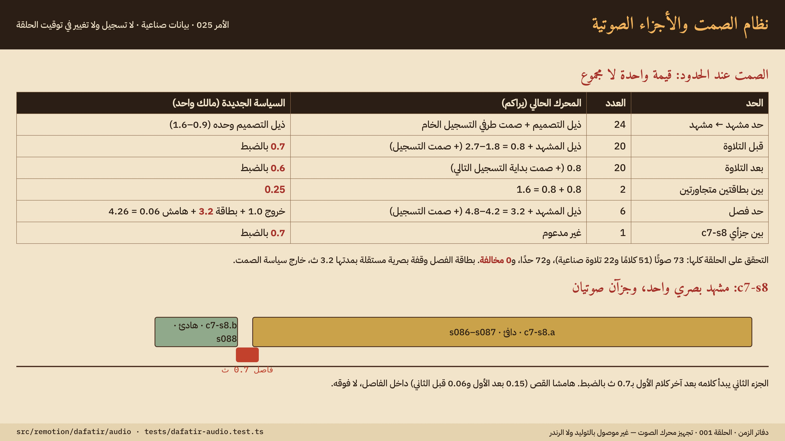

# تجهيز محرك الصوت قبل العينات — الأمر 025

**المنفّذ · ٧ نوفمبر ٢٠٢٦.** لا تسجيل ولا توليد ولا تلاوة ولا مزامنة نهائية ولا Master. V7 رفع 9 والستوري بورد وكل الإصدارات السابقة كما هي. توقيت الحلقة الإنتاجي لم يتغير: `plan.json` والمحرك المشترك لم يُمسّا.



## 1. تصحيحات التشكيل المطبقة (D2–D4)

ثلاث كلمات، حرف تشكيل واحد أو اثنان في كل منها، ولا شيء غيرها في `tashkeel.md`:

```diff
- وَلَمْ يَكُنْ سُؤَالُهُمْ اعْتِرَاضًا …        (السطر 42، D4)
+ وَلَمْ يَكُنْ سُؤَالُهُمُ اعْتِرَاضًا …
- وَعِنْدَمَا عَرَضَ اللَّهُ المَسَمَّيَاتِ …    (السطر 77، D2)
+ وَعِنْدَمَا عَرَضَ اللَّهُ المُسَمَّيَاتِ …
- … بِمَا يُسِّرَهُ لَنَا …                    (السطر 87، D3)
+ … بِمَا يَسَّرَهُ لَنَا …
```

- **تحقق قبل الكتابة:** كل سطر طابق نصه المعروض في المراجعة 024 قبل التعديل. والملف بعد حذف التشكيل مطابق لما قبله حرفًا. وعلامات الآيات الـ22 كما هي.
- **ما لم يتغير:** السكريبت (`script.md`) لم يُمس.
- **بصمة التشكيل:** `adb4de51399a900d` ← `722810009478704c`.
- **ما لا يتأثر:** بصمات مراجعة المشاهد، لأنها تُحسب من نص الخطة بلا تشكيل.

## 2. خريطة النبرة v1.2

- **المقاطع المتغيرة:** ثلاثة فقط (s016 وs029 وs032)، تغيّر فيها النص المشكول والعلامات وملاحظة النطق. والبصمة حُدّثت.
- **ما بقي ثابتًا:** المعرّفات s001–s088، والمفاتيح، والمشاهد، والأجزاء الصوتية، والحدود. المفتاح يُحسب من النص بلا تشكيل، فلم يتغير بالتصحيح.
- **الإصدارات السابقة محفوظة:** `tone-map.v1.json` (مطابق للمراجعة 023)، و`tone-map.v1.1.json` (مطابق للمراجعة 024).
- **سجل الفروق:** فيه v1 ← v1.1 ← v1.2.
- [البيانات — JSON](docs/tone-map-001-v1.2.json)، بصمته `538c42ba387aafa9`.

## 3. بنية الصوت المعزولة

**المكان:** `src/remotion/dafatir/audio/`، وهو مجال منظومة القناة. لم يُعدَّل أي ملف مشترك؛ والأوامر المفتوحة #60 و#68 و#70 و#73 و#75 و#76 تعمل على `voice/generate.ts` و`plan/duration.ts` و`plan/collect.ts` و`Episode.tsx`. الوحدات لا يستدعيها التوليد ولا الرندر بعد؛ ربطها يحتاج تنسيقًا مع أصحاب تلك الفروع.

| الوحدة | ما تفعله |
| --- | --- |
| `trim.ts` | حدود الكلام في التسجيل. تبدأ من أول إطار قوي، ثم ترجع ما دام الصوت فوق عتبة لينة (الحرف المهموس في أول الكلام)، وتتقدم في الآخر ما دام الصوت يتلاشى. ثم تترك هامشًا 0.06 ث قبل الكلام و0.15 ث بعده. `safeTrim` توسّع القص بمحاذاة الحروف ولا تضيّقه أبدًا. وفيها قارئ WAV |
| `parts.ts` | مهام التوليد من الخريطة: 52 جزءًا، منها `c7-s8.a` و`c7-s8.b`. وتوزيع الأجزاء في المشهد، ونوافذ الجمل بمعرّفاتها من محاذاة الحروف. ترفض الخريطة المعيبة: جزء بلا مقاطع، أو مقطع بلا جزء، أو مقاطع غير متتالية، أو تسجيل ناقص |
| `silence.ts` | الجدول الزمني والصمت عند كل حد بمالك واحد: الصمت = الأكبر من المقرر والحد البصري، لا مجموعهما. والقياس من مواضع الصوت الفعلية |

## 4. اختبارات المقاطع المتعددة والصمت

الاختبارات في `tests/dafatir-audio.test.ts`، 16 اختبارًا كلها ببيانات صناعية:

- **حفظ الحروف عند القص:**
  - حرف مهموس ضعيف (−36 dB، 70 ms) قبل الكلام يبقى كاملًا مع هامشه، وكذلك التلاشي بعده.
  - التسجيل الذي يبدأ بالكلام لا يُقص منه شيء، والتسجيل الصامت يُرفض.
  - المحاذاة توسّع القص ولا تضيّقه، وWAV صناعي يعطي الحدود نفسها.
- **المقاطع المتعددة:**
  - نص كل مشهد = أجزاؤه موصولة.
  - `c7-s8.b` يبدأ كلامه بعد آخر كلام `c7-s8.a` بـ0.7 ث بالضبط، وهامشا القص داخل الفاصل.
  - نوافذ الجمل مرتبة وداخل جزئها ومربوطة بمعرّفاتها، والمحاذاة غير المطابقة تُرفض.
- **منع تراكم الصمت على الحلقة كلها:**
  - 51 كلامًا و22 تلاوة صناعية مدة كل منها 6 ث، و72 حدًا: **0 مخالفة**.
  - قبل التلاوة 0.7 ث بالضبط (20 حدًا)، وبعدها 0.6 ث (20)، وبين البطاقتين المتجاورتين 0.25 ث (2).
  - كل حد قبل التلاوة أقل مما يعطيه المحرك الحالي، ولا يساوي «ذيل المشهد + 0.7».
- **بطاقة الفصل:** 3.2 ث كما هي في المواضع الستة. الصمت عندها = الخروج البصري (أو هامش التلاشي، أيهما أطول) + 3.2 + هامش البداية، ولا صمت مضاف.
- **استقرار المعرّفات:** s001–s088 والمشاهد والمفاتيح ثابتة في v1 وv1.1 وv1.2. ولا يتغير نص بين v1.1 وv1.2 إلا s016 وs029 وs032، وحروفها كما هي.

| الحد | العدد | المحرك الحالي | السياسة |
| --- | --- | --- | --- |
| مشهد ← مشهد | 24 | ذيل التصميم + صمت طرفي التسجيل الخام | ذيل التصميم وحده (0.9–1.6) |
| قبل التلاوة | 20 | ذيل المشهد + 0.8 = 1.8–2.7، وفوقه صمت التسجيل | 0.7 |
| بعد التلاوة | 20 | 0.8، وفوقه صمت بداية التسجيل | 0.6 |
| بين بطاقتين | 2 | 1.6 | 0.25 |
| حد فصل | 6 | ذيل المشهد + 3.2 = 4.2–4.8، وفوقه صمت التسجيل | 1.0 + 3.2 + 0.06 = 4.26 |
| بين جزأي c7-s8 | 1 | غير مدعوم | 0.7 |

## 5. القيود المتبقية قبل عينات الراوي

1. **الربط بالمسار الفعلي لم يتم.** التوليد اليوم تسجيل واحد لكل مشهد من نصه في الخطة، والرندر يضع التسجيل في أول المشهد ويحسب المدة بذيل ثابت. ربط `partJobs` و`layoutScene` و`buildAudioTimeline` يحتاج تعديل ملفات مشتركة تعمل عليها فروع مفتوحة، فيلزم تنسيق قبله.
2. **العينات القصيرة وحدها لا تحتاج الربط الكامل.** عينة الراوي تُقاس وتُقص بـ`trim.ts` ويُراجع قصها مستقلًا. أما مشهد `c7-s8` بجزأيه فلا يُولَّد قبل الربط.
3. **قيم الخروج البصري الأدنى** (بلا 0، تلاشٍ 0.5، قلب صفحة 1.0) افتراض هندسي. تُراجع بالنظر عند التحريك على الصوت. ومشاهد الفصول تنتهي كلها بقلب صفحة، فصمت الفصل 4.26 ث، وأغلبه وقفة البطاقة البصرية.
4. **عتبات القص مختبرة على إشارات صناعية فقط.** تُعايَر على أول عينة حقيقية، ويُستمع إلى طرفي كل تسجيل.
5. **مسودتا 022** تدمجان البطاقتين المتجاورتين. وصمت 0.25 بينهما مطبق الآن على الخطة الحالية.
6. **المؤجل بقرار:** مطابقة الآيات (0 من 22) والمسائل التفسيرية.

**Drive:** لم يُنقل؛ ملفات 025 أُضيفت إلى `tech-reviews/020/drive-upload.sh`.
