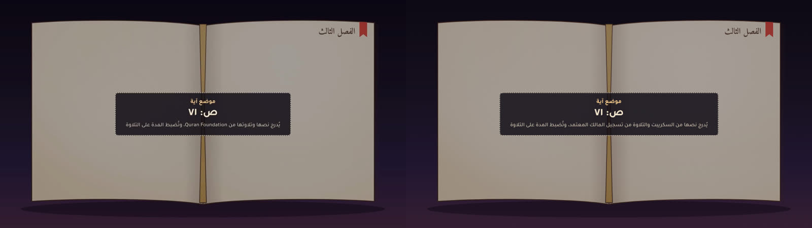
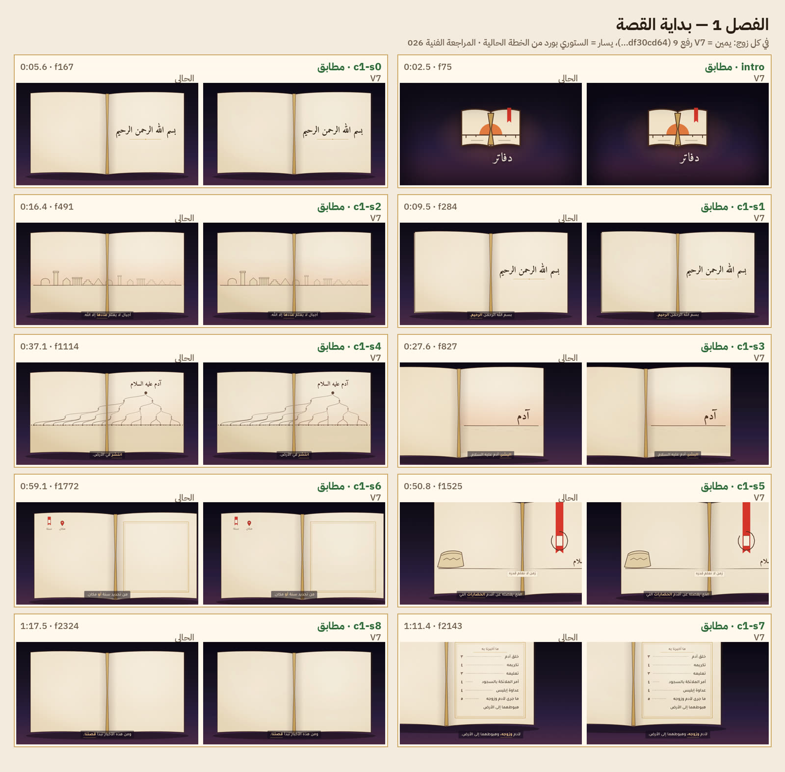
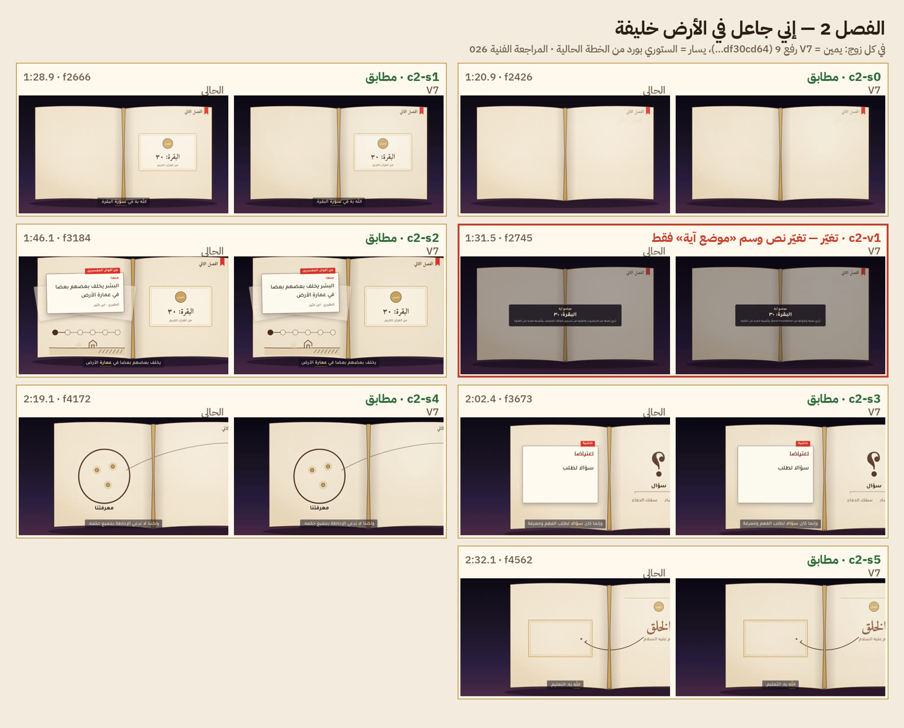
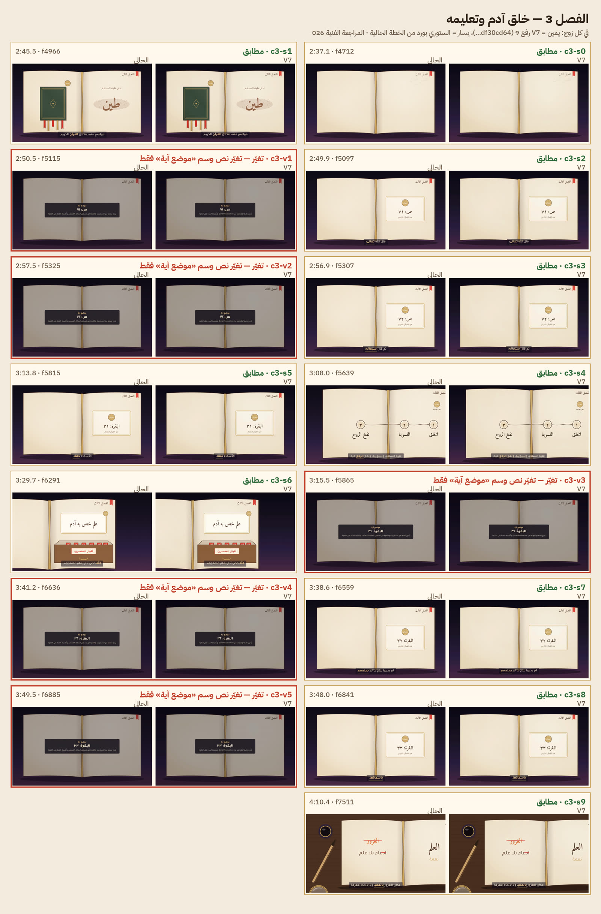
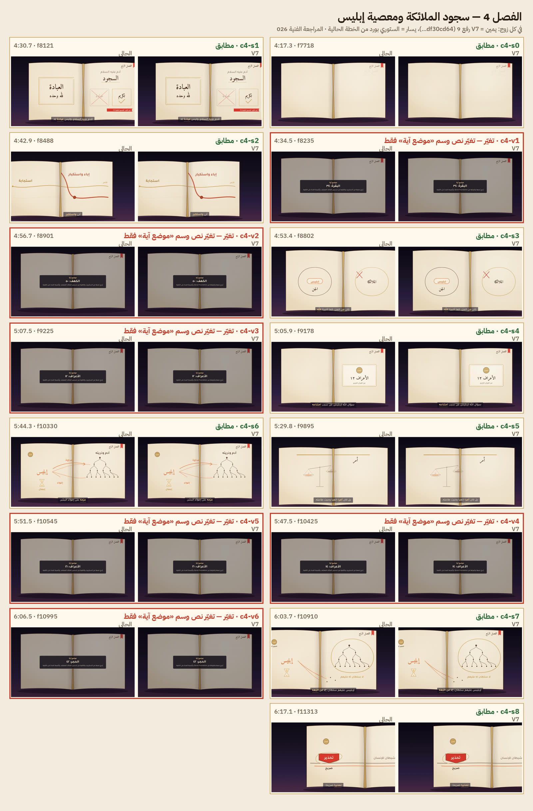
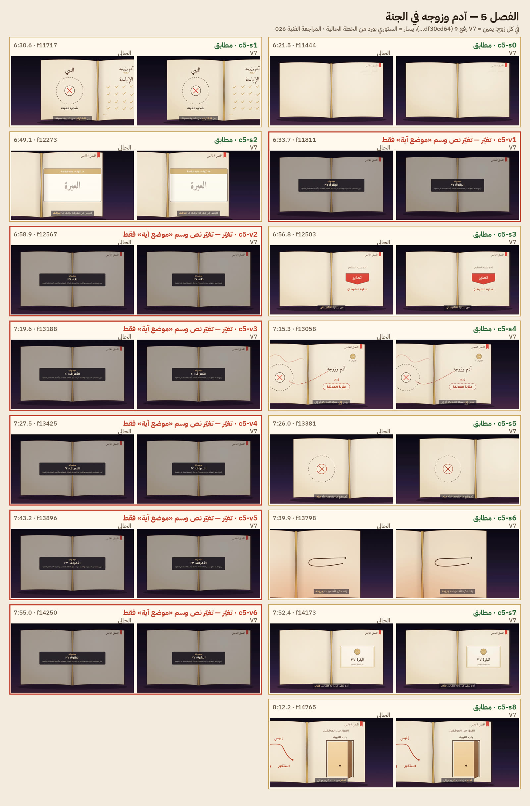
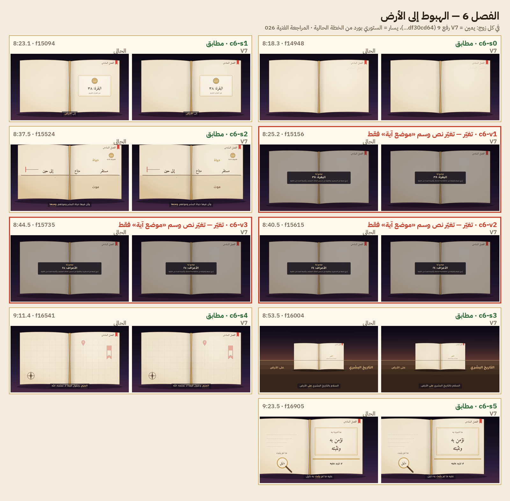
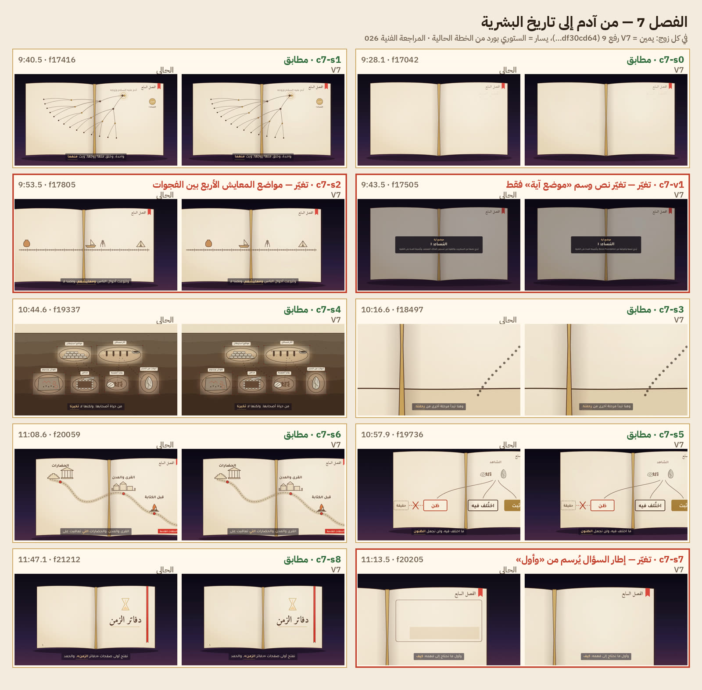

# مطابقة V7 رفع 9 مع الستوري بورد الحالي، وتنظيف المعاينات القديمة — الأمر 026

**المنفّذ · ٨ نوفمبر ٢٠٢٦.** بطلب صاحب القناة: «طابق الفيديو المرسل مع المشاهد في الستوري بورد واحذف القديم». لا رندر نهائي ولا صوت ولا تلاوة. `plan.json` و`script.md` لم يُمسّا هنا.

## الخلاصة
- **V7 لا يطابق الستوري بورد الحالي:** تغيّر **24 مشهدًا من 80**، وبقي **56 مشهدًا والافتتاحية** مطابقة، ولا مشهد جديد ولا محذوف.
- `plan.json` لم يتغير منذ V7 (البصمة نفسها)؛ الفروق كلها من تعديلات المحرك بعد V7، لا من الأوامر 020–025.
- قورن **954 إطارًا** عند رقم الإطار نفسه (لوحة كل مشهد، و25% و55% منه، وإطار كل ثانية). المطابق يختلف بأقل من 0.16% من النقاط، والمتغير بأكثر من 0.86%.

## ما تغيّر (24)
1. **مواضع الآيات الـ22:** تغيّر وسم البطاقة فقط. **V7 كان يعرض اسم مزوّد التلاوة على الشاشة في المواضع الـ22**، فلا يُرسل V7 خارج الاستوديو أبدًا (القاعدة الأولى).
2. **`c7-s2`:** المعايش الأربعة صارت بين فجوات السجل بدل أن تكون تحتها.
3. **`c7-s7`:** إطار السؤال الأول يُرسم من «وأول» بدل صفحة فارغة نحو 5 ث.



لكل فصل لوحة مقارنة (يمين V7، يسار الحالي):









## مشكلة جديدة لم تُصلح هنا
- في الخطة الحالية يقع القارب في `c7-s2` على كعب الدفتر. تُصلح مع عمل الحركة الجاري على الحلقة.

## التنظيف
- **حُذفت من المعاينات:** «نسخة المشاهدة المتصلة» (`review-proxy.mp4`) و«تفصيل E2» (`e2-detail.mp4`)، فهما أداتا مراجعة لـ V7 (الأمر 019).
- **بقيت V7 وحدها** بعنوان «قديمة — V7 قبل تعديلات ٢٠–٢٥؛ تُستبدل بمعاينة جديدة من الخطة الحالية»، حتى تُصنع معاينة صامتة جديدة على جهاز المالك.
- بقيت `plan.v1.json` و`plan.v4.json` و`six-shots-storyboard.md` لأن ملفات أخرى تشير إليها.

## ما يفعله صاحب القناة على جهازه لاستبدال V7
بعد دمج عمل الحركة والآيات الجاري:
```
cd ~/balislam
npx bal --channel dafatir-alzaman render 001
npx bal --channel dafatir-alzaman upload-preview 001 episode out/001-landscape.mp4 --title "معاينة صامتة كاملة من الخطة الحالية — جاهزة للمراجعة"
```
ملاحظة: تُعاد المطابقة بعد دمج تعديلات الخطة الجارية.
