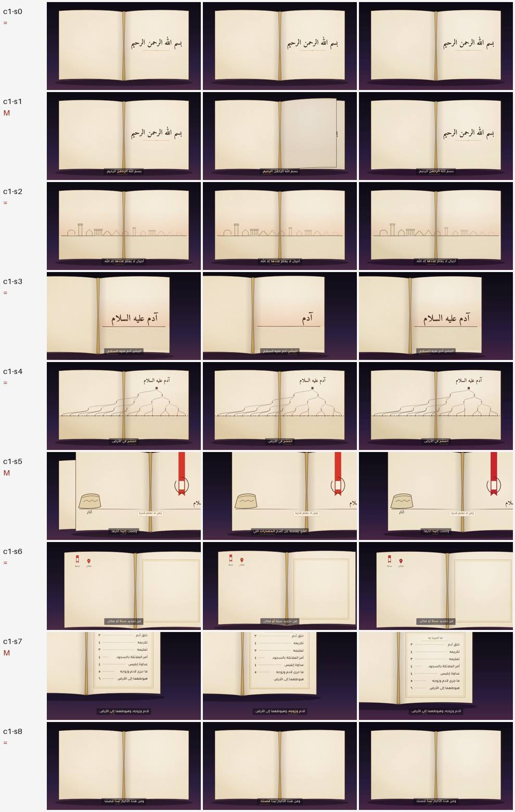
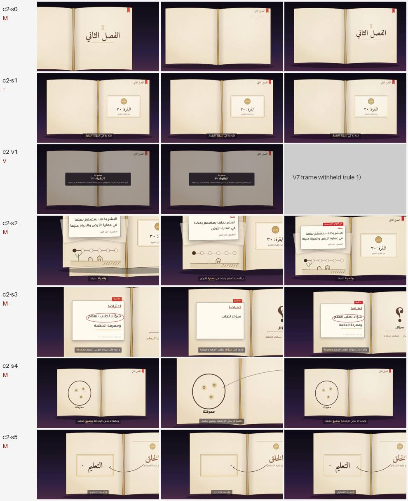
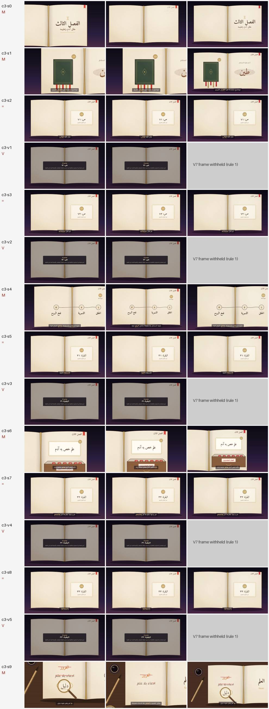
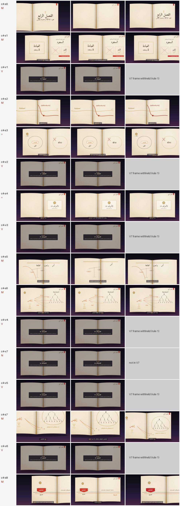
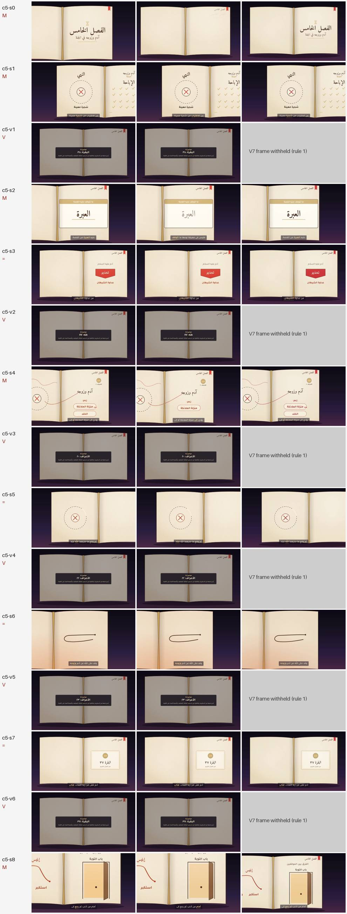
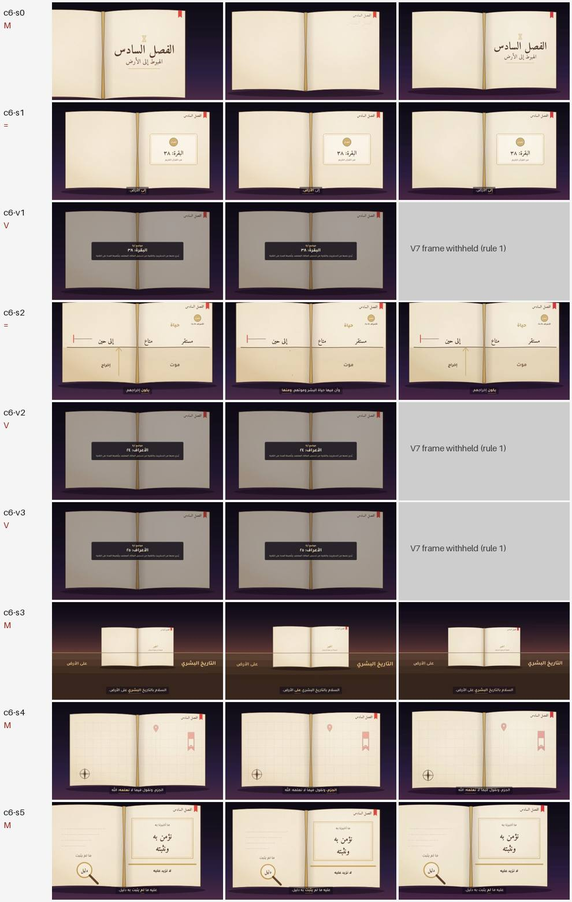
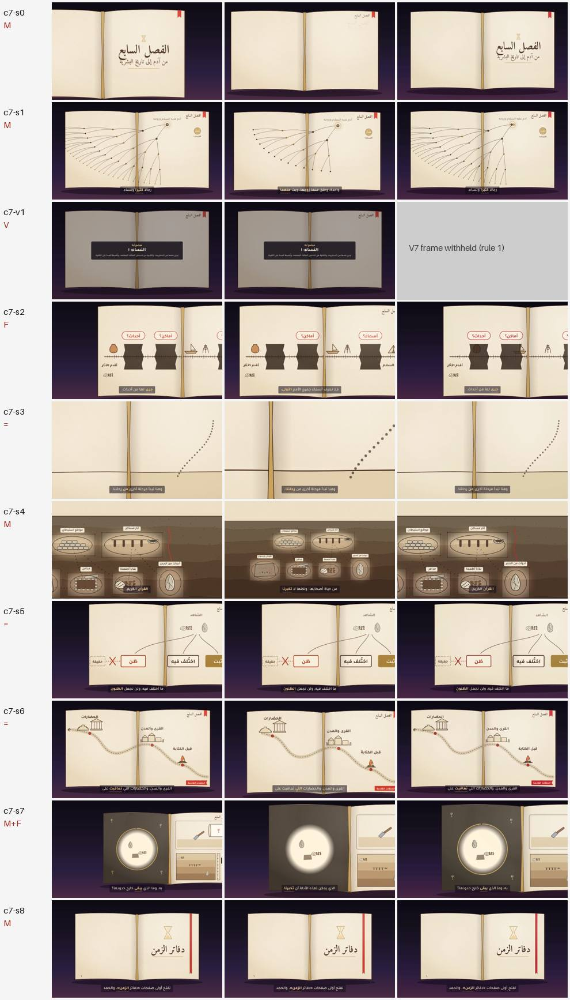

# الستوري بورد والمعاينة الكاملة: لماذا يختلفان، ولوحة كل مشهد عند اكتماله — الأمر 027

**المنفّذ · ٩ نوفمبر ٢٠٢٦.** بطلب صاحب القناة: «الستوري بورد في الاستوديو يختلف عن فيديوهات المعاينات، خصوصًا الفيديو الكامل؛ ضع نسخة الفيديو في الستوري بورد بدل الحالية». لا صوت ولا تلاوة ولا رندر للحلقة. `plan.json` و`script.md` والمحرك (رسم المشاهد) لم تُمسّ. **ليست اعتمادًا.**

## الخلاصة
- **الستوري بورد في الاستوديو لا يحفظ صورًا:** كل لوحة تُرسم حيّة من الخطة الحالية بالمحرك الحالي، عند لحظة ثابتة من المشهد. فهو دائمًا «ما سيُرندر الآن». أما المعاينة الكاملة (V7 رفع 9، `df30cd64…`) فرُندرت في ٦ نوفمبر.
- **تصميم الخطة لم يتغير منذ V7** (القوالب والمشاهد وحقولها كما هي)، إلا بطاقة الأعراف 15 `c4-v7` التي أضفتها في ٨ نوفمبر وأرقام السطور. فلا شيء يُعاد إلى الخطة من الفيديو.
- **سبب الاختلاف خمسة أشياء،** أربعة منها تعديلات مقصودة بعد V7، والخامس خطأ في اختيار لحظة اللوحة (أُصلح هنا):
  1. **حركة ٨ نوفمبر** (الإدخال «إكمال الحلقة 001 قبل خطوات المالك» في `07-decisions.md`): الخروج يبدأ عند إغلاق الفكرة، ومفاتيح كاميرا مربوطة بالكلمات، وبطاقة الفصل تقترب من عنوانها. غيّرت **34 مشهدًا**. هي التي رفعت الحركة إلى 82–96% في الفصول السبعة (كانت في V7 بين 47 و83%).
  2. **بطاقة `c4-v7` الجديدة** (+4 ث)؛ فكل ما بعدها في الستوري بورد يتأخر 4 ث عن الفيديو.
  3. **وسم «موضع آية» في 22 بطاقة:** تغيّر نصه وحده. وسم V7 يذكر اسم مزوّد التلاوة على الشاشة (يخالف القاعدة الأولى)، فلا تُنقل إطارات V7 لهذه البطاقات إلى أي شيء، ولا إلى لوحات هذه المراجعة.
  4. **إصلاحا الفصل السابع:** `c7-s2` (المعايش بين فجوات السجل) و`c7-s7` (إطار السؤال من «وأول»).
  5. **لحظة اللوحة (أُصلحت):** كانت لوحة «خط الأفق» عند 80% من المشهد. فوقعت **13 لوحة** في الخروج: عناوين الفصول الستة صفحات فارغة، و7 لوحات في قلب الصفحة أو خفوت الحبر. ووقعت **31 لوحة** قبل نطق آخر كلمة، فظهر المشهد ناقصًا (مثل `c2-s3` بلا دائرة «سؤالًا لطلب الفهم»، و`c2-s5` بلا «التعليم»). أي 44 لوحة من 81 لا تعرض المشهد كما يراه المشاهد.

## ما تغيّر
- **لحظة لوحة «خط الأفق»** (`shotFrame` في `src/plan/storyboardView.ts`): عند اكتمال آخر كلمة، قبل الخروج. +0.25 ث بعد آخر كلمة للخفوت وبلا خروج، و+0.03 ث للقلب (الكادر يعود قبل القلب بعد 0.05 ث). وعنوان الفصل في منتصفه. بطاقة الآية (55%) وقوالب القناتين الأخريين (80%) كما هي. بصوت الراوي تُحسب من نهاية آخر كلمة في الصوت، كما يفعل المشهد نفسه.
- **إعادة فتح الستوري بورد:** لحظة اللوحة دخلت بصمة الستوري بورد البصرية لمشاهد «خط الأفق» وحدها (`HORIZON_BOARD_VIEW`). فأي سجل مراجعة لوحات سابق يظهر «تغيّر» لهذه المشاهد، ويلزم سجل جديد واعتماد جديد بكلمة مرورك قبل إنتاج المشاهد. لا اعتماد مسجل في المستودع، ولم يُعتمد شيء نيابة عنك.
- **لوحات قابلة للإعادة من الخطة:** `npx bal --channel dafatir-alzaman storyboard 001 --stills` يرندر لوحة لكل مشهد من تكوين الحلقة نفسه عند لحظتها (صامتة، توقيت تقديري، 640 بكسل، نحو 1.5 م.ب للحلقة). تُكتب في `storyboard-stills/` بجوار السكريبت، خارج Git، ومعها بيان ببصمة الخطة والمحرك. `--check-stills` يقول هل هي ما سيُرندر الآن. البيان بصيغة مصدّر PDF المشترك، فيمكن بناء PDF ستوري بورد جديد من الخطة الحالية بدل v1.1 (المبني من V7). لم يُبنَ PDF هنا.
- **لم يُضف عرض مقطع V7 لكل مشهد في الستوري بورد:** 57 مشهدًا من 81 لا تطابقه، و22 منها فيها الوسم المخالف. عرضه يعيد التناقض نفسه.

## النتيجة مشهدًا مشهدًا (81 مشهدًا والافتتاحية)
قورنت 726 لقطة: الحالي، والمحرك كما كان عند المراجعة 026، وV7، كل منها عند لوحة كل مشهد قبل الإصلاح وبعده ومنتصفه. السبب يُحسم بمقارنة رندرين بلا ضغط، فالفرق الصفري يعني أن المحرك لم يتغير في هذا المشهد.

| الحالة مقابل V7 | العدد | قبل → بعد (وسيط فرق البكسلات عن V7) |
|---|---|---|
| مطابق (الافتتاحية و23 مشهدًا) | 24 | 0.13% → 0.12% |
| نص الوسم وحده (بطاقات الآيات) | 22 | 2.5% → 2.5% |
| تغيّر بحركة ٨ نوفمبر (منها `c7-s7` مع إصلاحه) | 34 | 9.8% → 5.3% (أقصاه 56%) |
| إصلاح الفصل السابع وحده (`c7-s2`) | 1 | 1.7% → 1.0% |
| جديد بعد V7 (`c4-v7`) | 1 | — |

**بعد الإصلاح:** كل لوحات «خط الأفق» بعد آخر كلمة وقبل الخروج (0 من 44 خاطئة؛ الاختبار يفرضه على الحلقة كلها). **ولا تتطابق اللوحات مع V7 في 57 مشهدًا،** لأن الفرق في التعديلات بعد V7 لا في اللوحة. الفيديو هو القديم: تطابقهما يحتاج معاينة صامتة جديدة من الخطة الحالية، أو إرجاع حركة ٨ نوفمبر (سؤال 1).

- **مطابق:** `c1-s0` `c1-s2` `c1-s3` `c1-s4` `c1-s6` `c1-s8` `c2-s1` `c3-s2` `c3-s3` `c3-s5` `c3-s7` `c3-s8` `c4-s3` `c4-s4` `c5-s3` `c5-s5` `c5-s6` `c5-s7` `c6-s1` `c6-s2` `c7-s3` `c7-s5` `c7-s6`.
- **حركة ٨ نوفمبر:** `c1-s1` `c1-s5` `c1-s7` `c2-s0` `c2-s2` `c2-s3` `c2-s4` `c2-s5` `c3-s0` `c3-s1` `c3-s4` `c3-s6` `c3-s9` `c4-s0` `c4-s1` `c4-s2` `c4-s5` `c4-s6` `c4-s7` `c4-s8` `c5-s0` `c5-s1` `c5-s2` `c5-s4` `c5-s8` `c6-s0` `c6-s3` `c6-s4` `c6-s5` `c7-s0` `c7-s1` `c7-s4` `c7-s7` `c7-s8`.

## اللوحات
لكل فصل لوحة. **يمين:** V7 عند لحظة اللوحة الجديدة. **وسط:** الستوري بورد قبل الإصلاح. **يسار:** الستوري بورد بعده. علامة كل صف: `=` مطابق، `M` حركة ٨ نوفمبر، `V` وسم الآية (إطار V7 محجوب)، `F` إصلاح الفصل السابع، `N` جديد.

## أسئلة لصاحب القناة
1. **حركة ٨ نوفمبر في 34 مشهدًا:** تبقى (وبها الحركة 82–96%)، أم تريد شكل V7 في مشاهد بعينها؟ سمِّها. إرجاعها كلها يعيد ستة فصول تحت 80% (القاعدة الثانية)، فلم يُرجَع شيء دون قرارك.
2. **استبدال V7:** معاينة صامتة جديدة من الخطة الحالية على جهازك (`npx bal --channel dafatir-alzaman render 001` ثم `upload-preview 001 episode …`) تجعل الفيديو = الستوري بورد. هل نمضي فيها بدل أي إرجاع؟
3. **PDF ستوري بورد جديد** من لوحات الخطة الحالية (`--stills`) بدل v1.1 المبني من V7، وفيه لوحة `c4-v7`؟
4. **ربط اعتماد الستوري بورد بالمحرك:** الاعتماد مربوط بمحتوى الخطة، فتعديل المحرك (مثل ٨ نوفمبر) يغيّر اللوحات دون أن يعيد فتحه. هل يُربط ببصمة المحرك؟ عيبه أن كل تعديل في رسم المشاهد سيعيد فتحه.

## خطوتك
- افتح «الستوري بورد» وراجع اللوحات. سجل المراجعة السابق، إن وُجد على جهازك، يظهر «تغيّر» لمشاهد «خط الأفق». سجّل ملاحظتك ثم اعتمد بكلمة مرورك.
- ثم استبدل V7 بمعاينة صامتة من الخطة الحالية (السؤال 2).
