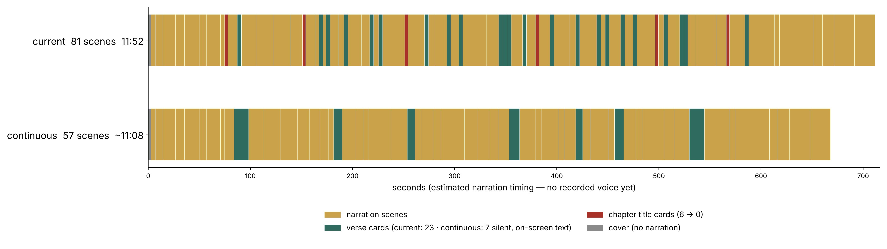

# تحويل الحلقة 001 إلى سرد وثائقي متصل — خطة مقارنة (الأمر 026)

**المنفّذ · ١٠ نوفمبر ٢٠٢٦ · الحالة: خطة للمراجعة، لم يُنفَّذ منها شيء.**

لم يُعدَّل شيء من الأصول، وكلها محفوظة كما هي: `plan.json`، و`script.md`، و`tashkeel.md`، وTone Map v1.2، وV7، والستوري بورد وإصداراته. لا رندر ولا صوت ولا اعتماد.

- [الخطة المقترحة كاملة — JSON](docs/continuous-plan-proposal.json): ترتيب المشاهد ومددها، والمزال، وخريطة البطاقات إلى الآيات.

## 1. الخلاصة

| البند | الحالي | السرد المتصل |
| --- | --- | --- |
| المشاهد | 81 | **57** |
| مشاهد السرد | 51 | 49 (يُحذف تمهيدا تلاوة لا معنى لهما بلا آية) |
| بطاقات الآيات | 23 (تلاوة مسموعة لاحقًا) | **7** (نص الآية على الشاشة، صامتة، بلا تلاوة) |
| بطاقات الفصول | 6 (`c2-s0` … `c7-s0`) | **0** |
| رأس «الفصل …» أعلى الصفحة | 68 مشهدًا (65 في الخطة و3 في الكود) | **0** |
| أرقام الفصول في فهرس `c1-s7` و`c1-s8` | ٣–٦ بجوار كل خبر | **تُحذف الأرقام وتبقى الأخبار** |
| المدة المتوقعة | 11:52 | **≈ 11:08** |

**طريقة حساب المدة:** بتوقيت المحرك التقديري، لأن صوت الراوي لم يُسجَّل بعد. والآيات المعروضة تأخذ زمن قراءة: 1.5 ث + عدد الكلمات ÷ 2.2، ولا يقل عن 4 ث، وهذا يعطي 70.9 ث للسبع.
- إن بقيت الآيات المعروضة على 4 ث، فالمدة ≈ 10:25.
- وتُحسب المدة النهائية من صوت الراوي الحقيقي بعد تسجيله.

## 2. ما يُزال وما يبقى

**يُزال من النسخة الجديدة فقط:**
- بطاقات الفصول الست، ورأس الفصل في كل صفحة، وأرقام الفصول في الفهرس.
- 16 بطاقة آية (الجدول ٥).
- مشهدا التمهيد `c3-s2` «قال الله تعالى:» و`c3-s3` «ثم قال سبحانه:».
- كل تلاوة مسموعة.

**يبقى دون تغيير:**
- تصميم الكتاب المفتوح، والألوان، والخطوط، والخلفيات، والهوية، والكاميرا، والحركة.
- المشاهد المصمَّمة الـ49 كلها بلقطاتها، ومنها إصلاحات التأطير (D48).
- الغلاف `c1-s0` والبسملة `c1-s1` وكل محتوى الفصلين الأول والثاني.
- معرّفات المشاهد (`c1-s2` …) لتبقى روابط خريطة النبرة والمصادر صالحة.
- سجل التوثيق بمراجعه الـ23 كلها (`source-audit.md`).

**الانتقال بين الأحداث:** حيث كانت بطاقة الفصل، يصير الانتقال قلب الصفحة الذي ينتهي به المشهد السابق أصلًا، أي خروج «turn» القائم. لا انتقال جديد ولا عنصر جديد.

## 3. الاستشهادات القرآنية السبعة المقترحة

بطاقة الآية نفسها كما هي، ونص الآية من السكريبت على الشاشة دون تلاوة. هذا سكون مقصود مستثنى من قياس الحركة. والراوي لا يقرأ الآية (القاعدة الثابتة).

| # | البطاقة | الآية | لماذا هي |
| --- | --- | --- | --- |
| 1 | `c2-v1` | البقرة 30 | إعلان الخلافة، أساس القصة كلها |
| 2 | `c3-v3` | البقرة 31 | تعليم الأسماء، أعظم ما خُصّ به آدم |
| 3 | `c4-v1` | البقرة 34 | السجود وإباء إبليس، الحدث المحوري |
| 4 | `c5-v1` | البقرة 35 | السكنى في الجنة والنهي، أصل الاختبار |
| 5 | `c5-v5` | الأعراف 23 | دعاء التوبة «ربنا ظلمنا أنفسنا»، قلب الحلقة |
| 6 | `c6-v1` | البقرة 38 | الهبوط ووعد الهدى، الانتقال إلى الأرض |
| 7 | `c7-v1` | النساء 1 | الأصل الواحد للبشرية، جسر إلى تاريخ الإنسان |

**بدائل للاستبدال بقرارك:** الأعراف 12 (حجة إبليس «أنا خير منه»)، أو ص 72 (نفخ الروح)، أو البقرة 37 (قبول التوبة).

**شرط العرض:** نص الآية على الشاشة يحتاج مطابقة بالمصحف قبل النسخة النهائية. المطابقة مؤجلة بقرار سابق، والتوثيق 0 من 22. وسطر الإنتاج الداخلي في البطاقة الحالية («يُدرج نصها من السكريبت…») يُستبدل بنص الآية.

## 4. الجمل المقترح تعديلها — للموافقة، لم يُعدَّل شيء

| المشهد | النص الحالي | المقترح | السبب |
| --- | --- | --- | --- |
| `c3-s2` | قال الله تعالى: | **يُحذف المشهد** | تمهيد لتلاوة ص 71 التي لن تُعرض ولن تُسمع، وليس فيه معنى غير التمهيد |
| `c3-s3` | ثم قال سبحانه: | **يُحذف المشهد** | تمهيد لتلاوة ص 72 |
| `c3-s4` | وفي هذه الآيات خبر خلق آدم عليه السلام، وتسويته، ونفخ الروح فيه. | وفي سورة ص خبر خلق آدم عليه السلام، وتسويته، ونفخ الروح فيه. | «هذه الآيات» تشير إلى آيات لم تعد تُعرض |
| `c4-s6` | … وقد ذكر القرآن الكريم أن إبليس سأل الله أن يمهله، وأنه أعلن عزمه على إغواء البشر. | … أن إبليس سأل الله أن يمهله **فأمهله**، وأنه أعلن عزمه على إغواء البشر. | إمهال الله لإبليس (الأعراف 15) كان في البطاقة وحدها، فلا يضيع المعنى |
| `c5-s5` | ثم وقع ما حذرهما الله منه. | ثم وقع ما حذرهما الله منه، **فأكلا من الشجرة**. | الحدث نفسه (الأعراف 22) كان في البطاقة وحدها، والجملة الحالية لا تذكره |
| `c5-s1` | خلق الله لآدم زوجه، وأسكنهما الجنة… | **و**خلق الله لآدم زوجه، وأسكنهما الجنة… | كانت أول جملة بعد بطاقة فصل، فصارت تتلو التحذير مباشرة |
| `c6-s1` | أخبرنا الله أن آدم وزوجه هبطا إلى الأرض. | **ثم** أخبرنا الله أن آدم وزوجه هبطا إلى الأرض. | كانت بداية فصل. «ثم» تصل التوبة بالهبوط كما في ترتيب البقرة 37–38 |
| `c7-s1` | بدأ نسل البشر من آدم عليه السلام وزوجه. … | **ومن آدم عليه السلام وزوجه بدأ نسل البشر.** … | كانت بداية فصل (اختياري) |

**جمل مراجَعة تبقى كما هي:**
- `c1-s8` و`c2-s1` و`c2-s5` (جسر «الخلق ← التعليم» حدثًا لا عنوان فصل)، و`c3-s1` و`c4-s1` و`c4-s3` و`c4-s4` و`c4-s7` و`c5-s3` و`c5-s4` و`c5-s7` و`c6-s2` و`c7-s3`: تتصل دون تعديل.
- `c2-s1` و`c3-s5` و`c4-s1` و`c5-s1` و`c5-s6` («دعاءهما:») و`c6-s1` و`c7-s1` تبقى تمهيدًا لآية معروضة.

التعديلان في `c4-s6` و`c5-s5` معنى قرآني بصيغة الراوي، فيحتاجان مراجعتك أو المراجع المؤهل. وكل تعديل يُعتمد يُشكَّل ويُضاف إلى خريطة النبرة إصدارًا جديدًا، ويبقى v1.2.

## 5. البطاقات المزالة وأين بقي معناها في السرد

لا يضيع حدث ولا معنى. كل آية مزالة يحملها مشهد سرد قائم، إلا اثنتين يحتاجان التعديل في الجدول ٤.

| البطاقة | الآية | يحمل معناها |
| --- | --- | --- |
| `c3-v1` | ص 71 | `c3-s1` «خلق الله آدم عليه السلام من طين»، و`c3-s4` (مُعدَّلة) |
| `c3-v2` | ص 72 | `c3-s4` «وتسويته، ونفخ الروح فيه»، و`c4-s1` (السجود) |
| `c3-v4` | البقرة 32 | `c3-s7` «لم يدعوا علم ما لم يعلمهم الله» |
| `c3-v5` | البقرة 33 | `c3-s8` و`c3-s9` «أظهر الله لملائكته ما علمه لآدم» |
| `c4-v2` | الكهف 50 | `c4-s3` «كان من الجن، كما أخبرنا الله في سورة الكهف»، و`c4-s8` (التحذير) |
| `c4-v3` | الأعراف 12 | `c4-s4` (سؤال الله لإبليس)، و`c4-s5` «خلقه من نار… من طين» |
| `c4-v4` | الأعراف 14 | `c4-s6` «سأل الله أن يمهله» |
| `c4-v7` | الأعراف 15 | `c4-s6` بالتعديل المقترح «فأمهله» — **كان معناها في البطاقة وحدها** |
| `c4-v5` | الأعراف 16 | `c4-s6` «أعلن عزمه على إغواء البشر» |
| `c4-v6` | الحجر 42 | `c4-s7` بنصها تقريبًا |
| `c5-v2` | طه 117 | `c5-s3` «حذر الله آدم من عداوة الشيطان» |
| `c5-v3` | الأعراف 20 | `c5-s4` «أغراهما بما زعم أنه يؤدي إلى منزلة الملائكة أو إلى الخلد» |
| `c5-v4` | الأعراف 22 | `c5-s5` بالتعديل المقترح «فأكلا من الشجرة» — **كان الحدث في البطاقة وحدها** |
| `c5-v6` | البقرة 37 | `c5-s7` «تلقى من ربه كلمات، فتاب عليه» |
| `c6-v2` | الأعراف 24 | `c6-s2` «في الأرض مستقرا ومتاعا إلى حين» |
| `c6-v3` | الأعراف 25 | `c6-s2` «فيها حياة البشر وموتهم، ومنها يكون إخراجهم» |

## 6. ترتيب المشاهد الجديد (57 مشهدًا، بلا فصول)

| # | المشهد | يبدأ | المدة ث | السرد / النوع | ملاحظة |
| --- | --- | --- | --- | --- | --- |
| 1 | `c1-s0` | 0:00.0 | 2.6 | — |  |
| 2 | `c1-s1` | 0:02.6 | 4.2 | بسم الله الرحمن الرحيم. |  |
| 3 | `c1-s2` | 0:06.8 | 7.6 | عرفت الأرض أمما كثيرة، وتعاقبت فيها أجيال لا يعلم عددها إلا الله. |  |
| 4 | `c1-s3` | 0:14.4 | 12.1 | ولكن رحلتنا هذه لا تبدأ من مدينة قديمة، ولا من مملكة نسي الناس اسمها… |  |
| 5 | `c1-s4` | 0:26.5 | 8.9 | من أول إنسان خلقه الله سبحانه وتعالى، ومنه بدأ نسل البشر الذي انتشر … |  |
| 6 | `c1-s5` | 0:35.4 | 14.9 | ولا نملك تاريخا ثابتا لخلق آدم عليه السلام. فلم يخبرنا القرآن الكريم… |  |
| 7 | `c1-s6` | 0:50.3 | 6.6 | ولكن الله أخبرنا بما هو أعظم من تحديد سنة أو مكان. |  |
| 8 | `c1-s7` | 0:56.9 | 13.8 | أخبرنا عن خلق آدم، وتكريمه، وتعليمه، وعن أمر الملائكة بالسجود له، وع… |  |
| 9 | `c1-s8` | 1:10.7 | 4.1 | ومن هذه الأخبار نبدأ قصتنا. |  |
| 10 | `c2-s1` | 1:14.8 | 9.2 | قبل أن نتحدث عن حياة آدم عليه السلام، نقف عند ما أخبرنا الله به في س… |  |
| 11 | `c2-v1` | 1:24.0 | 14.2 | آية معروضة (صامتة) | البقرة 30 — نص الآية على الشاشة بلا تلاوة |
| 12 | `c2-s2` | 1:38.2 | 14.3 | أخبر الله ملائكته أنه جاعل في الأرض خليفة. وقد ذكر المفسرون في معنى … |  |
| 13 | `c2-s3` | 1:52.5 | 16.8 | وسألت الملائكة ربها عن جعل من يكون منه الفساد وسفك الدماء، مع أنهم ي… |  |
| 14 | `c2-s4` | 2:09.3 | 16.6 | فأجابهم الله بأنه يعلم ما لا يعلمون. إن معرفتنا محدودة، وعلم الله مح… |  |
| 15 | `c2-s5` | 2:25.9 | 12.1 | وبعد هذا الإخبار، يحدثنا القرآن الكريم عن خلق آدم عليه السلام، ثم عن… |  |
| 16 | `c3-s1` | 2:38.0 | 9.8 | خلق الله آدم عليه السلام من طين. وقد جاء ذكر خلقه في مواضع متعددة من… |  |
| 17 | `c3-s4` | 2:47.8 | 8.4 | وفي هذه الآيات خبر خلق آدم عليه السلام، وتسويته، ونفخ الروح فيه. | تعديل مقترح (الجدول ٤) |
| 18 | `c3-s5` | 2:56.2 | 5.3 | ثم أخبرنا الله بأنه علم آدم الأسماء كلها. |  |
| 19 | `c3-v3` | 3:01.5 | 8.3 | آية معروضة (صامتة) | البقرة 31 — نص الآية على الشاشة بلا تلاوة |
| 20 | `c3-s6` | 3:09.8 | 13.5 | وقد اختلف المفسرون في تفصيل المقصود بالأسماء، وذكروا في ذلك أقوالا م… |  |
| 21 | `c3-s7` | 3:23.3 | 7.8 | وعندما عرض الله المسميات على الملائكة، لم يدعوا علم ما لم يعلمهم الله. |  |
| 22 | `c3-s8` | 3:31.1 | 4.8 | ثم أمر الله آدم أن ينبئهم بأسمائها. |  |
| 23 | `c3-s9` | 3:35.9 | 21.7 | وهكذا أظهر الله لملائكته ما علمه لآدم عليه السلام. ونتعلم من هذا الم… |  |
| 24 | `c4-s1` | 3:57.6 | 16.0 | بعد أن خلق الله آدم عليه السلام، أمر الملائكة أن يسجدوا له. وكان هذا… |  |
| 25 | `c4-v1` | 4:13.6 | 7.4 | آية معروضة (صامتة) | البقرة 34 — نص الآية على الشاشة بلا تلاوة |
| 26 | `c4-s2` | 4:21.0 | 6.3 | استجابت الملائكة لأمر ربها. ولكن إبليس أبى واستكبر. |  |
| 27 | `c4-s3` | 4:27.3 | 11.5 | ومن المهم هنا أن نعرف أن إبليس لم يكن من الملائكة. بل كان من الجن، ك… |  |
| 28 | `c4-s4` | 4:38.8 | 7.8 | وقد جاء في سورة الأعراف خبر سؤال الله لإبليس عن سبب امتناعه عن السجود. |  |
| 29 | `c4-s5` | 4:46.6 | 22.9 | فقدم إبليس ما ظنه حجة، حين رأى أن خلقه من نار يجعله أفضل من آدم الذي… |  |
| 30 | `c4-s6` | 5:09.5 | 13.0 | وهكذا أصبح إبليس عدوا لآدم وذريته. وقد ذكر القرآن الكريم أن إبليس سأ… | تعديل مقترح (الجدول ٤) |
| 31 | `c4-s7` | 5:22.5 | 11.1 | وفي مقابل هذا الوعيد، أخبر الله في سورة الحجر أن عباده ليس لإبليس عل… |  |
| 32 | `c4-s8` | 5:33.6 | 9.0 | ومن هنا نفهم أن عداوة الشيطان للإنسان قديمة، وأن القرآن يحذرنا منها … |  |
| 33 | `c5-s1` | 5:42.6 | 10.8 | خلق الله لآدم زوجه، وأسكنهما الجنة. وأباح لهما أن يأكلا منها، ونهاهم… | تعديل مقترح (الجدول ٤) |
| 34 | `c5-v1` | 5:53.4 | 10.1 | آية معروضة (صامتة) | البقرة 35 — نص الآية على الشاشة بلا تلاوة |
| 35 | `c5-s2` | 6:03.5 | 15.5 | ولم يسم القرآن الكريم نوع تلك الشجرة. ولذلك لا نجزم بأنها شجرة تفاح،… |  |
| 36 | `c5-s3` | 6:19.0 | 5.7 | وقد حذر الله آدم عليه السلام من عداوة الشيطان. |  |
| 37 | `c5-s4` | 6:24.7 | 16.7 | ولكن إبليس وسوس إلى آدم وزوجه، وسعى إلى إيقاعهما فيما نهاهما الله عن… |  |
| 38 | `c5-s5` | 6:41.4 | 5.7 | ثم وقع ما حذرهما الله منه. | تعديل مقترح (الجدول ٤) |
| 39 | `c5-s6` | 6:47.1 | 11.3 | ولكن آدم عليه السلام لم يصر على معصيته، بل رجع إلى ربه. وقد حكى الله… |  |
| 40 | `c5-v5` | 6:58.4 | 7.0 | آية معروضة (صامتة) | الأعراف 23 — نص الآية على الشاشة بلا تلاوة |
| 41 | `c5-s7` | 7:05.4 | 7.8 | وفي سورة البقرة، أخبرنا الله أن آدم تلقى من ربه كلمات، فتاب عليه. |  |
| 42 | `c5-s8` | 7:13.2 | 17.7 | وهنا يظهر الفرق بين الموقفين: فإبليس استكبر وأصر، وآدم عليه السلام ت… |  |
| 43 | `c6-s1` | 7:30.9 | 5.5 | أخبرنا الله أن آدم وزوجه هبطا إلى الأرض. | تعديل مقترح (الجدول ٤) |
| 44 | `c6-v1` | 7:36.4 | 9.2 | آية معروضة (صامتة) | البقرة 38 — نص الآية على الشاشة بلا تلاوة |
| 45 | `c6-s2` | 7:45.6 | 11.6 | وفي سورة الأعراف، جاء بيان أن في الأرض مستقرا ومتاعا إلى حين، وأن في… |  |
| 46 | `c6-s3` | 7:57.2 | 7.1 | ومن هنا تتصل قصة آدم عليه السلام بالتاريخ البشري على الأرض. |  |
| 47 | `c6-s4` | 8:04.3 | 20.6 | وأما موضع هبوطه، فقد اشتهرت فيه روايات مختلفة، ولا نعلم نصا صحيحا صر… |  |
| 48 | `c6-s5` | 8:24.9 | 10.0 | وما أخبرنا الله به عن آدم نؤمن به ونثبته، دون أن نزيد عليه ما لم يثب… |  |
| 49 | `c7-s1` | 8:34.9 | 14.8 | بدأ نسل البشر من آدم عليه السلام وزوجه. وأخبرنا الله في سورة النساء … | تعديل مقترح (الجدول ٤) |
| 50 | `c7-v1` | 8:49.7 | 14.7 | آية معروضة (صامتة) | النساء 1 — نص الآية على الشاشة بلا تلاوة |
| 51 | `c7-s2` | 9:04.4 | 25.0 | ومع تعاقب الأجيال، امتد التاريخ البشري، وتنوعت أحوال الناس ومعايشهم.… |  |
| 52 | `c7-s3` | 9:29.4 | 5.1 | وهنا تبدأ مرحلة أخرى من رحلتنا. |  |
| 53 | `c7-s4` | 9:34.5 | 33.7 | فإلى جانب ما أخبرنا الله به، هناك شواهد مادية درسها الباحثون للتعرف … |  |
| 54 | `c7-s5` | 10:08.2 | 8.2 | ولذلك سنذكر منها ما ثبت، ونبين ما اختلف فيه، ولن نجعل الظنون حقائق. |  |
| 55 | `c7-s6` | 10:16.4 | 11.4 | ومع تقدم حلقاتنا، سنتعرف إلى أحوال البشر قبل الكتابة، ثم إلى نشأة ال… |  |
| 56 | `c7-s7` | 10:27.8 | 20.1 | وأول ما نحتاج إلى فهمه: كيف يعرف الباحثون شيئا عن حياة قوم لم يتركوا… |  |
| 57 | `c7-s8` | 10:47.9 | 20.1 | هذا ما سنبدأ به في الحلقة القادمة من «قصة الإنسان عبر الزمن». أما ال… |  |

**المجموع ≈ 11:08.0.** المشاهد المعدَّل نصها تقديرها شامل للكلمات المضافة.

## 7. التنفيذ بعد موافقتك (لا يبدأ قبلها)

1. **خطة جديدة `plan.continuous.json`،** والخطة الحالية محفوظة. ثم تُعتمد بعد مراجعتك في الاستوديو.
2. **بنية الخطة:** حلقة واحدة بلا فصول ظاهرة. خياران:
   - (أ) فصل واحد يضم كل المشاهد.
   - (ب) أن تبقى المجموعات داخل البيانات للمصادر وخريطة النبرة، بلا أي أثر على الشاشة.

   أوصي بـ (ب) لأنها لا تكسر روابط خريطة النبرة.
3. **ما يُعدَّل:**
   - **في الخطة:** حذف `head` من 65 مشهدًا، وحذف البطاقات المزالة ومشهدي التمهيد.
   - **في كود القناة:** إخفاء رأس الفصل المكتوب في 3 لقطات (`shots.tsx`)، وأرقام الفهرس في `c1-s7` و`c1-s8`، ووسوم مراجع الآيات غير المعروضة في مشاهد السرد.
4. **ما لا يُعدَّل:** لا تغيير في الهوية ولا في أي ملف مشترك.
5. **بعد ذلك:**
   - ستوري بورد جديد من الخطة الجديدة.
   - مراجعة كل مشهد تغيّر انتقاله، إطارًا كل نصف ثانية.
   - تعديلات السكريبت المعتمدة تُطبَّق بإصدار جديد للسكريبت والتشكيل وخريطة النبرة.
   - ثم صوت الراوي.

## 8. قرارات مطلوبة منك

1. **الآيات السبع:** الموافقة عليها، أو استبدال بديل بأيٍّ منها.
2. **الآيات المعروضة:** صامتة بنصها على الشاشة كما اقترحت، أم يُكتفى بوسم المرجع دون نص؟
3. **تعديلات الجدول ٤:** الثمانية، ومنها حذف `c3-s2` و`c3-s3`.
4. **بنية الخطة:** الخيار (أ) أو (ب).
