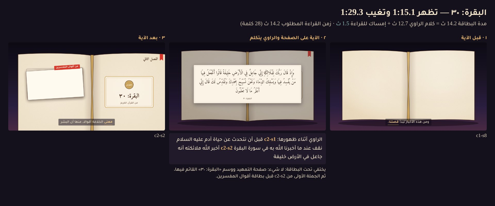
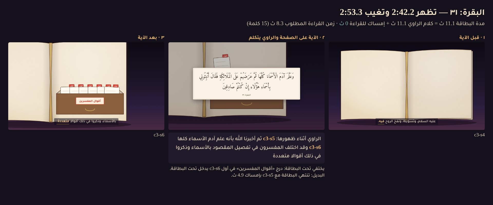
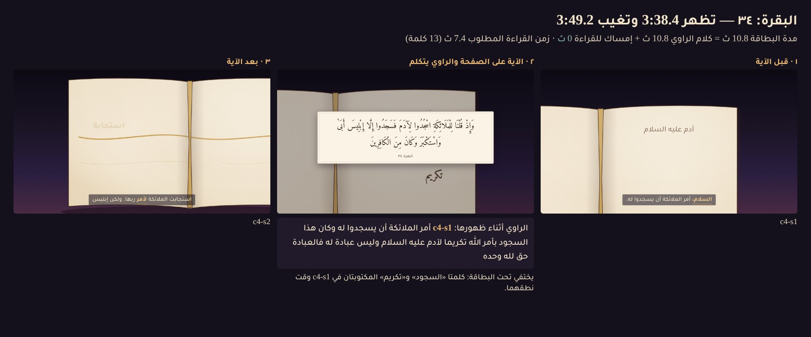
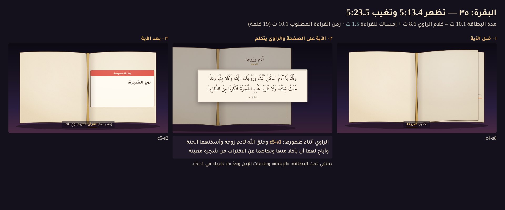
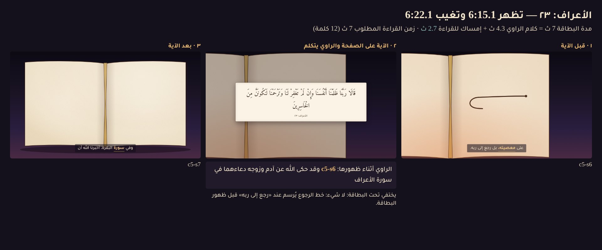
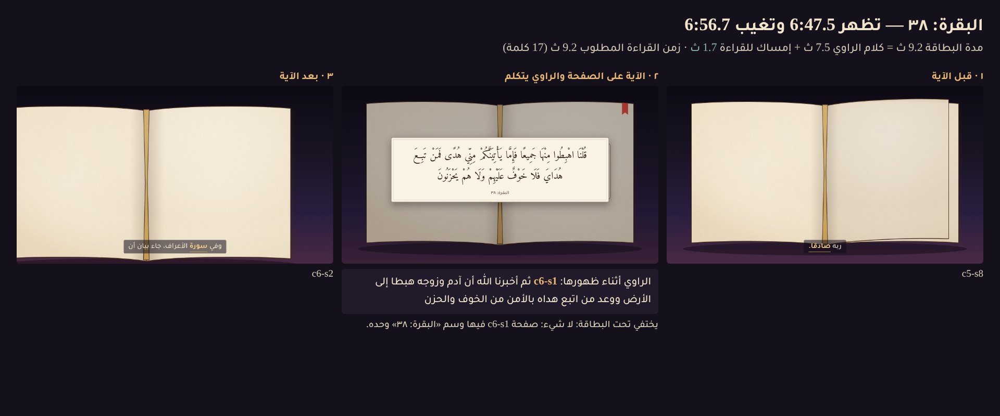
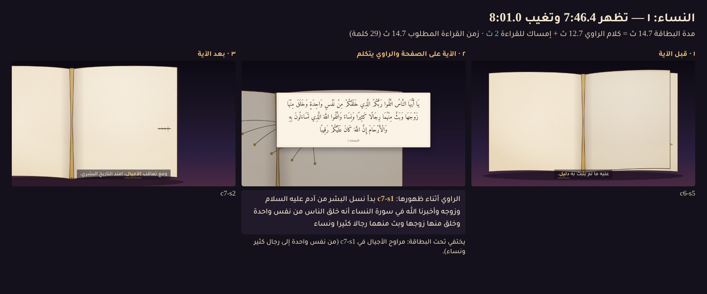

# السرد المتصل والآيات البصرية — نسخة مراجعة للسكريبت وستوري بورد المواضع المتأثرة (الأمر 027)

**المنفّذ · ١٠ نوفمبر ٢٠٢٦ · الحالة: للمراجعة، لم يُنفَّذ منها شيء.**

لم يُكتب شيء في السكريبت المعتمد، ولم يتغير `plan.json` ولا `tashkeel.md` ولا Tone Map v1.2 ولا V7 ولا الستوري بورد. لا صوت ولا فيديو ولا Master. اللقطات أدناه صور ثابتة للمراجعة فقط.

- [الفروق آليًا — diff](docs/script-027.diff): السكريبت المعتمد مقابل المقترح، مواضع التغيير وحدها.
- [توقيت الآيات السبع — JSON](docs/verse-windows.json).

## 1. الخلاصة

| البند | قبل (V7) | بعد (مقترح) |
| --- | --- | --- |
| المشاهد على الشاشة | 81 | **50** مشهدًا متصلًا |
| بطاقات الفصول ورؤوسها | 6 بطاقات + رأس في 68 مشهدًا | **0** |
| الآيات | 23 بطاقة مستقلة بتلاوة | **7** تظهر نصًا فوق صفحة الدفتر **والراوي مستمر** |
| التلاوة المسموعة | 23 | **0** |
| مصادر الآيات في السكريبت (قسم «الاستشهادات») | 23 | **23 كما هي** |
| المدة المتوقعة | 11:52 | **≈ 10:14** |

**الفرق عن خطة 028:** كانت الآية هناك مشهدًا صامتًا مستقلًا (57 مشهدًا، ≈ 11:08). صارت الآن بطاقة تظهر فوق مشهد السرد نفسه، فلا تبقى لها خانة مستقلة. هذا يُسقط 7 مشاهد ونحو 54 ثانية.

**كيف حُسبت المدة:** بتوقيت المحرك التقديري للمشاهد الخمسين، 10:04.5. يُضاف إليه 9.4 ث هي مجموع الإمساك للقراءة في نهاية بعض الآيات (الجدول ٣). وتُعاد الحسبة من صوت الراوي الحقيقي.

## 2. السكريبت المقترح — مواضع التغيير فقط

**ما لا يتغير في السكريبت:**
- بقية السطور كلها، والبسملة.
- **عناوين الفصول السبعة** (`## الفصل …`): تبقى في الملف تنظيمًا داخليًا يحفظ معرّفات المشاهد (`c2-s1` …) وروابط خريطة النبرة، **ولا تظهر على الشاشة**.
- **قسم «الاستشهادات» بمراجعه الـ23**: يبقى كما هو، فلا يضيع مصدر.

### أ) جمل السرد

| # | السطر | المشهد | النص الأصلي | النص الجديد | السبب |
| --- | --- | --- | --- | --- | --- |
| 1 | 63 | `c3-s2` | قال الله تعالى: | **يُحذف** | تمهيد لتلاوة ص 71، ولن تُعرض ولن تُسمع |
| 2 | 67 | `c3-s3` | ثم قال سبحانه: | **يُحذف** | تمهيد لتلاوة ص 72 |
| 3 | 71 | `c3-s4` | وفي **هذه الآيات** خبر خلق آدم عليه السلام، وتسويته، ونفخ الروح فيه. | وفي **سورة ص** خبر خلق آدم عليه السلام، وتسويته، ونفخ الروح فيه. | «هذه الآيات» تشير إلى آيات لم تعد على الشاشة. **والمصدر محفوظ بالتسمية** |
| 4 | 129 | `c4-s6` | … أن إبليس سأل الله أن يمهله، وأنه أعلن عزمه على إغواء البشر. | … أن إبليس سأل الله أن يمهله **فأمهله**، وأنه أعلن عزمه على إغواء البشر. | معنى الأعراف 15 كان في بطاقتها وحدها |
| 5 | 145 | `c5-s1` | خلق الله لآدم زوجه، وأسكنهما الجنة. | **و**خلق الله لآدم زوجه، وأسكنهما الجنة. | وصل: كانت أول جملة بعد بطاقة فصل |
| 6 | 167 | `c5-s5` | ثم وقع ما حذرهما الله منه. | ثم وقع ما حذرهما الله منه، **فأكلا من الشجرة.** | الأكل نفسه (الأعراف 22) كان في البطاقة وحدها |
| 7 | 173 | `c5-s6` | وقد حكى الله عن آدم وزوجه دعاءهما**:** | وقد حكى الله عن آدم وزوجه دعاءهما **في سورة الأعراف.** | **جديد في هذا الأمر.** النقطتان كانتا تفتحان على التلاوة. الآن تظهر الآية أثناء الجملة نفسها، فتختم الجملة بمصدرها |
| 8 | 187 | `c6-s1` | أخبرنا الله أن آدم وزوجه هبطا إلى الأرض. | **ثم** أخبرنا الله أن آدم وزوجه هبطا إلى الأرض**، ووعد من اتبع هداه بالأمن من الخوف والحزن.** | «ثم» للوصل. **والإضافة جديدة في هذا الأمر:** البقرة 38 تظهر أثناء هذه الجملة، ووعد الهدى فيها لا يذكره الراوي في أي موضع. بدونها إما أن تمتد البطاقة فوق جملة «وفي سورة الأعراف…» (آية على الشاشة ومصدر آخر في الكلام)، وإما إمساك صامت 5.4 ث |

- **اختياري، لم أُدرجه في الفروق:** `c7-s1` (سطر 209) يُعاد ترتيبه إلى «ومن آدم عليه السلام وزوجه بدأ نسل البشر.» الوصل مقبول بدونه.
- **معنى قرآني بصيغة الراوي** (التعديلات 4 و6 و8): لم أنقل لفظ آية إلى الراوي، فالصوت المستنسخ لا يتلو. هذه التعديلات الثلاثة تحتاج تأكيدك أو تأكيد المراجع المؤهل لصياغتها.

### ب) الآيات

| الحالة | العدد | ما يحدث في السكريبت |
| --- | --- | --- |
| تُعرض نصًا أثناء السرد | 7 | السطر كما هو **حرفًا بحرف**، لم يمسّه شيء (تحقق آلي: مطابقة بايت ببايت) |
| لا تُعرض | 16 | يُحذف سطر `[آية: …]` من مجرى السكريبت. مرجعها باقٍ في «الاستشهادات» و`source-audit.md`، ومعناها يحمله السرد (جدول ٥ في المراجعة 028) |

الآيات الست عشرة التي تُحذف من مجرى السكريبت: ص 71، ص 72، البقرة 32، البقرة 33، الكهف 50، الأعراف 12، الأعراف 14، الأعراف 15، الأعراف 16، الحجر 42، طه 117، الأعراف 20، الأعراف 22، البقرة 37، الأعراف 24، الأعراف 25.

**بعد اعتماد التعديلات:** تُشكَّل الجمل المعدلة، وتصدر خريطة النبرة v1.3 مقاطعها الجديدة. تبقى v1.2 كما هي، وتبقى معرّفات المقاطع والمشاهد.

## 3. الآيات السبع: النص كما يظهر، ومتى يظهر

النص منقول من سطور `[آية: …]` في `script.md` دون أي تعديل، والمرجع تحته بصيغة البطاقة القائمة «البقرة: ٣٠».

| # | الآية | النص المعروض | تظهر مع | تغيب بعد | المدة (كلام + إمساك) |
| --- | --- | --- | --- | --- | --- |
| 1 | البقرة 30 | وَإِذْ قَالَ رَبُّكَ لِلْمَلَائِكَةِ إِنِّي جَاعِلٌ فِي الْأَرْضِ خَلِيفَةً قَالُوا أَتَجْعَلُ فِيهَا مَنْ يُفْسِدُ فِيهَا وَيَسْفِكُ الدِّمَاءَ وَنَحْنُ نُسَبِّحُ بِحَمْدِكَ وَنُقَدِّسُ لَكَ قَالَ إِنِّي أَعْلَمُ مَا لَا تَعْلَمُونَ | `c2-s1` «قبل أن نتحدث…» (1:15.1) | `c2-s2` «…جاعل في الأرض خليفة.» | 14.2 ث (12.7 + 1.5) |
| 2 | البقرة 31 | وَعَلَّمَ آدَمَ الْأَسْمَاءَ كُلَّهَا ثُمَّ عَرَضَهُمْ عَلَى الْمَلَائِكَةِ فَقَالَ أَنْبِئُونِي بِأَسْمَاءِ هَٰؤُلَاءِ إِنْ كُنْتُمْ صَادِقِينَ | `c3-s5` «ثم أخبرنا الله…» (2:42.2) | `c3-s6` «…أقوالا متعددة.» | 11.1 ث (11.1 + 0) |
| 3 | البقرة 34 | وَإِذْ قُلْنَا لِلْمَلَائِكَةِ اسْجُدُوا لِآدَمَ فَسَجَدُوا إِلَّا إِبْلِيسَ أَبَىٰ وَاسْتَكْبَرَ وَكَانَ مِنَ الْكَافِرِينَ | `c4-s1` «أمر الملائكة…» (3:38.4) | `c4-s1` «…حق لله وحده.» | 10.8 ث (10.8 + 0) |
| 4 | البقرة 35 | وَقُلْنَا يَا آدَمُ اسْكُنْ أَنْتَ وَزَوْجُكَ الْجَنَّةَ وَكُلَا مِنْهَا رَغَدًا حَيْثُ شِئْتُمَا وَلَا تَقْرَبَا هَٰذِهِ الشَّجَرَةَ فَتَكُونَا مِنَ الظَّالِمِينَ | `c5-s1` «وخلق الله لآدم زوجه…» (5:13.4) | `c5-s1` «…شجرة معينة.» | 10.1 ث (8.6 + 1.5) |
| 5 | الأعراف 23 | قَالَا رَبَّنَا ظَلَمْنَا أَنْفُسَنَا وَإِنْ لَمْ تَغْفِرْ لَنَا وَتَرْحَمْنَا لَنَكُونَنَّ مِنَ الْخَاسِرِينَ | `c5-s6` «وقد حكى الله…» (6:15.1) | `c5-s6` «…في سورة الأعراف.» | 7.0 ث (4.3 + 2.7) |
| 6 | البقرة 38 | قُلْنَا اهْبِطُوا مِنْهَا جَمِيعًا فَإِمَّا يَأْتِيَنَّكُمْ مِنِّي هُدًى فَمَنْ تَبِعَ هُدَايَ فَلَا خَوْفٌ عَلَيْهِمْ وَلَا هُمْ يَحْزَنُونَ | `c6-s1` «ثم أخبرنا الله…» (6:47.5) | `c6-s1` «…من الخوف والحزن.» | 9.2 ث (7.5 + 1.7) |
| 7 | النساء 1 | يَا أَيُّهَا النَّاسُ اتَّقُوا رَبَّكُمُ الَّذِي خَلَقَكُمْ مِنْ نَفْسٍ وَاحِدَةٍ وَخَلَقَ مِنْهَا زَوْجَهَا وَبَثَّ مِنْهُمَا رِجَالًا كَثِيرًا وَنِسَاءً وَاتَّقُوا اللَّهَ الَّذِي تَسَاءَلُونَ بِهِ وَالْأَرْحَامَ إِنَّ اللَّهَ كَانَ عَلَيْكُمْ رَقِيبًا | `c7-s1` «بدأ نسل البشر…» (7:46.4) | `c7-s1` «…رجالا كثيرا ونساء.» | 14.7 ث (12.7 + 2.0) |

**قواعد التوقيت:**
- **زمن القراءة:** 1.5 ث + عدد الكلمات ÷ 2.2، ولا يقل عن 4 ث، وهو قاعدة 028 نفسها.
- **متى تظهر البطاقة ومتى تغيب:** تظهر مع بداية الجملة التي تحكي معنى الآية، وتغيب بنهاية آخر جملة تحكي المعنى نفسه. فلا تبقى آية على الشاشة والراوي يذكر مصدرًا آخر.
- **الإمساك للقراءة:** إن كان كلام الراوي تحت البطاقة أقصر من زمن القراءة، تبقى البطاقة لحظة بعد آخر كلمة، بين 1.5 و2.7 ث. هذا سكون مقصود عند الآية، مستثنى من قياس الحركة، ولا يُضاف قبله أو بعده حركة تعويضية.
- **في ثلاثة مواضع لا تمسّ البطاقة جملًا أخرى:** في البقرة 30 لا تمتد فوق «وقد ذكر المفسرون…». وفي الأعراف 23 لا تصل إلى «وفي سورة البقرة…» (البقرة 37). وفي البقرة 38 لا تصل إلى «وفي سورة الأعراف…».

### سلامة النص

- **مطابقة السكريبت:** أسطر الآيات السبع في المقترح مطابقة لـ`script.md` بايتًا ببايت. لم يُكتب نص آية من الذاكرة، ولم يُعد صوغ شيء منه ولا اختُصر.
- **فحص مستقل بمصدر ثانٍ:** قابلتُ الآيات الـ23 بنص المصحف العثماني من الحزمة المفتوحة `quran-json@3.1.2`، ومصدرها «موسوعة القرآن الكريم» QuranEnc. وهي حزمة npm لأن مصادر الاستوديو لا تُبلغ من هنا.
  - **الحروف:** 23 من 23 متطابقة بعد توحيد فروق الرسم المعروفة: الألف الخنجرية، و«يا آدم» و«يا أيها» الموصولتين في العثماني، وصور الهمزة.
  - **الحركات (للسبع المعروضة):** متطابقة كلمة كلمة. الفروق الوحيدة اصطلاحات رسم: سكون النون قبل الإخفاء والإدغام، وألف الجمع الفارقة، و«آ» مقابل «ءَا».
  - **هذا فحص مساند، لا توثيق.** المطابقة بالمصدر المعتمد في الاستوديو تبقى بوابة قبل النسخة النهائية، وسجل التوثيق لم يتغير.
- **شكل البطاقة:** بطاقة الرَّق القائمة `VerseCard` بقيمها كما هي، بخط الأميري وإطار مزدوج ونص كامل غير مقطوع.

## 4. ستوري بورد المواضع المتأثرة

**طريقة الصنع:**
- اللقطات صور ثابتة من المشاهد الحالية، بلا رؤوس فصول، ومن رندر المحرك نفسه.
- البطاقة فوقها **محاكاة لـ`VerseCard` القائمة بالقيم نفسها** (العرض والهامش والخط وتعتيم 28%)، لأن ربط الآية بمشهد السرد لم يُبنَ بعد.
- الترجمة النصية للراوي أُخفيت في لقطة الآية (القرار ٣)، وكلام الراوي مكتوب تحتها.
- عنوان «الفصل الثاني» الظاهر في لقطة `c2-s2` مكتوب في الكود، ويُزال عند التنفيذ.

**ما يُرى في اللوحات:**
- **أربعة مواضع نظيفة:** البقرة 30، والبقرة 31 حتى نهاية `c3-s5`، والأعراف 23، والبقرة 38.
  - البطاقة تنزل على صفحة فيها أصلًا وسم المرجع («البقرة: ٣٠»، «البقرة: ٣١»، «البقرة: ٣٨»)، أو على صفحة التمهيد.
  - وفي الأعراف 23 تظهر البطاقة بعد أن يُرسم خط الرجوع عند «رجع إلى ربه».
- **أربعة مواضع تغطي فيها البطاقة لحظات مرسومة** (القرار ٢):
  - البقرة 31: درج «أقوال المفسرين» في أول `c3-s6`.
  - البقرة 34: كلمتا «السجود» و«تكريم» في `c4-s1`، وتظهر حافة «تكريم» تحت البطاقة.
  - البقرة 35: «الإباحة» وحدّ «لا تقربا» في `c5-s1`.
  - النساء 1: مراوح الأجيال في `c7-s1`.

## 5. ما يُبنى عند أمر التنفيذ (لا يبدأ قبله)

1. **ظهور الآية فوق مشهد السرد:** الآية تظهر في مشهد السرد نفسه من كلمة إلى كلمة، بالبطاقة القائمة. تُحذف خانات الآيات، وتبقى معرّفات مشاهد السرد كما هي.
   - اللقطة `c2-s1` مهيأة لهذا أصلًا، فهي تعرض البطاقة فوق صفحة التمهيد.
2. **سطر المرجع:** بلا «· بصوت …» لأنه لا تلاوة، فيصير المرجع وحده «البقرة: ٣٠».
   - هذا تغيير في سطر واحد من `VerseCard`. وهي مكوّن خاص بالقناة، فلا يحتاج تنسيقًا مع المحادثة الرئيسية.
3. **ما يُزال من الشاشة:** رؤوس الفصول، والعناوين الثلاثة المكتوبة في الكود، وأرقام الفهرس، كما في 028.
4. **النصوص:**
   - سكريبت وتشكيل بإصدار جديد للتعديلات الثمانية المعتمدة.
   - خريطة النبرة v1.3.
   - خطة متصلة `plan.continuous.json`، والخطة الحالية محفوظة.
5. **المراجعة والرفع:**
   - مراجعة كل موضع آية إطارًا كل نصف ثانية: الظهور، والقراءة، والغياب، والوصلة.
   - ثم ستوري بورد كامل للخطة الجديدة يُرفع إلى الاستوديو.

## 6. قرارات مطلوبة

1. **التعديلات الثمانية في الجدول ٢-أ:** وخاصة الجديدان 7 (`c5-s6`) و8 (`c6-s1`). وهل يُدرج إعادة ترتيب `c7-s1` الاختياري؟
2. **المواضع الأربعة التي تغطي فيها البطاقة لحظات مرسومة** (البقرة 31، البقرة 34، البقرة 35، النساء 1). لكل موضع أحد خيارين:
   - **(أ)** تبقى البطاقة فوقها كما في اللوحات، فلا تتغير اللقطة.
   - **(ب)** تتأخر تلك اللحظات حتى تغيب البطاقة. هذا تعديل توقيت داخل اللقطة، فيتأخر ظهور الكلمة المرسومة عن نطقها.
   - البقرة 31 لها بديل ثالث: تنتهي البطاقة مع `c3-s5` بإمساك 4.9 ث.
   - **توصيتي (أ)**، لأن (ب) يخالف قاعدة «العنصر وقت نطق كلمته».
3. **الترجمة النصية للراوي أثناء ظهور الآية:** أوصي بإخفائها، كي لا يظهر نصان معًا على الشاشة ولا يختلط كلام الراوي بالآية. والصوت مستمر.
