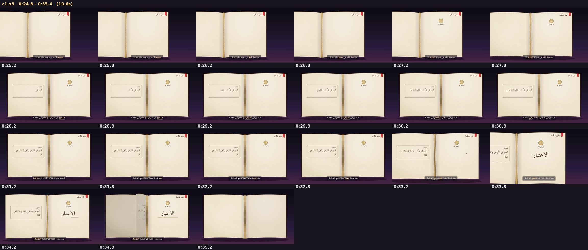
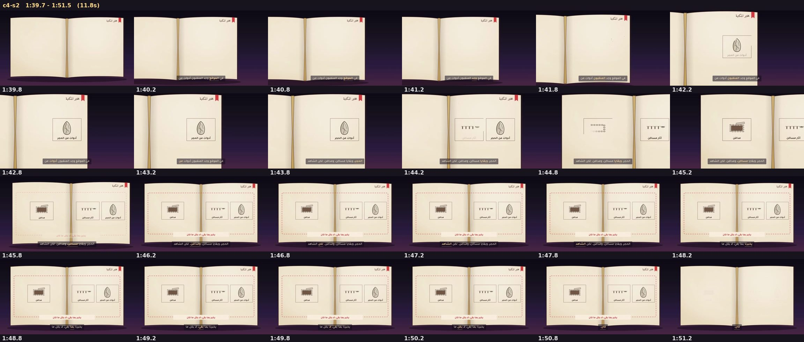

# مراجعة فنية — مختبر مكتبة «دفتر الأفق» (الأمر 018)

**المراجِع:** المنفّذ · **التاريخ:** ٥ نوفمبر ٢٠٢٦ · **المادة:** `900-library-lab/previews/library.mp4` (1:51.5، ‏1920×1080، صامت، البصمة `0cc2f4c5…`)
**الطريقة:** مشاهدة كاملة، ثم شريط لكل مشهد بلقطتين في الثانية (التوقيتات أدناه من الشريط نفسه)، ثم قياس الحركة بخطة المختبر.
**هذه توصية المنفّذ. قرار الاعتماد للمشرف، وحالة المختبر وأدواته تبقى «جاهز للمراجعة».**

## الخلاصة

| الأداة | التوصية | السبب في سطر |
| --- | --- | --- |
| `lib-term` | يحتاج إصلاحين قبل الاعتماد | المصطلح المتأخر يُقرأ ثانية ونصفًا فقط قبل قلب الصفحة، وختم القرآن صغير لا يُقرأ |
| `lib-gloss` | صالح، مع تحسين | فصل الطبقات الثلاث واضح؛ إطار التعليق يظهر فارغًا قبل نصه |
| `lib-compare` | صالح، مع تحسين | الحكم والختم والتخفيت واضحة؛ لا عنصر لجملة التمهيد قبل الطرف الأول |
| `lib-timeline` | صالح، مع تحسين | التتبع والفجوة يعملان؛ الكادر الأول يخرج عن الصفحة ويقص الرأس |
| `lib-evidence` | يحتاج إصلاحًا قبل الاعتماد | رسم «آثار مساكن» صغير لا يُفهم، وهو وظيفة الأداة نفسها |

**الحركة (بخطة المختبر):** 54% (59 من 110 ث)، والسكون المقصود المستثنى ثانية واحدة. دون حد 80% لأن نصوص المختبر قصيرة وأغلب جملها تبدأ بتمهيد بلا عنصر؛ لا تُعالج بزينة.
**العربية والتشكيل:** سليمة في كل الإطارات المراجعة: «الحَضَارَة» بتشكيل كامل تُكشف بالحبر متصلة الحروف (0:14.2–0:15.2)، و«سَنَدٌ» بتشكيل جزئي (1:21.2)، ولا كلمة مقطوعة ولا نص فوق الكعب.
**الهوية:** الألوان والخطان والورق والختم واللسان الأحمر من هوية «دفتر الأفق»، وصالحة لحلقات بمواضيع مختلفة (مصطلح، أصل وحاشية، مقارنة، زمن، شواهد).

## الملاحظات بالتوقيت

| # | الوقت | المشهد | الأداة | المشكلة | الأثر | المعالجة المقترحة | التصنيف |
| --- | --- | --- | --- | --- | --- | --- | --- |
| L1 | 0:33.2–0:35.4 | `c1-s3` | `lib-term` | «الاعتبار» آخر كلمة في المشهد، فيُكتب عند 0:33.2 ويبقى نحو 1.6 ث ثم تُقلب الصفحة. قبله 8 ث بلا عنصر رئيسي على الصفحة اليمنى | المصطلح المحوري لا يُقرأ؛ ثقل الصورة معكوس | في الأداة: إمساك لا يقل عن ثانيتين بعد آخر حدث (إطالة الذيل تلقائيًا). وفي الاستعمال: لا يُختار `lib-term` إن كان المصطلح آخر كلمة، أو يُختار مرسى أسبق يذكره | ضرورية للأداة |
| L1b | 0:27.0–0:35.4 | `c1-s3` | `lib-term` | ختم القرآن «الروم: ٤٢» صغير في رأس الصفحة (حجم 0.9) لا يُقرأ بحجم المعاينة | المصدر القرآني غير واضح | للنوع `quran`: لوحة المرجع `VerseRefPanel` أو ختم أكبر تحت المصطلح | ضرورية للأداة |
| L1c | 0:03.2–0:06.8 | `c1-s1` | `lib-term` | 3.6 ث لا يظهر فيها إلا سطر المصدر الصغير قبل كتابة «الاستقرار» | بداية فارغة | حجم سطر المصدر أكبر قليلًا، أو اختيار مرساه بحيث يقترب من المصطلح | تحسينية |
| L4 | 0:58.2–0:59.8 | `c2-s2` | `lib-gloss` | إطار «تعليق» يظهر فارغًا 1.6 ث قبل كلماته | فراغ يبدو خطأ | يظهر الإطار مع أول كلمة من نص التعليق لا مع كلمة المرسى | تحسينية |
| L4b | 0:35.4–0:38.0 | `c2-s1` | `lib-gloss` | 2.6 ث صفحة فارغة قبل إطار النص الأصلي (جملة «يقول ابن خلدون في مقدمته») | بداية فارغة | ظهور وسم المصدر «ابن خلدون · المقدمة» عند ذكره قبل النص | تحسينية |
| L4c | 0:40.8–0:46.0 | `c2-s1`/`c2-s2` | `lib-gloss` | عند انتقال الكاميرا إلى الحاشية يُقص إطار الأصل عند حافة الكادر | مقبول في التتبع، لكنه يقطع عبارة | تكبير أقل (1.0–1.05) عند الانتقال إلى اليسار | تحسينية |
| L3 | 1:03.3–1:07.0 | `c3-s1` | `lib-compare` | 3.7 ث صفحة فارغة لجملة «اختلف المؤرخون في سبب هجر المدينة» | أطول بداية فارغة في المختبر | حقل اختياري `title` (سؤال المقارنة) يُكتب عند كلمته | تحسينية |
| L5 | 1:28.6–1:31.2 | `c4-s1` | `lib-timeline` | الكادر الأول عند أقصى اليمين بتكبير 1.22: يظهر ما وراء حافة الصفحة ويُقص رأس الصفحة | تكوين غير متزن في أول المشهد | بداية بتكبير أقل وحد للكاميرا يبقي حافة الصفحة داخل الكادر | تحسينية |
| L5b | 1:32.8–1:35.2 | `c4-s1` | `lib-timeline` | علامة «؟» ملاصقة لوسم «قرون بلا سجل» | ازدحام صغير | إزاحة «؟» إلى جانب الدائرة لا فوق الخط | تحسينية |
| L2 | 1:44.2–1:51.5 | `c4-s2` | `lib-evidence` | رسم «آثار مساكن» صفّ أعمدة صغيرة داكنة (يظهر كـ «TTTT»)، أصغر من بطاقته ولا يُفهم أنه مساكن | الشاهد لا يُقرأ، وهو وظيفة الأداة | نسخة للبطاقة من رسم المساكن بحجمها، وحساب الحجم من حدود الرسم الفعلية لا من نصف قطره | ضرورية للأداة |
| L2b | 1:41.8–1:43.8 | `c4-s2` | `lib-evidence` | الاقتراب من البطاقة الأولى يُظهر ما وراء حافة الصفحة ويقص الرأس | كما L5 | الحد نفسه للكاميرا | تحسينية |

## الأدلة البصرية

## ما يعمل جيدًا ويُثبَّت كما هو

- **الكتابة بالحبر مع التشكيل** (0:14.2–0:15.2): الكلمة كاملة ومتصلة في كل إطار، وسن القلم يتقدم من اليمين.
- **فصل المصادر** (0:47.4–1:03.3): الختم الذهبي بالمرجع وحده بلا نص آية، واللسان الأحمر «تفسير» بمصدره، والتعليق بإطار متقطع. لا اختلاط.
- **الحكم في المقارنة**: القصاصة فوق الكعب للمسألة المفتوحة (1:15.2)، والختم مع تخفيت الطرف الآخر (1:24.2).
- **الخط الزمني**: يتقدم مع الكلام، والفجوة متقطعة بدائرة جوفاء، والتراجع الأخير يرى الخط كله (1:38.8).
- **إطار «حدود الشاهد»** (1:45.8): واضح الوظيفة.
- **الانتقالات**: قلب الصفحة بين الأفكار، والخفوت داخلها، والاستمرار بلا قطع من الخط الزمني إلى الشواهد (1:39.7).
- **السكون عند ذكر الله** (0:24.8–0:27.0): لا حدث ولا حركة في نافذة لفظ الجلالة، والختم يتأخر عنها آليًا.

## التوصية

**المكتبة صالحة أساسًا، وتحتاج إصلاحات محددة قبل اعتمادها إخراجيًا:** ثلاثة إصلاحات ضرورية في أداتين (`lib-term`: L1 وL1b، و`lib-evidence`: L2)، ثم تحسينات لا تمنع استعمال الأدوات الثلاث الأخرى في حلقة.
لم يُعدَّل شيء في المختبر أو المكتبة في هذا الأمر؛ الإصلاحات تُنفَّذ بأمر لاحق، ثم يُعاد رندر المختبر وتُرفع معاينة جديدة في خانتها.
